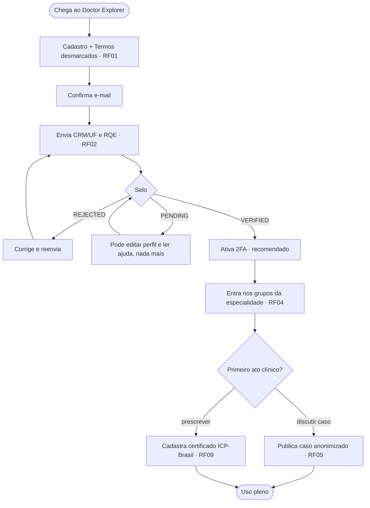
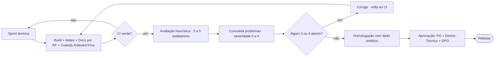

# Diagramas de atividades transversais

Por RF: ver `docs/rf/`. Aqui, os dois fluxos que o time inteiro precisa conhecer.

## Onboarding do médico (do cadastro ao primeiro ato clínico)

## Ciclo de release com avaliação heurística

