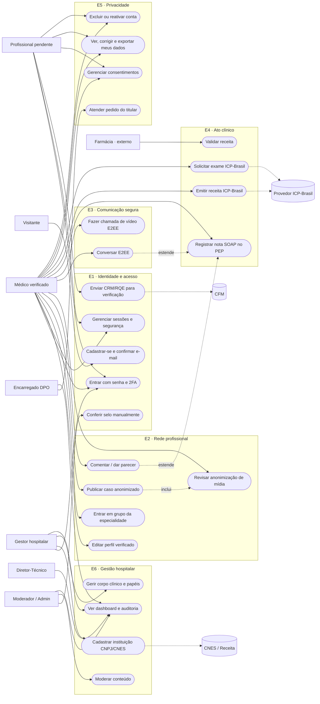

# Diagrama de casos de uso (visão geral do MVP)

O Mermaid não tem notação UML de caso de uso; usamos `flowchart` com atores em retângulo e casos de uso
em elipse, agrupados por módulo. Detalhe por RF em [rf/README.md](rf/README.md).

