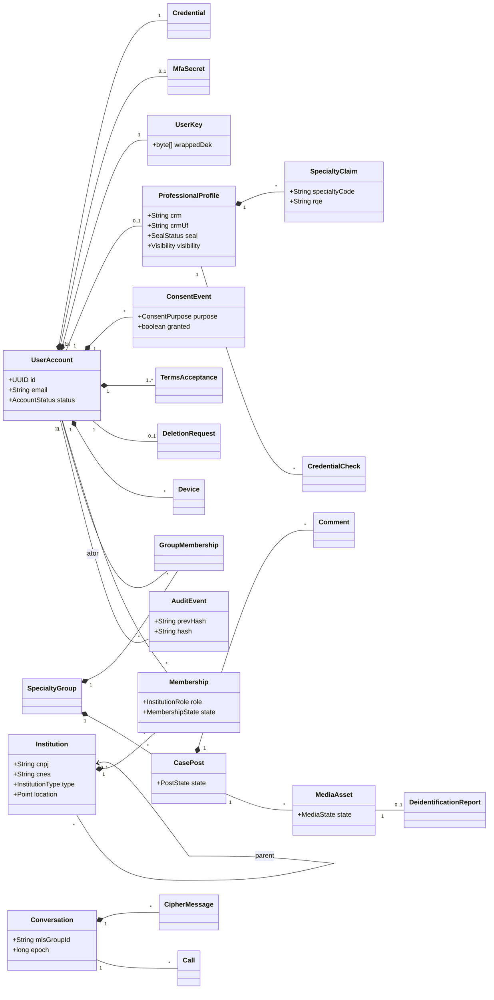
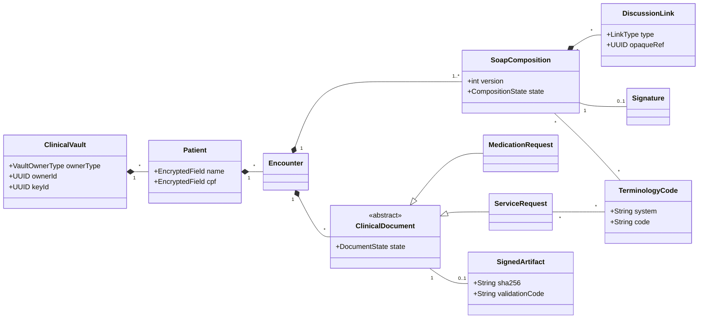

# Diagrama de classes (modelo de domínio consolidado)

Visão por contexto. Os detalhes de cada classe estão no RF correspondente.

## core-api

## clinical-api

A referência da `core-api` para a `clinical-api` é sempre por **id opaco** (`DiscussionLink.opaqueRef`);
a `clinical-api` nunca guarda e-mail, nome de usuário ou qualquer dado social.
