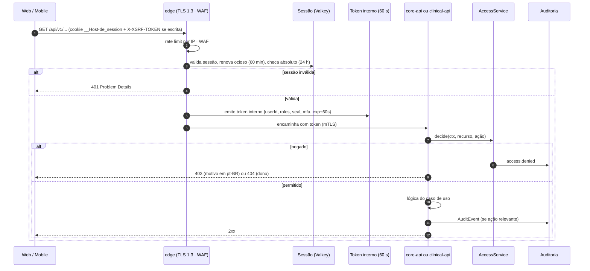
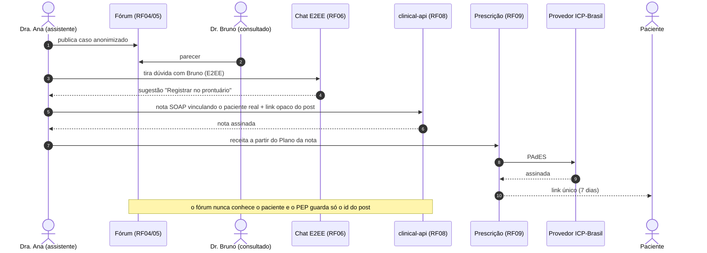

# Diagramas de sequência transversais

As sequências por RF estão em cada `docs/rf/RFnn-*.md`. Aqui ficam as duas que atravessam todos os
serviços.

## Requisição autenticada passando pela camada de QoS

## Jornada ponta a ponta: do caso no fórum à receita assinada

