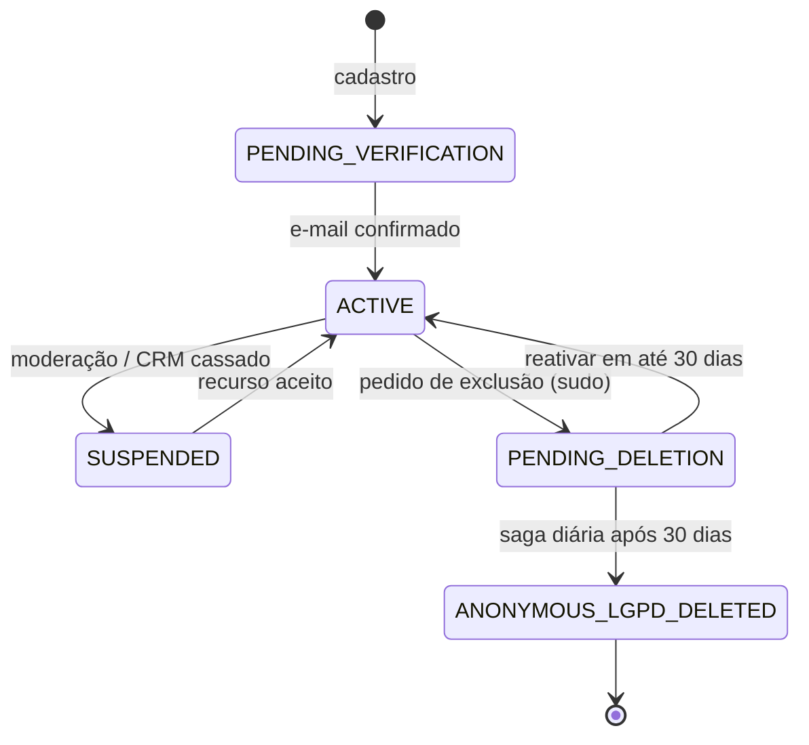
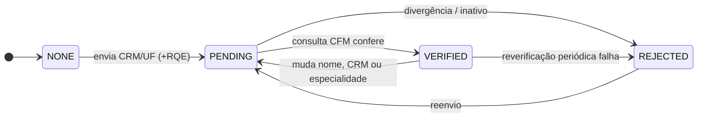
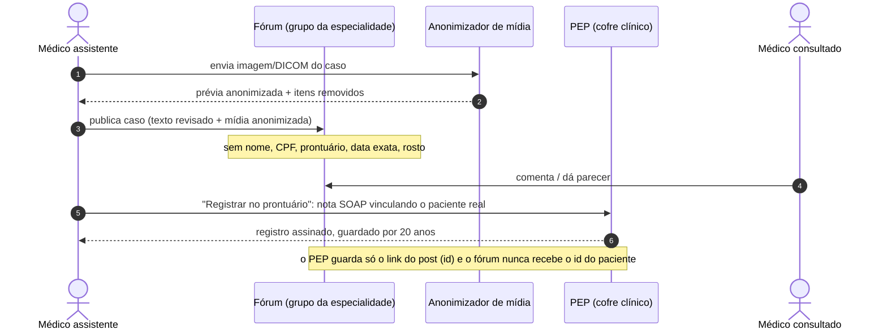
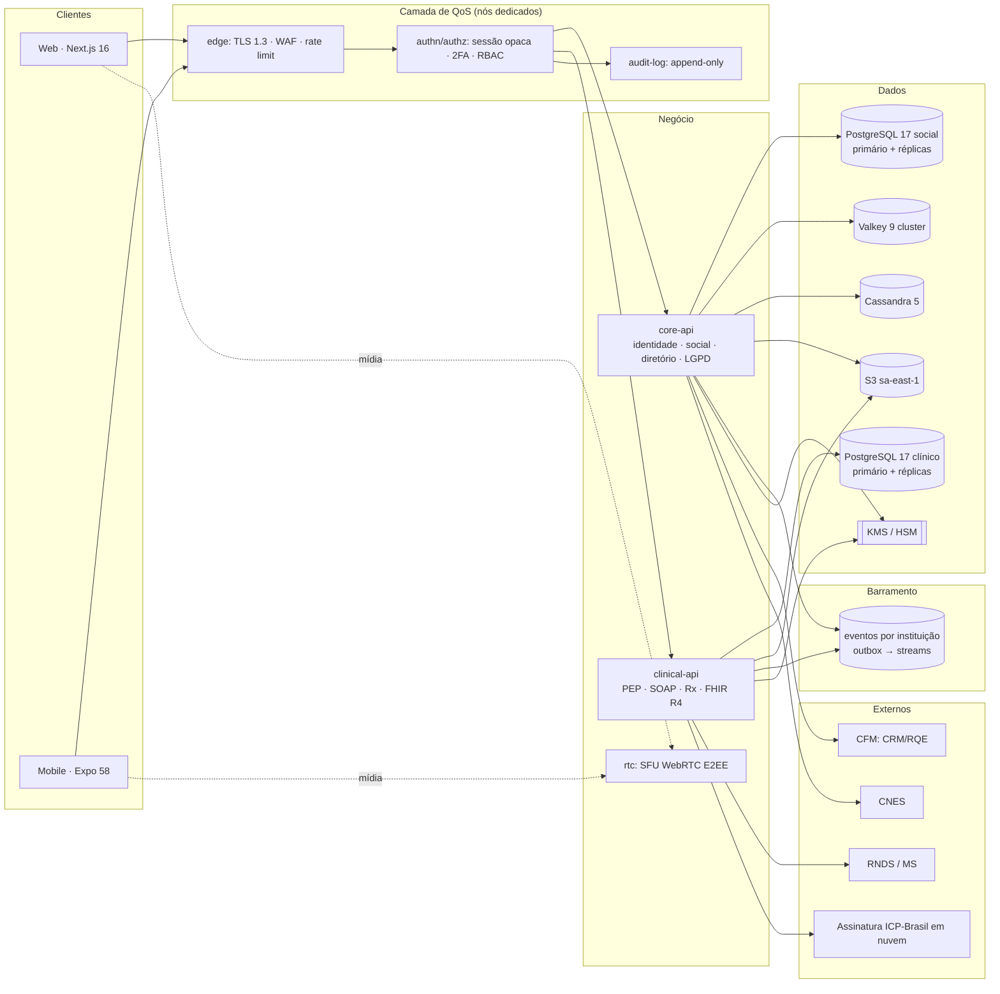
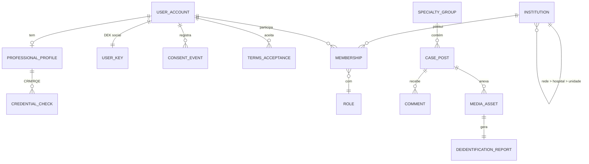
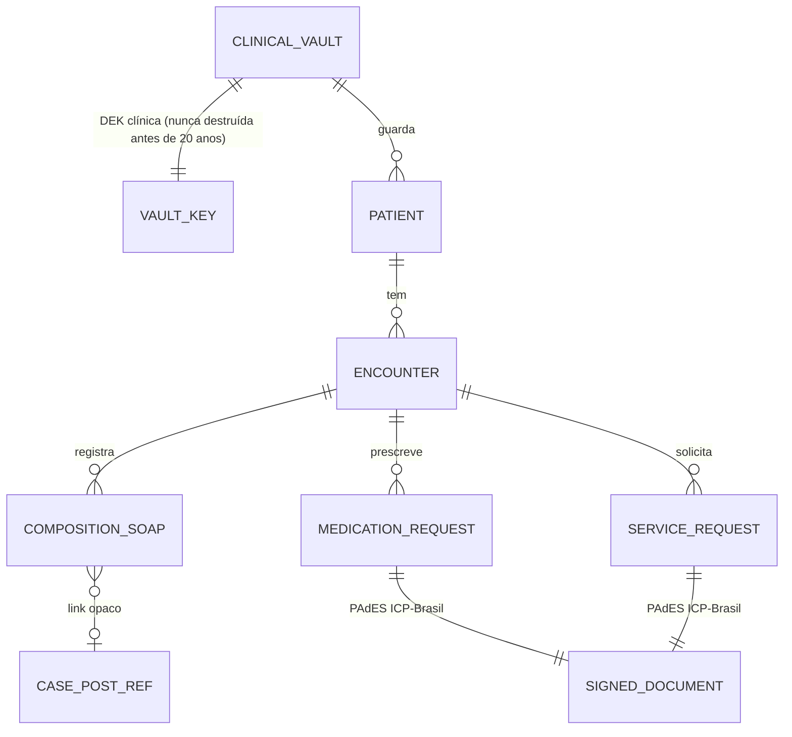

# Doctor Explorer · Especificação técnica, arquitetural e funcional

| Campo | Valor |
|---|---|
| Versão | 0.1 (rascunho para revisão) |
| Data | 2026-10-24 |
| Escopo | Rede social profissional para médicos, profissionais de saúde e redes hospitalares (MVP) |
| Controladora | `{{RAZÃO SOCIAL}}` · CNPJ `{{…}}` |
| Diretor-Técnico Médico | `{{NOME}}` · CRM `{{nº/UF}}` |
| Encarregado (DPO) | `{{NOME}}` · `{{e-mail do canal}}` |
| Documentos irmãos | [CONFORMIDADE.md](CONFORMIDADE.md) · [PESQUISA_TECNOLOGIAS.md](PESQUISA_TECNOLOGIAS.md) (ADRs) · [rf/README.md](rf/README.md) · [QUESTOES_ABERTAS.md](QUESTOES_ABERTAS.md) |

> **Aviso.** As referências normativas abaixo orientam a engenharia; não substituem parecer jurídico nem
> regulatório. Cada item marcado **⚖️ validar** precisa de confirmação do jurídico e do Diretor-Técnico
> antes do go-live.

---

## Sumário

1. [Visão do produto e atores](#1-visão-do-produto-e-atores)
2. [Conformidade regulatória (compliance nativo)](#2-conformidade-regulatória-compliance-nativo)
3. [Arquitetura de software e interoperabilidade](#3-arquitetura-de-software-e-interoperabilidade)
4. [Segurança da informação](#4-segurança-da-informação)
5. [Atributos de qualidade e trade-offs](#5-atributos-de-qualidade-e-trade-offs)
6. [Usabilidade e heurísticas de Nielsen](#6-usabilidade-e-heurísticas-de-nielsen)
7. [Escopo do MVP](#7-escopo-do-mvp)
8. [Modelo de dados](#8-modelo-de-dados)
9. [API](#9-api)
10. [Infraestrutura e operação](#10-infraestrutura-e-operação)
11. [Plano de entrega](#11-plano-de-entrega)

---

## 1. Visão do produto e atores

O Doctor Explorer é uma rede profissional **fechada e verificada**. Só entra quem prova o vínculo com a
saúde. A rede junta quatro funções que hoje ficam espalhadas entre WhatsApp, e-mail e sistemas
hospitalares:

1. **Identidade profissional verificada:** CRM/RQE conferido e selo visível.
2. **Discussão de casos clínicos** em grupos fechados por especialidade, com mídia anonimizada.
3. **Comunicação segura entre pares:** chat e vídeo com criptografia ponta a ponta.
4. **Ato clínico formal:** nota SOAP, receita e pedido de exame assinados com ICP-Brasil, gravados no PEP.

### 1.1 Atores

| Ator | Entrada | Verificação | Permissões no MVP |
|---|---|---|---|
| Visitante | sem sessão | — | página institucional, diretório público de hospitais |
| Profissional pendente | cadastro | e-mail (código de 6 dígitos) | completar perfil, enviar documentos; **não** publica nem conversa |
| Médico verificado | cadastro + selo | CRM ativo + RQE (quando declara especialidade) no CRM regional | feed, grupos, chat/vídeo, SOAP, prescrição, pedido de exame |
| Outro profissional de saúde | cadastro + selo | conselho próprio (COREN, CRF, CREFITO…) **⚖️ validar escopo no MVP** | feed e chat; **sem** prescrição médica |
| Gestor hospitalar | convite da instituição | e-mail institucional + vínculo à instituição (CNPJ + CNES) | corpo clínico, RBAC da instituição, dashboard |
| Diretor-Técnico (plataforma) | papel interno | CRM + designação formal | aprova regras clínicas, responde ao CFM |
| Moderador / Admin | convite interno, **2FA obrigatório** | — | conferir selos, moderar conteúdo, toda ação auditada |
| Encarregado (DPO) | papel interno | — | pedidos do titular, incidentes, RIPD |
| Paciente (titular) | **fora do MVP como usuário ativo**; titular dos dados do PEP | — | painel de direitos do titular (Art. 18) via link autenticado **⚖️ validar** |

### 1.2 Estados

Transição inválida lança exceção no domínio. A reverificação do CRM roda num job diário: a situação do
médico no CFM pode mudar (suspensão, cassação, óbito).

---

## 2. Conformidade regulatória (compliance nativo)

O detalhamento requisito → norma → controle → evidência está em [CONFORMIDADE.md](CONFORMIDADE.md).
Aqui ficam só as decisões que mudam a arquitetura.

### 2.1 CFM

| Exigência | Decisão de engenharia |
|---|---|
| CRM ativo e RQE | Módulo `credentialing`: consulta ao serviço de verificação do CFM (webservice contratado ou consulta pública oficial, ver ADR-009). Resultado guardado com data, fonte e hash da resposta. Sem selo `VERIFIED`, o usuário não publica, não conversa e não prescreve. |
| Diretor-Técnico | Cadastro formal no módulo `governance`: nome, CRM, ato de designação, vigência. O nome aparece no rodapé e na página "Sobre" (exigência de publicidade médica, Res. CFM 2.336/2023 **⚖️ validar**). |
| Registro em PEP e guarda de 20 anos | Toda interação **clínica**, ou seja, parecer sobre um paciente identificável, vira um `ClinicalEncounter` no PEP. A guarda mínima é de 20 anos a partir do último registro (Lei 13.787/2018, Res. CFM 1.821/2007). A discussão **anonimizada** no fórum não é registro clínico. O que vai ao PEP é a nota que o médico assistente escreve a partir dela (ver §2.4). |
| Prescrição e exames com ICP-Brasil | Módulo `clinical-docs`: documento estruturado → PDF/A → assinatura **PAdES** com certificado ICP-Brasil do médico (A3 em nuvem, ver ADR-007). Validação com a política de assinatura ICP-Brasil e QR code para conferência pela farmácia (Res. CFM 2.299/2021 **⚖️ validar**). |
| Sem diagnóstico automatizado ao paciente | Regra de arquitetura: **nenhum** endpoint voltado a paciente devolve saída de algoritmo. Saídas de IA vivem num contexto isolado (`cds`), só aparecem para médico verificado, sempre com rótulo "Apoio à decisão, não é diagnóstico" e exigem aceite ou recusa explícita do médico, que fica registrado. |

### 2.2 LGPD

| Exigência | Decisão de engenharia |
|---|---|
| Base legal por tratamento | Registro de operações (`processing_activity`, Art. 37) com finalidade, base legal, categorias e retenção. Dado de saúde no PEP: **tutela da saúde** (Art. 11, II, "f"), não consentimento. Por isso o paciente não pode "revogar" o PEP. Recomendação por IA, marketing e localização: **consentimento** (Art. 11, I / Art. 7º, I). |
| Privacy by Default | Perfil visível só para a rede verificada; localização desligada; recomendações desligadas; nenhum toggle de finalidade vem ligado. |
| Minimização | Cadastro pede só nome, e-mail, data de nascimento, CRM/UF e RQE. CPF só ao ativar a prescrição, porque o certificado ICP o exige. |
| Direitos do titular | Painel "Seus dados" (acessar, corrigir, exportar em JSON versionado, revogar consentimento, pedir exclusão). Canal do Encarregado com prazo de resposta. |
| Incidentes | Runbook de comunicação à ANPD e aos titulares (Art. 48, Res. CD/ANPD 15/2024: 3 dias úteis **⚖️ validar**). |
| RIPD | Relatório de Impacto antes do go-live (Art. 38), obrigatório na prática para dado sensível em larga escala. |

**Conflito que precisa ser resolvido no desenho: exclusão da conta × guarda de 20 anos.**
Ao excluir a conta, o perfil social, os posts, as mensagens e as preferências são eliminados ou
anonimizados (saga com *crypto-shredding* da DEK social do usuário). Os registros clínicos (PEP, receitas,
laudos) **ficam guardados** por obrigação legal (Art. 16, I). Eles usam outra chave, a do **cofre clínico
da instituição ou do médico responsável**, que não é destruída. O titular é avisado disso na tela de
exclusão.

### 2.3 Anvisa (SaMD, RDC 657/2022 e RDC 751/2022)

- O **MVP não traz** algoritmo preditivo, triagem automática nem apoio diagnóstico por IA. Isso mantém a
  plataforma fora do enquadramento como SaMD no primeiro release. **⚖️ validar** com o regulatório.
  Calculadoras clínicas simples (IMC, clearance) também podem enquadrar e ficam **fora** do MVP.
- A arquitetura **reserva** o contexto `cds` (Clinical Decision Support) como um serviço implantado à
  parte, com repositório, pipeline, versionamento e trilha de auditoria próprios. Assim, um módulo SaMD
  futuro passa por certificação (classe de risco, IEC 62304, ISO 14971) sem arrastar o resto da
  plataforma.
- Todo módulo de IA futuro segue XAI (§5.3).

### 2.4 Fluxo caso clínico → PEP

---

## 3. Arquitetura de software e interoperabilidade

### 3.1 Estilo arquitetural

O prompt mestre pede SOA/microserviços com ESB hierárquico. A stack de referência é uma aplicação
Spring Boot única. A recomendação (ADR-001) é um **monólito modular no início, com fronteiras de serviço
desde o primeiro dia**, mais **dois serviços separados desde já**:

| Unidade implantável | Por que fica separada |
|---|---|
| `core-api` (Spring Boot 4.1) | identidade, rede social, diretório, RBAC, LGPD; módulos com dependências verificadas por teste de arquitetura (ArchUnit) |
| `clinical-api` (Spring Boot 4.1) | PEP, SOAP, prescrição, FHIR; banco e chaves **separados**, retenção de 20 anos, superfície de ataque menor, candidato a certificação SBIS |
| `edge` (gateway) | TLS 1.3, WAF, rate limit, sessão, CSRF: a "camada de QoS isolada" (§3.3) |
| `rtc` (SFU WebRTC) | mídia em tempo real tem perfil de carga e escala próprios (ADR-006) |
| `cds` (futuro) | isolado por exigência Anvisa (§2.3) |

O **ESB hierárquico** vira um barramento de eventos com tópicos particionados por instituição (ADR-002):
cada hospital tem um sub-barramento lógico e o barramento central só carrega eventos entre instituições.
Até a carga justificar, o barramento é implementado com o padrão *transactional outbox* no PostgreSQL e
streams do Valkey.

### 3.2 Interoperabilidade clínica

| Padrão | Onde entra |
|---|---|
| **HL7 FHIR R4 (4.0.1)** | `clinical-api` expõe `/fhir/r4/*` (Patient, Practitioner, PractitionerRole, Organization, Encounter, Composition, MedicationRequest, ServiceRequest, DiagnosticReport, Consent, Provenance, AuditEvent). Biblioteca HAPI FHIR (ADR-004). Perfis BR da RNDS usados como base dos perfis próprios. |
| **RNDS** | Integração pelo barramento da RNDS com certificado ICP-Brasil da instituição (e-CNPJ). No MVP: envio dos documentos que a RNDS aceita e consulta ao histórico do paciente com consentimento. Credenciamento no Portal de Serviços do DATASUS **⚖️ validar o escopo**. |
| **CID-10** | Diagnóstico na nota SOAP (A) e no pedido de exame. Tabela do DATASUS versionada no banco. |
| **LOINC** | Código dos exames solicitados e resultados. Mapeamento para a tabela SUS/TUSS mantido à parte. |
| **SNOMED CT** | Achados e problemas. O Brasil é membro da SNOMED International, mas o uso exige licença afiliada **⚖️ validar**. No MVP: campo opcional com servidor de terminologia (ADR-005). |
| **openEHR** | Modelo interno do PEP: Composition por encontro, com arquétipos do CKM (`openEHR-EHR-COMPOSITION.encounter`, `OBSERVATION`, `EVALUATION.problem_diagnosis`, `INSTRUCTION.medication_order`). O FHIR é a fachada de troca e o openEHR, o modelo de persistência. Mapeamento documentado por arquétipo (ADR-003). |

### 3.3 Camada de QoS isolada

Autenticação, autorização, sessão e auditoria **não** ficam espalhadas na lógica clínica:

- **Sessão:** o prompt mestre pede "JWT curto com 2FA". A stack de referência proíbe JWT no cliente.
  Decisão (ADR-008): o **cliente** recebe só uma sessão opaca (`__Host-de_session`, ocioso de 60 min,
  absoluto de 24 h, 2FA TOTP). O `edge` troca a sessão por um **token interno de curta duração (60 s)**,
  assinado e com o escopo da requisição, que os serviços validam. A intenção do prompt mestre (credencial
  curta + 2FA) fica atendida sem expor token revogável só por expiração.
- **RBAC + ABAC:** papéis globais (médico, moderador, DPO) mais papéis **por instituição** (§7.2). Checagem
  de dono do recurso no serviço: `404` sem revelar existência, `403` com motivo em pt-BR.
- **Auditoria:** biblioteca comum que publica `AuditEvent` (FHIR) num log append-only (Cassandra, com hash
  encadeado para evidenciar adulteração). Registros clínicos de auditoria ficam 20 anos e vão para
  armazenamento frio (S3 Object Lock, modo *compliance*).

---

## 4. Segurança da informação

| Camada | Controle |
|---|---|
| Em trânsito | **TLS 1.3** apenas (sem 1.2 na borda pública), HSTS com preload, mTLS entre serviços. |
| Em repouso | **AES-256-GCM** com *envelope encryption*: KEK no KMS (AWS KMS sa-east-1, HSM FIPS 140-3), uma DEK por usuário (social) e uma por cofre clínico (instituição ou médico). Volumes e backups também cifrados. |
| Mídia de chamada | **WebRTC DTLS-SRTP** (obrigatório no WebRTC) **mais** E2EE por *insertable streams* (SFrame). Sem a segunda camada, o SFU vê a mídia em claro (ADR-006). |
| Chat | **MLS (RFC 9420)** para conversas 1:1 e em grupo. O servidor só guarda cifrado. Chaves nos aparelhos, com backup de chave opcional protegido por frase. Consequência: o servidor **não consegue** moderar nem registrar conteúdo de chat. Por isso conversa clínica sobre paciente identificado vai ao PEP pela ação explícita "Registrar no prontuário" (ADR-010). |
| Arquivos | URL pré-assinada de 15 min. Imagens limpas no servidor (sem EXIF/GPS). DICOM desidentificado por perfil PS3.15 Anexo E. OCR para texto gravado na imagem e detecção de rosto, com revisão humana obrigatória antes de publicar. |
| Senhas e 2FA | Argon2id; TOTP + 10 códigos de recuperação; **modo sudo** para prescrição, exclusão e troca de senha. Passkeys (WebAuthn) no roadmap. |
| Cadeia de suprimento | CodeQL, Gitleaks, Trivy, SBOM CycloneDX, Dependabot, imagem Jib sem shell. |
| Testes ofensivos | Pentest externo antes do go-live e a cada release maior; ASVS 5.0 nível 3 para `clinical-api` e nível 2 para `core-api`. |

---

## 5. Atributos de qualidade e trade-offs

### 5.1 Priorização (ISO/IEC 25010)

| Prioridade | Atributo | Meta mensurável do MVP |
|---|---|---|
| 1 | Segurança | 0 vulnerabilidade alta/crítica aberta no release; 100% das ações clínicas com `AuditEvent` |
| 1 | Interoperabilidade | recursos FHIR do MVP validados contra os perfis (validador HAPI no CI) |
| 2 | Escalabilidade / capacidade | 50 mil usuários ativos, 2 mil chamadas simultâneas, crescimento horizontal sem mudar código |
| 3 | Disponibilidade | 99,95% (`clinical-api`) / 99,9% (`core-api`); RPO ≤ 5 min, RTO ≤ 30 min |
| 3 | Desempenho | p95 < 300 ms leitura e < 800 ms assinatura de receita (sem contar o tempo do usuário no provedor ICP) |
| 4 | Usabilidade | tarefa "emitir receita de 1 item" em < 60 s para usuário treinado (§6.2) |

### 5.2 Táticas compensatórias

| Custo | Tática |
|---|---|
| Overhead de criptografia e auditoria | Escala horizontal sem estado (sessão no Valkey); auditoria **assíncrona** com garantia de entrega (outbox), exceto em ação clínica, onde a gravação é síncrona e falha fechada; cache de DEK decifrada em memória por poucos minutos |
| Gargalo no barramento central | Sub-barramentos por instituição (partição por `institution_id`); o central só leva eventos entre instituições |
| Ponto único de falha | 3 zonas de disponibilidade em sa-east-1; PostgreSQL com primário + 2 réplicas síncronas/assíncronas (Patroni ou RDS Multi-AZ, ADR-011); Valkey em cluster; Cassandra RF=3; balanceador L7 redundante |
| E2EE impede moderação no servidor | Denúncia feita pelo cliente (o usuário encaminha a mensagem decifrada ao moderador) |
| Desempenho da busca | Réplicas de leitura + PostGIS + índice de texto; ranking em ZSET no Valkey |

### 5.3 IA explicável (quando houver)

Fora do MVP. Requisitos já fixados para qualquer módulo `cds`:

- Imagem: Grad-CAM ou mapas de saliência sobrepostos; dados tabulares: SHAP ou LIME, com os fatores
  principais em linguagem clínica.
- O médico **aceita, ajusta ou recusa** a sugestão. A decisão e a justificativa vão ao PEP como
  `Provenance`.
- Versão do modelo, dados de validação e desempenho por subgrupo (viés) publicados para o médico.
- Nunca exibido ao paciente (§2.1).

---

## 6. Usabilidade e heurísticas de Nielsen

### 6.1 Aplicação das 10 heurísticas

| # | Heurística | Regra concreta no Doctor Explorer |
|---|---|---|
| 1 | Visibilidade do status | Envio de receita mostra as etapas: rascunho → assinando no provedor ICP → assinada → enviada ao paciente. Chamada mostra qualidade da rede e o selo "Criptografada ponta a ponta". |
| 2 | Mundo real | Nota em **SOAP** (Subjetivo, Objetivo, Avaliação, Plano); posologia no formato que o médico escreve ("1 comp. VO 8/8 h por 7 dias"), convertida para FHIR `Dosage` por baixo. |
| 3 | Controle e liberdade | Desfazer de 10 s ao apagar post ou comentário; rascunho salvo automaticamente; receita assinada não se apaga, se **cancela** com motivo (o documento original é preservado). |
| 4 | Consistência | Design System único (tokens DTCG, shadcn/ui + Radix) para web e mobile. |
| 5 | Prevenção de erros | Confirmação com resumo antes de assinar; alerta de dose máxima e alergia registrada **⚖️ (se for regra automática, avaliar SaMD)**; CID e medicamento escolhidos de lista, não digitados livres. |
| 6 | Reconhecimento | Busca de paciente por nome parcial, data de nascimento ou nº de prontuário; recentes e favoritos; autocomplete de CID-10, LOINC e medicamentos (base CMED/ANVISA). |
| 7 | Flexibilidade | Atalhos de teclado (`/` busca, `N` nova nota, `Ctrl+Enter` salvar, `?` lista de atalhos); modelos de receita e de SOAP por médico. |
| 8 | Minimalismo | Vermelho (`--danger`) **reservado** a erro e ação destrutiva, nunca em texto normal; uma ação primária por tela. |
| 9 | Diagnóstico de erros | Problem Details (RFC 9457) com título e detalhe em pt-BR que dizem o que fazer: "Seu certificado ICP-Brasil expirou em 12/10. Renove no seu provedor e tente de novo." |
| 10 | Ajuda | Ajuda por tarefa ("Como emitir receita de controle especial"), abrindo ao lado da tela, sem tirar o usuário do fluxo. |

### 6.2 Avaliação heurística por release

- **3 a 5 avaliadores** independentes, pelo menos um médico e um especialista em UX, que avaliam sozinhos
  antes de consolidar.
- Severidade de 0 a 4: 0 não é problema · 1 cosmético · 2 menor · 3 **maior** · 4 **catástrofe**.
- **Bloqueia o release**: qualquer problema 3 ou 4 aberto. Problemas de nível 2 entram no backlog com
  prazo.
- Planilha padrão: tela, heurística, descrição, severidade de cada avaliador, média e decisão. Guardada em
  `docs/usabilidade/AVALIACAO_<release>.md`.
- Complementos: teste com 5 médicos em tarefa cronometrada, Playwright + axe no CI (WCAG 2.2 AA) e
  contraste verificado por script.

---

## 7. Escopo do MVP

Detalhamento por RF em [rf/README.md](rf/README.md).

### 7.1 Módulo do médico

| RF | Funcionalidade | Critério de aceite resumido |
|---|---|---|
| RF01 | Cadastro, login, 2FA, sessões | Fluxos do prompt de identidade (sessão opaca, Argon2id, TOTP, sudo) |
| RF02 | Verificação de CRM/RQE e selo | Sem `VERIFIED`, nenhum recurso de escrita social ou clínica; selo com cor + ícone + texto |
| RF03 | Perfil profissional | CRM/UF e RQE visíveis; respeita a Res. CFM 2.336/2023 (sem promessa de resultado, sem antes/depois) |
| RF04 | Grupos fechados por especialidade e feed de casos | Entrada por RQE ou aprovação do moderador do grupo; post de caso passa pelo anonimizador |
| RF05 | Anonimização de mídia | EXIF/GPS removidos; DICOM desidentificado; OCR + detecção de rosto com revisão obrigatória |
| RF06 | Chat E2EE | MLS; indicador de criptografia; denúncia pelo cliente |
| RF07 | Vídeo E2EE | WebRTC DTLS-SRTP + SFrame; até 8 participantes no MVP |
| RF08 | Nota SOAP vinculada à discussão | Gravada no PEP (openEHR), assinada, com o link do post |
| RF09 | Prescrição e pedido de exame ICP-Brasil | PAdES, QR de validação, envio ao paciente; controle especial **fora do MVP ⚖️** |
| RF10 | Consentimentos e painel do titular | Toggles desligados por padrão, exportação, exclusão com carência |

### 7.2 Módulo hospitalar / administrativo

| RF | Funcionalidade | Critério de aceite resumido |
|---|---|---|
| RF11 | Diretório de redes hospitalares | Instituição conferida por CNPJ + CNES; corpo clínico mostra só médicos `VERIFIED` com vínculo aceito pelos dois lados |
| RF12 | RBAC hierárquico por instituição | Hierarquia rede → hospital → unidade/centro cirúrgico; papéis: `NETWORK_ADMIN`, `HOSPITAL_ADMIN`, `CLINICAL_DIRECTOR`, `UNIT_MANAGER`, `STAFF_PHYSICIAN`, `AUDITOR`; permissão herdada para baixo, nunca para cima |
| RF13 | Dashboard administrativo | Métricas de engajamento **agregadas** (mínimo de 10 pessoas por célula, sem dado de saúde); logs de auditoria filtráveis (ator, ação, período) e exportáveis; relatório de qualidade (tempo de resposta a parecer, selos pendentes, avaliação heurística) |

### 7.3 Fora do MVP

Paciente como usuário ativo (agendamento, avaliações), receita de controle especial, integração com
farmácias, IA/CDS, faturamento TISS, teleconsulta com paciente (Res. CFM 2.314/2022 traz exigências
próprias).

---

## 8. Modelo de dados

Dois bancos PostgreSQL 17, com credenciais, chaves e backups separados.

- IDs públicos em UUID v7; Flyway `V1..Vn` + `SchemaConsistencyTest`; `ddl-auto: validate`.
- Registros clínicos são **imutáveis**: correção gera nova versão (`Composition` versionada) com motivo,
  como manda o prontuário.

---

## 9. API

| Prefixo | Serviço | Observação |
|---|---|---|
| `/api/v1/auth/*`, `/api/v1/me/*` | core-api | conforme o prompt de identidade (CSRF SPA, Problem Details) |
| `/api/v1/credentials/*` | core-api | envio e status do selo |
| `/api/v1/groups/*`, `/api/v1/posts/*`, `/api/v1/media/*` | core-api | upload por URL pré-assinada → anonimização → revisão → publicação |
| `/api/v1/institutions/*` | core-api | diretório, vínculos, RBAC |
| `/api/v1/admin/*` | core-api | moderação e dashboard; 2FA obrigatório; tudo auditado |
| `/api/v1/privacy/*` | core-api | consentimentos, exportação, exclusão, canal do Encarregado |
| `/api/v1/clinical/*` | clinical-api | SOAP, receitas, pedidos (DTOs da UI) |
| `/fhir/r4/*` | clinical-api | interoperabilidade (SMART on FHIR para integração de terceiros, roadmap) |
| `/rtc/*` | rtc | sinalização WebSocket; mídia direto no SFU |

OpenAPI 3.1 gerado pelo Spring; o cliente `packages/api` é gerado a partir dele.

---

## 10. Infraestrutura e operação

- **Região:** AWS `sa-east-1` (dados no Brasil, o que simplifica a transferência internacional, Art. 33),
  3 zonas de disponibilidade. Backup cifrado com cópia em região secundária **⚖️ (transferência
  internacional: avaliar outra região brasileira ou cláusulas padrão da ANPD)**.
- **Orquestração:** a definir (ADR-011); contêineres Jib; nenhum nó com estado fora dos serviços de dados
  gerenciados.
- **Observabilidade:** OpenTelemetry (métricas, traces, logs) **sem** dado de saúde nem PII nos atributos;
  filtro que redige campos sensíveis antes da exportação.
- **Continuidade:** teste de restauração mensal; game day trimestral (queda de uma AZ, queda do provedor
  ICP, queda do CFM: o selo continua válido pelo cache e novos cadastros ficam em fila).
- **Ambientes:** dev (Compose), it (Testcontainers), homologação com dado sintético (Synthea), produção.
  **Nunca** dado real fora da produção.

---

## 11. Plano de entrega

Mesma ordem do prompt de identidade, com as etapas clínicas depois:

| Fase | Entrega | Saída |
|---|---|---|
| 0 | Esta especificação + ADRs aceitos + respostas de [QUESTOES_ABERTAS.md](QUESTOES_ABERTAS.md) | aprovação do Diretor-Técnico, DPO e jurídico |
| 1 | Compose, esqueleto Spring, Flyway V1, testes de schema | CI verde |
| 2 | Cadastro, e-mail, login, sessão, CSRF, rate limit (RF01) | testes `*IT` com login real |
| 3 | 2FA, sudo, sessões (RF01) | — |
| 4 | Selo CRM/RQE + RBAC + matriz testada (RF02, RF12) | matriz de acesso no doc = teste |
| 5 | Telas LGPD + saga de exclusão (RF10) | RIPD rascunho |
| 6 | Tokens, Design System, Storybook a11y | tabela de contraste no CI |
| 7 | Perfil, diretório, grupos, feed, anonimização (RF03–05, RF11) | avaliação heurística nº 1 |
| 8 | Chat e vídeo E2EE (RF06–07) | revisão criptográfica externa |
| 9 | `clinical-api`: SOAP, PEP openEHR, FHIR (RF08) | validador FHIR no CI |
| 10 | Prescrição e exames ICP-Brasil, RNDS (RF09) | homologação com o provedor ICP |
| 11 | Dashboard (RF13), pentest, avaliação heurística final | go-live |
