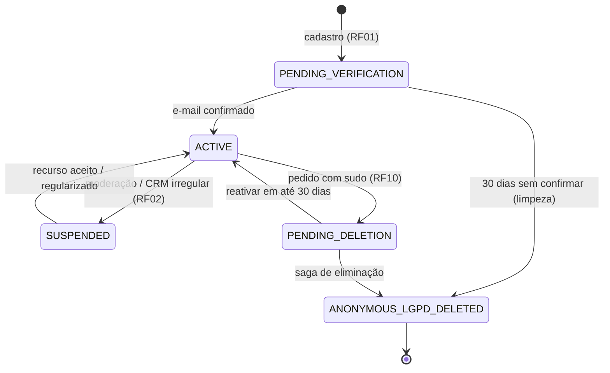
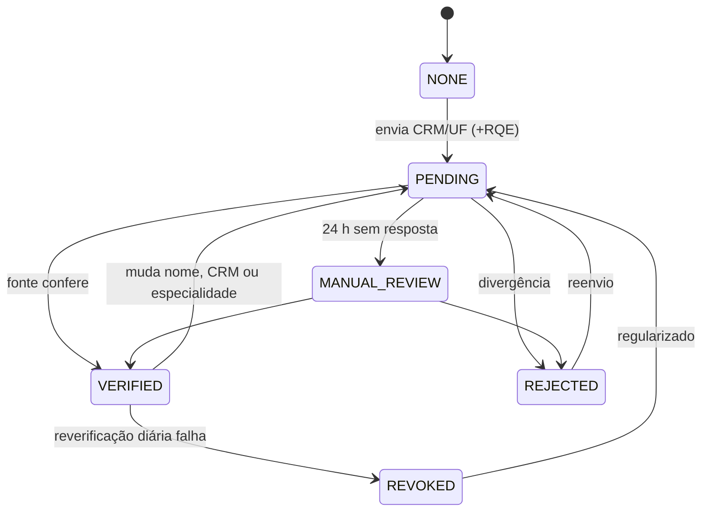
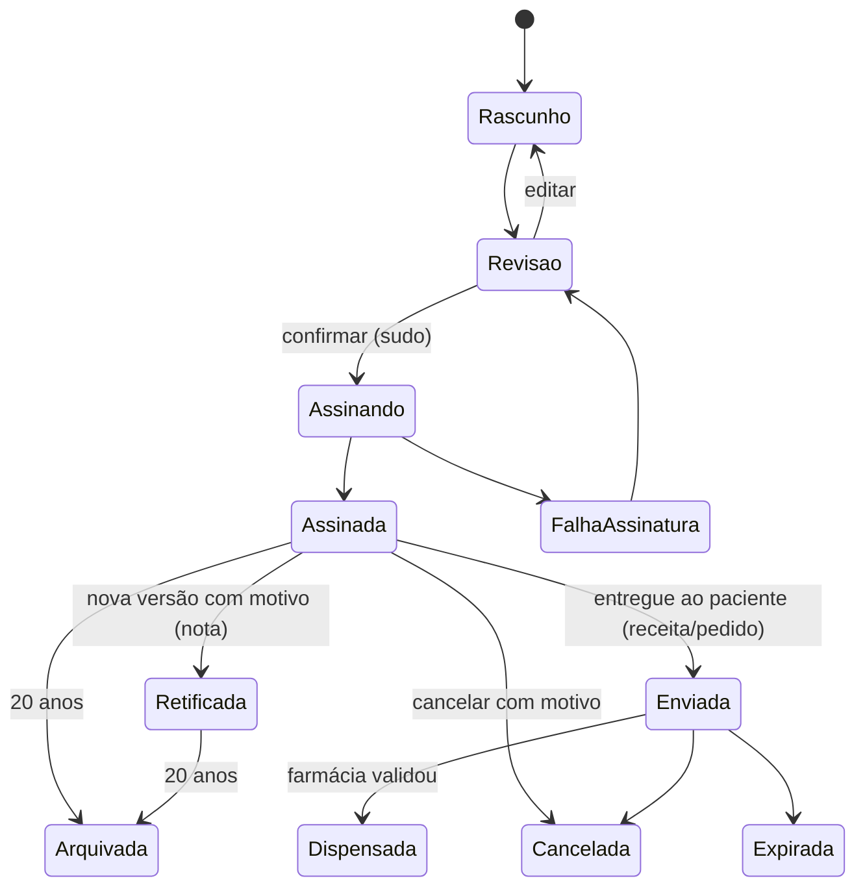

# Máquinas de estado transversais

As máquinas por RF estão em cada `docs/rf/RFnn-*.md`. Aqui ficam as três que cruzam módulos e que o
domínio implementa como enums com transições explícitas (transição inválida = exceção).

## Conta

| De → Para | Quem dispara | Efeitos |
|---|---|---|
| ACTIVE → SUSPENDED | moderador, job de reverificação | encerra sessões, oculta perfil, bloqueia escrita |
| ACTIVE → PENDING_DELETION | titular (sudo) | agenda saga, mantém login só para reativar |
| PENDING_DELETION → ANONYMOUS_LGPD_DELETED | `ErasureJob` | crypto-shredding da DEK social; PEP preservado |

## Selo profissional

Capacidades por estado (RF12): só `VERIFIED` publica, conversa, chama, registra SOAP, prescreve e aparece
no diretório.

## Documento clínico (nota, receita, pedido)

Invariante: a partir de **Assinada**, nenhum estado apaga o artefato assinado; só acrescenta versão ou
marca cancelamento.
