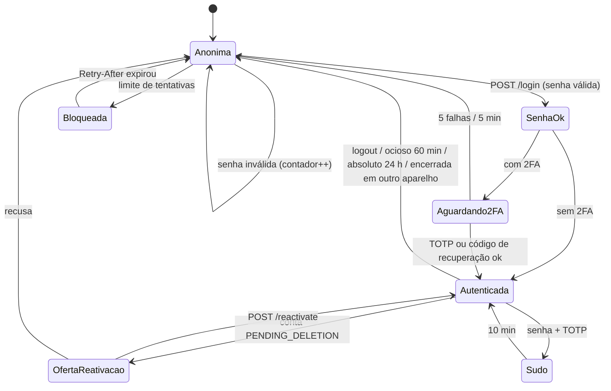
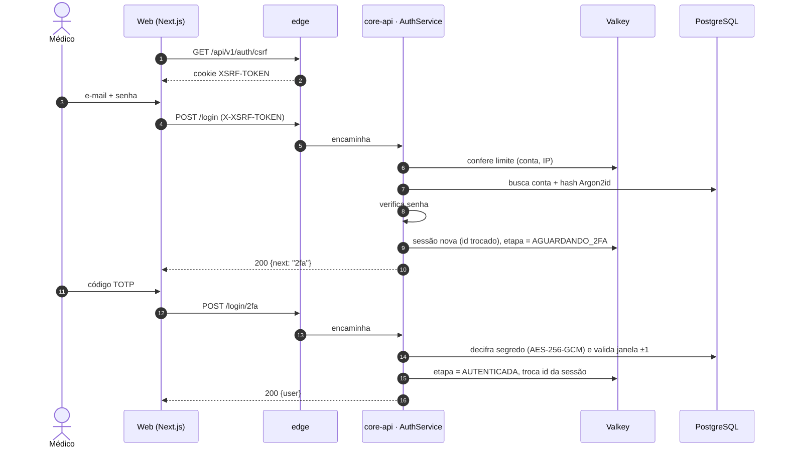
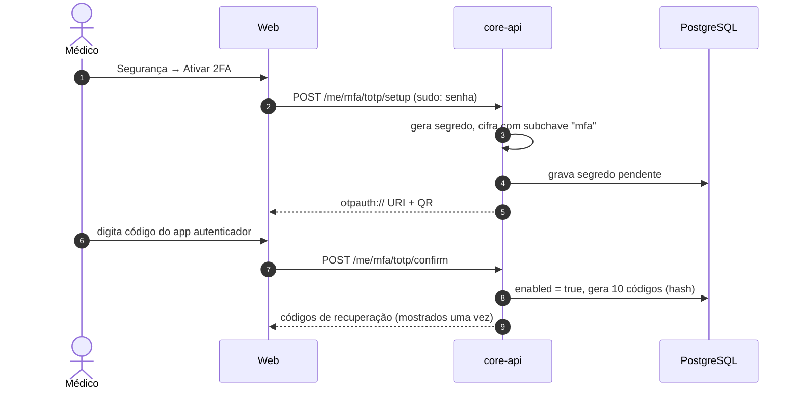
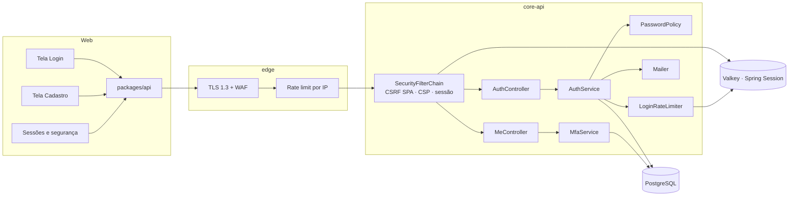
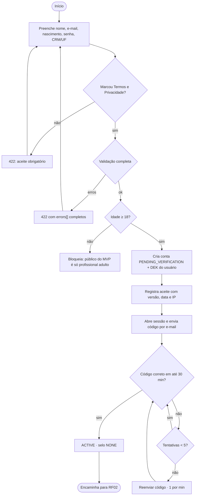

# RF01 · Cadastro, login, 2FA e sessões

Base de identidade do Doctor Explorer: sessão opaca no Valkey, CSRF no padrão SPA, Argon2id, TOTP,
códigos de recuperação e **modo sudo**. Nunca JWT no cliente (ADR-008).

## Critérios de aceite

1. `POST /api/v1/auth/register` cria a conta em `PENDING_VERIFICATION`, abre sessão e envia código de
   6 dígitos (validade 30 min, 5 tentativas, reenvio 1/min). Devolve **todos** os erros juntos em `422`.
2. Aceite dos Termos e da Política vem com **caixa desmarcada**; versão, data e IP ficam em
   `terms_acceptance`.
3. Login em etapas: senha → `POST /login/2fa` (se tiver 2FA) → oferta de `POST /reactivate` (se
   `PENDING_DELETION`). O estado intermediário fica na sessão, nunca no cliente.
4. A mensagem de erro de login é neutra: "E-mail ou senha incorretos". Limite de tentativas por conta e
   por IP → `429` + `Retry-After`.
5. Cookie `__Host-de_session`: `HttpOnly`, `Secure`, `SameSite=Lax`, sem `Max-Age`. Ocioso de 60 min
   (deslizante) e absoluto de 24 h.
6. Trocar senha, ativar ou desativar 2FA, pedir exclusão e **assinar documento clínico** exigem modo sudo
   (senha + TOTP), que vale 10 min.
7. `GET/DELETE /me/sessions` lista aparelhos sem expor o id real da sessão.
8. Moderador, Admin e Gestor hospitalar não usam a conta sem 2FA ativo.

## Base legal

LGPD Art. 46 (segurança), Art. 6º, VII (prevenção) · ECA Digital, se houver menor (fora do MVP: só
profissionais maiores de 18).

## Máquina de estados

## Classes

## Sequência: login com 2FA

## Sequência: ativar 2FA

## Componentes

## Atividades: cadastro

## Rastreabilidade

| Camada | Artefato | Status |
|---|---|---|
| Migração | `V1__identidade.sql` (contas, credencial, 2FA, verificação, termos, consentimentos, preferências, `user_key`, `login_audit`) + `schema.sql` | ✅ |
| Domínio | `AccountStatus`, `SealStatus` (máquinas de estado com `InvalidTransitionException`) | ✅ |
| Domínio | `UserAccount`, `Credential`, `EmailVerification`, `TermsAcceptance`, `UserKey`, `UserPreference`, `LoginAudit` (JPA, `ddl-auto: validate`) | ✅ |
| Segurança | `SecurityConfig` (CSRF SPA, CSP, Referrer-Policy, HSTS, troca de id de sessão, 401 sem sessão), `AbsoluteSessionTimeoutFilter` (24 h), sessão opaca no Valkey (`indexed`), cookie `__Host-de_session` | ✅ |
| Segredos | `AppSecretProperties` (`DE_APP_SECRET` obrigatório fora de dev/it, HKDF por finalidade), `AesGcm`, `UserKeyService` (DEK por usuário) | ✅ |
| Erros | `ApiExceptionHandler` (Problem Details pt-BR, `422` com `errors[]`, `429` com `Retry-After`) | ✅ |
| Serviço | `RegistrationService` (todos os erros juntos, código 30 min / 5 tentativas / reenvio 1 min), `LoginService` (mensagem neutra, Argon2 sempre executado), `PasswordPolicy` (12–128, lista comum, sem e-mail/nome), `LoginRateLimiter` (Valkey, conta e IP) | ✅ |
| Serviço | `MfaService` (TOTP, códigos de recuperação, sudo) | ⏳ passo 3 |
| API | `AuthController` (`/csrf`, `/register`, `/login`, `/reactivate`, `/logout`, `/session`), `MeController` (`/me`, `/me/verify-email`, `/me/verify-email/resend`) | ✅ |
| API | `/login/2fa`, `/me/password`, `/me/sessions`, `/me/mfa/**` | ⏳ passo 3 |
| Web | telas Login, Cadastro, Segurança (protótipo em `design/prototype`: Sessões e segurança ✅) | 🟡 |
| Testes | `SchemaConsistencyTest`, `AccountStatusTest`, `EmailVerificationTest`, `PasswordPolicyTest`, `AppSecretPropertiesTest`, `SecurityHeadersTest` | ✅ |
| Testes | `AuthFlowIT` com `support/ApiClient` (CSRF + sessão real no Valkey): cadastro → código → ativação → logout → login, 422 agrupado, CSRF, limite por conta, reenvio | ✅ |
| Testes | `MfaIT` | ⏳ passo 3 |
