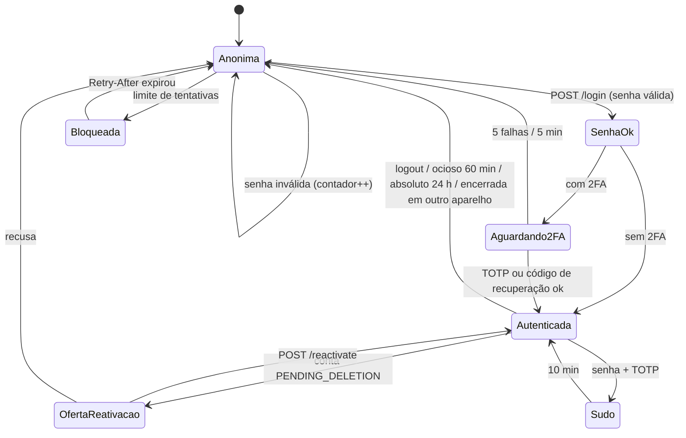
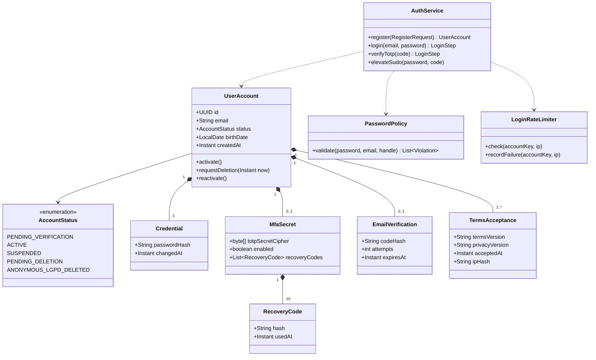
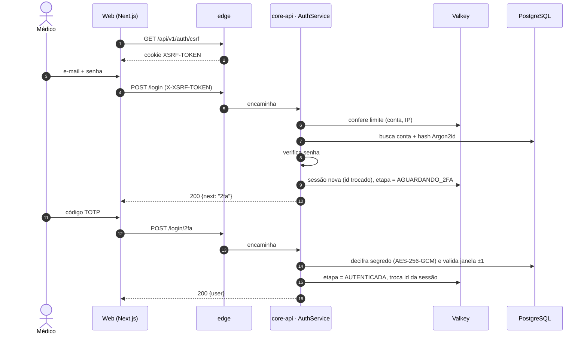
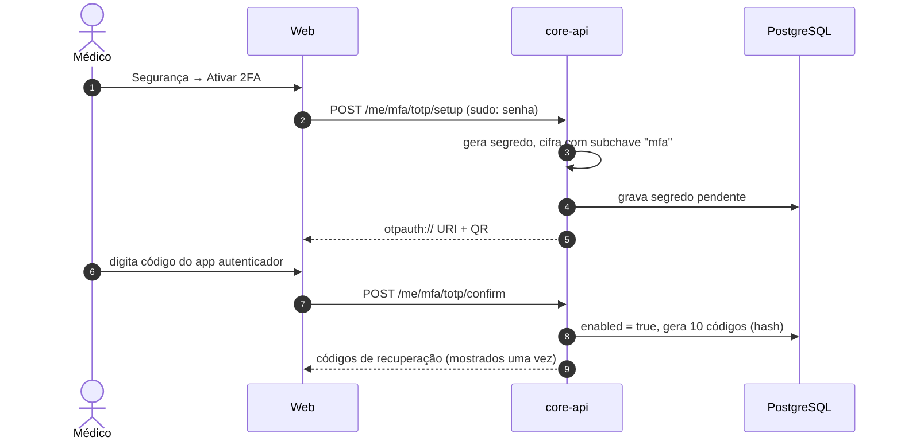
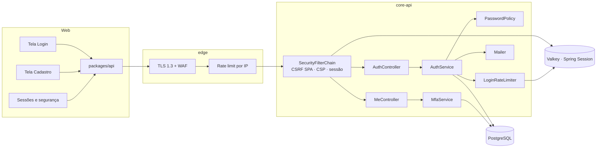

# RF01 · Cadastro, login, 2FA e sessões

Base de identidade do Doctor Explorer: sessão opaca no Valkey, CSRF no padrão SPA, Argon2id, TOTP,
códigos de recuperação e **modo sudo**. Nunca JWT no cliente (ADR-008).

## Critérios de aceite

1. `POST /api/v1/auth/register` cria a conta em `PENDING_VERIFICATION`, abre sessão e envia código de
   6 dígitos (validade 30 min, 5 tentativas, reenvio 1/min). Devolve **todos** os erros juntos em `422`.
2. Aceite dos Termos e da Política vem com **caixa desmarcada**; versão, data e IP ficam em
   `terms_acceptance`.
3. Login em etapas: senha → `POST /login/2fa` (se tiver 2FA) → oferta de `POST /reactivate` (se
   `PENDING_DELETION`). O estado intermediário fica na sessão, nunca no cliente.
4. A mensagem de erro de login é neutra: "E-mail ou senha incorretos". Limite de tentativas por conta e
   por IP → `429` + `Retry-After`.
5. Cookie `__Host-de_session`: `HttpOnly`, `Secure`, `SameSite=Lax`, sem `Max-Age`. Ocioso de 60 min
   (deslizante) e absoluto de 24 h.
6. Trocar senha, ativar ou desativar 2FA, pedir exclusão e **assinar documento clínico** exigem modo sudo
   (senha + TOTP), que vale 10 min.
7. `GET/DELETE /me/sessions` lista aparelhos sem expor o id real da sessão.
8. Moderador, Admin e Gestor hospitalar não usam a conta sem 2FA ativo.
9. **Aparência** (preferências da conta, sincronizam entre aparelhos): tema (sistema/claro/escuro), tamanho do
   texto (85–150 %) e arte de fundo entre cinco opções, com intensidade Forte/Média/Suave (véu de 20 a 80 %).
   O texto nunca fica direto sobre a arte: o conteúdo fica num painel de leitura a 92 % da cor de superfície,
   e `scripts/background_contrast.py` garante 4,5:1 para todos os tokens de texto com a arte mais forte.

## Base legal

LGPD Art. 46 (segurança), Art. 6º, VII (prevenção) · ECA Digital, se houver menor (fora do MVP: só
profissionais maiores de 18).

## Máquina de estados

## Classes

## Sequência: login com 2FA

## Sequência: ativar 2FA

## Componentes

## Atividades: cadastro

## Rastreabilidade

| Camada | Artefato | Status |
|---|---|---|
| Migração | `V1__identidade.sql` (contas, credencial, 2FA, verificação, termos, consentimentos, preferências, `user_key`, `login_audit`) + `schema.sql` | ✅ |
| Domínio | `AccountStatus`, `SealStatus` (máquinas de estado com `InvalidTransitionException`) | ✅ |
| Domínio | `UserAccount` (inclui `rename`, usado pelo RF03), `Credential`, `EmailVerification`, `TermsAcceptance`, `UserKey`, `UserPreference`, `LoginAudit` (JPA, `ddl-auto: validate`) | ✅ |
| Segurança | `SecurityConfig` (CSRF SPA, CSP, Referrer-Policy, HSTS, troca de id de sessão, 401 sem sessão), `AbsoluteSessionTimeoutFilter` (24 h), sessão opaca no Valkey (`indexed`), cookie `__Host-de_session` | ✅ |
| Segredos | `AppSecretProperties` (`DE_APP_SECRET` obrigatório fora de dev/it, HKDF por finalidade), `AesGcm`, `UserKeyService` (DEK por usuário) | ✅ |
| Erros | `ApiExceptionHandler` (Problem Details pt-BR, `422` com `errors[]`, `429` com `Retry-After`) | ✅ |
| Serviço | `RegistrationService` (todos os erros juntos, código 30 min / 5 tentativas / reenvio 1 min), `LoginService` (mensagem neutra, Argon2 sempre executado), `PasswordPolicy` (12–128, lista comum, sem e-mail/nome), `LoginRateLimiter` (Valkey, conta e IP) | ✅ |
| Serviço | `Totp` (RFC 6238, janela ±1, vetores do RFC no teste), `MfaService` (segredo cifrado com subchave "mfa", 10 códigos de recuperação de uso único, 5 falhas/5 min), modo sudo de 10 min em `SessionSupport` | ✅ |
| API | `AuthController` (`/csrf`, `/register`, `/login`, `/login/2fa`, `/reactivate`, `/logout`, `/session`), `GET /auth/session` com `roles` (RF12); `MeController` (`/me`, `/me/verify-email` reautentica para o principal refletir ACTIVE, `/me/verify-email/resend`) | ✅ |
| Sessão | `SessionSupport.authenticate` carrega papéis globais (`user_role`) como `ROLE_*` e a flag `de.session.mfaEnabled` usada pelas rotas que exigem 2FA (RF12) | ✅ |
| API | `MeSecurityController`: `POST /me/sudo`, `POST /me/password` (sudo, derruba as outras sessões), `GET /me/mfa`, `POST /me/mfa/totp/setup|confirm`, `POST /me/mfa/recovery-codes`, `DELETE /me/mfa`, `GET/DELETE /me/sessions[/{handle}]` (apelido por hash, nunca o id real), `POST /me/deletion` (sudo; RF10) | ✅ |
| Web | `apps/web` (Next.js 16): `/login` em etapas (senha → 2FA → reativação, 429 com Retry-After), `/cadastro` (caixas desmarcadas, 422 por campo, versão dos textos), `/verificar-email` (código, reenvio), `/seguranca` (sudo 10 min, troca de senha, TOTP + códigos de recuperação, sessões por aparelho, pedir exclusão). `lib/api.ts`: mesma origem via rewrite, CSRF SPA (`XSRF-TOKEN` → `X-XSRF-TOKEN`), Problem Details, `api.file` para PDF com o mesmo CSRF e os mesmos erros, `api.patch`; `lib/server-api.ts`: guarda de sessão no servidor (`(app)/layout.tsx`). Nunca token no cliente | ✅ |
| Testes | `SchemaConsistencyTest`, `AccountStatusTest`, `EmailVerificationTest`, `PasswordPolicyTest`, `AppSecretPropertiesTest`, `SecurityHeadersTest` | ✅ |
| Testes | `AuthFlowIT` com `support/ApiClient` (CSRF + sessão real no Valkey): cadastro → código → ativação → logout → login, 422 agrupado, CSRF, limite por conta, reenvio | ✅ |
| Migração | `V6__aparencia.sql`: `background` (none + 5 artes) e `background_veil` (20–80) em `user_preference`, com `check` | ✅ |
| API | `PreferencesController`: `GET/PUT /api/v1/me/preferences` (só os campos enviados mudam; 422 com todos os erros; linha criada com os padrões na primeira leitura) | ✅ |
| Web | `/aparencia` (miniaturas, intensidade, tema, tamanho do texto, desfazer), `lib/appearance.ts` (aplica no `<html>` e guarda cópia local só para não piscar), `AppearanceSync` no layout (servidor é a fonte da verdade), camadas arte → véu → painel em `globals.css`; artes em `design/brand/backgrounds` copiadas por `build_thumbs.py` | ✅ |
| Testes | `PreferencesIT` (padrões, atualização parcial, 422 agrupado, entra em "seus dados"), `apps/web/tests/appearance.test.ts` (aplicação no `<html>`, script de boot), e2e com as 5 artes, intensidade, painel de leitura e sincronização com outro aparelho, `background_contrast.py` no CI | ✅ |
| Testes | `apps/web/e2e/flow.cjs` (navegador real contra a API real, job `web-e2e`): cadastro → código → selo → grupo → caso → feed → LGPD → sudo → logout → login neutro; `apps/web/tests` (cliente da API, eixos do feed) | ✅ |
| Auditoria | `LoginService` e `MfaService` gravam `auth.login` (com o desfecho), `auth.logout`, `auth.password_change`, `auth.mfa_enable/disable/recovery_regenerate` na trilha encadeada do RF13, além do `login_audit` | ✅ |
| Testes | `TotpTest`, `MfaIT` (sudo obrigatório, ativar TOTP, login em etapas, código de recuperação de uso único, bloqueio após 5 erros, troca de senha derruba outras sessões, listagem sem ids reais) | ✅ |
