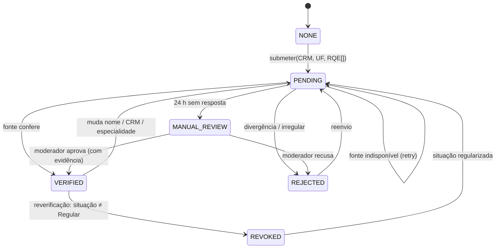
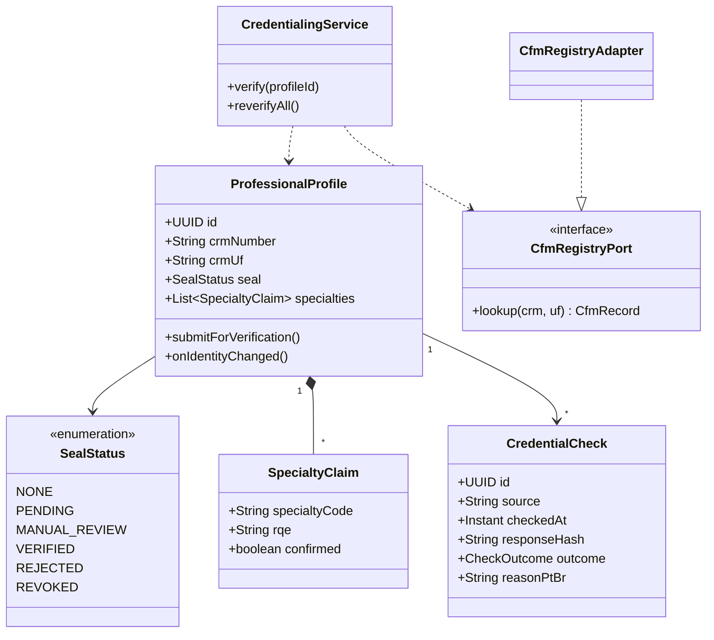
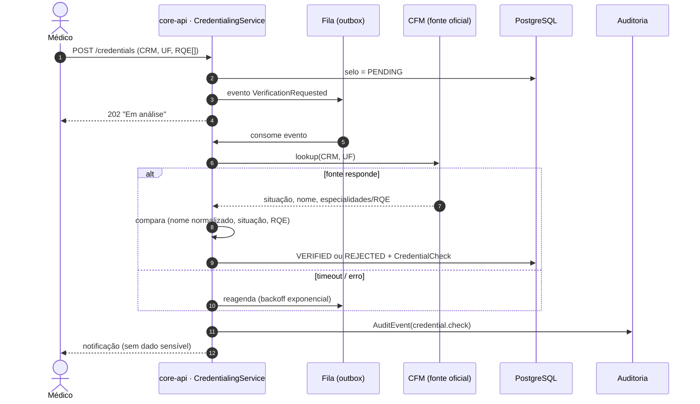
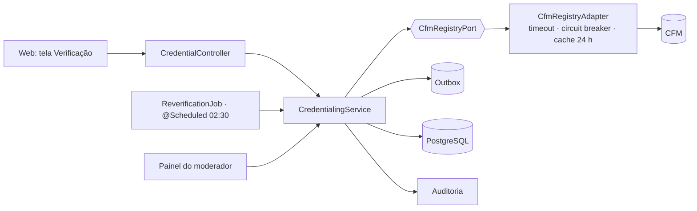
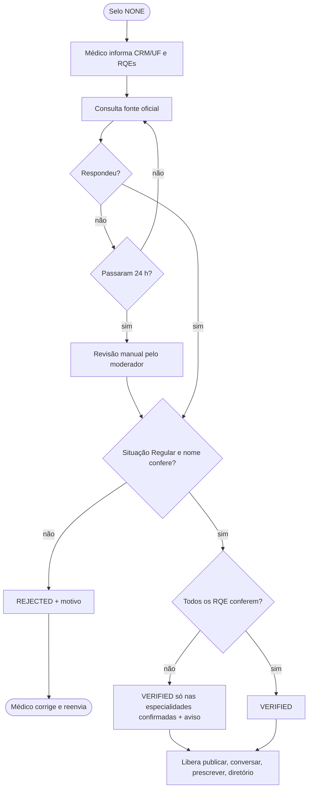

# RF02 · Verificação de CRM/RQE e selo profissional

## Critérios de aceite

1. O médico informa CRM, UF e, para cada especialidade declarada, o RQE.
2. O sistema consulta a fonte oficial do CFM (ADR-009) e compara nome, situação ("Regular") e
   especialidades/RQE.
3. Se tudo confere, o selo vai para `VERIFIED`. Se houver divergência ou situação irregular, vai para
   `REJECTED` com o motivo em pt-BR. Se a fonte estiver fora do ar, fica `PENDING` e entra em fila de
   nova tentativa (até 24 h, depois vai para revisão manual pelo moderador).
4. Mudar nome, CRM ou especialidade de conta verificada volta o selo para `PENDING`.
5. Job diário reverifica todos os selos `VERIFIED`. Situação diferente de "Regular" suspende os recursos
   clínicos na hora e avisa o médico.
6. A evidência de cada consulta (data, fonte, hash da resposta, resultado) é guardada e auditada.
7. Selo exibido com **cor + ícone + texto** ("CRM verificado", "Em análise", "Não verificado").
8. Sem `VERIFIED`: não publica, não conversa, não prescreve e não aparece no diretório.

## Base legal

Lei 3.268/1957 (exercício da medicina exige inscrição no CRM) · Res. CFM sobre RQE ·
LGPD Art. 7º, II/IX (cumprimento de obrigação e legítimo interesse na prevenção a fraude) **⚖️ validar**.

## Máquina de estados

## Classes

## Sequência

## Componentes

## Atividades

## Rastreabilidade

| Camada | Artefato | Status |
|---|---|---|
| Migração | `V2__credentialing.sql` | ⏳ |
| Domínio | `ProfessionalProfile`, `SealStatus`, `CredentialCheck` | ⏳ |
| Integração | `CfmRegistryAdapter` (ADR-009) | ⏳ |
| Job | `ReverificationJob` | ⏳ |
| Testes | `CredentialingIT` com stub WireMock do CFM | ⏳ |
