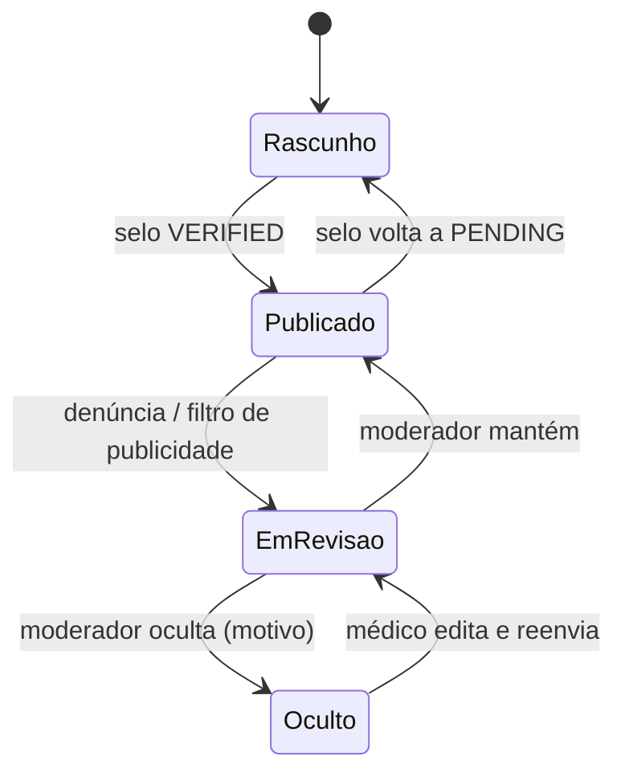
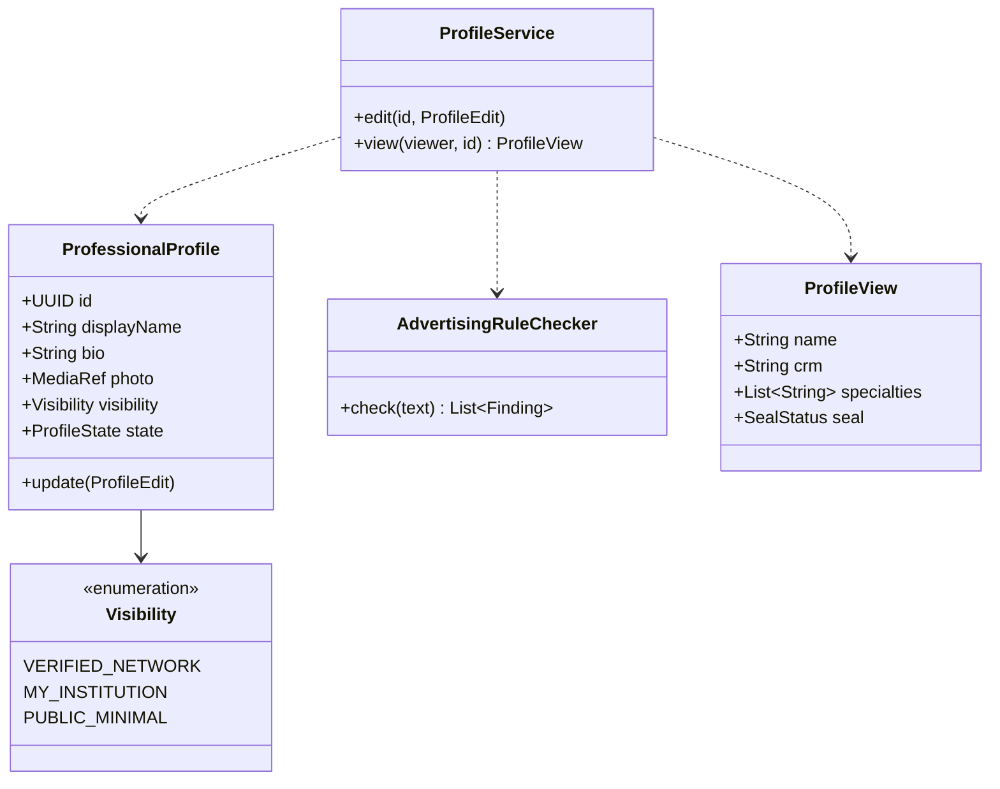
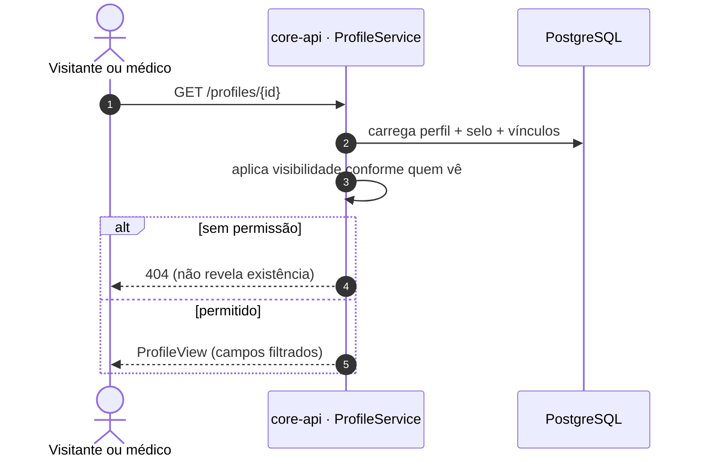
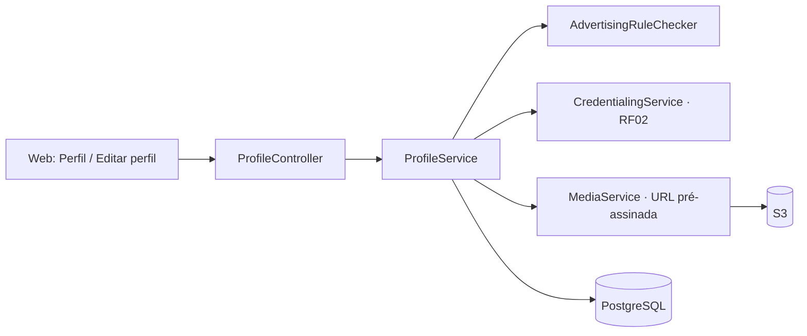
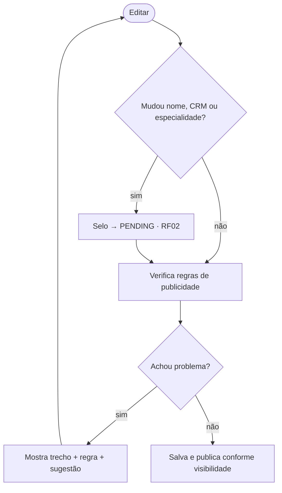

# RF03 · Perfil profissional verificado

## Critérios de aceite

1. O perfil mostra nome, foto, CRM/UF, especialidades com RQE, instituições vinculadas e o selo.
2. Visibilidade padrão é **"só a rede verificada"** (Privacy by Default). As opções são: rede verificada,
   minha instituição, ou público (só nome, CRM e especialidade).
3. O conteúdo segue a Res. CFM 2.336/2023 (publicidade médica): nada de promessa de resultado, foto de
   antes e depois de paciente nem preço como chamariz. O texto livre passa por verificação e o moderador
   pode ocultar.
4. A foto é enviada por URL pré-assinada e limpa no servidor (sem EXIF/GPS, limite de pixels).
5. Mudar nome ou especialidade dispara RF02 (o selo volta para `PENDING`).

## Máquina de estados (visibilidade e moderação do perfil)

## Classes

## Sequência: visualizar perfil

## Componentes

## Atividades: editar perfil

## Rastreabilidade

| Camada | Artefato | Status |
|---|---|---|
| Domínio | `ProfessionalProfile` (bio, `Visibility`, `edit`, `onIdentityChanged`), `UserAccount.rename` | ✅ |
| Serviço | `AdvertisingRuleChecker` (promessa de resultado, antes e depois, superlativos, preço/promoção, sensacionalismo) | ✅ (moderação de casos limítrofes ⏳) |
| API | `GET /profiles/{id}` (visitante só vê PUBLIC_MINIMAL; rede verificada; MY_INSTITUTION exige vínculo em comum; sem acesso = 404), `PUT /me/profile` (nome, bio, visibilidade; mudar nome devolve o selo para PENDING) | ✅ |
| Mídia | foto limpa por URL pré-assinada | ⏳ RF05 |
| Web | `apps/web/app/(app)/perfil`: meu perfil (nome, apresentação com aviso de publicidade médica, visibilidade) + envio de CRM/UF e RQE e evidências do selo (RF02); `/perfil/[id]`: perfil de colega renderizado no servidor com a visibilidade decidida pela API (404 sem acesso) | ✅ |
| Testes | `DirectoryIT.profileVisibilityAndAdvertisingRules` | ✅ |
