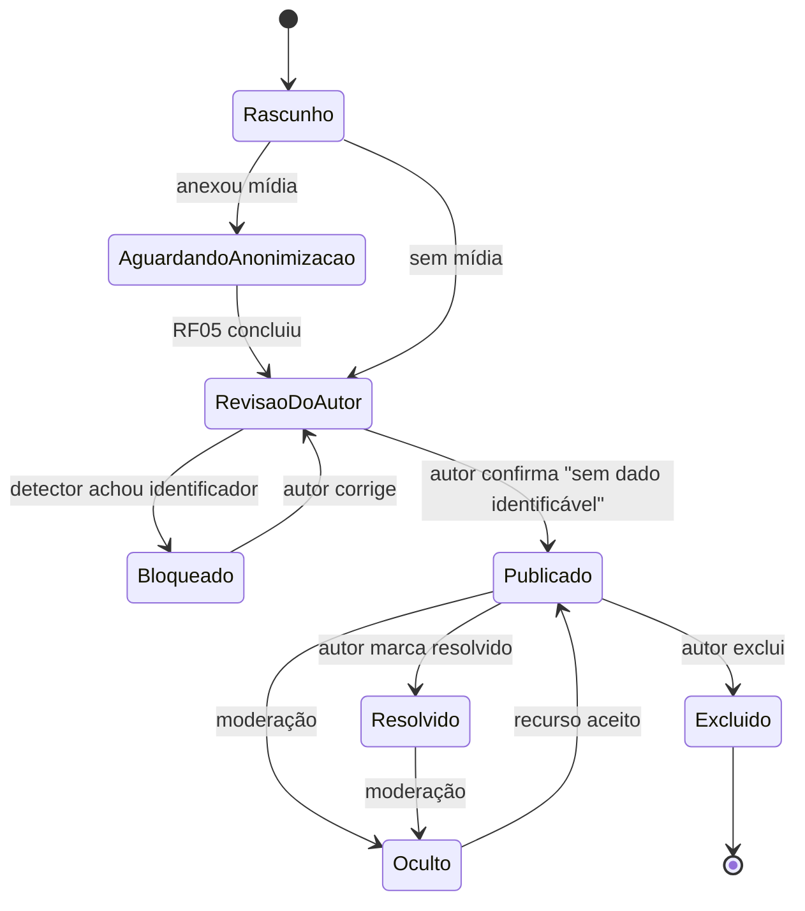
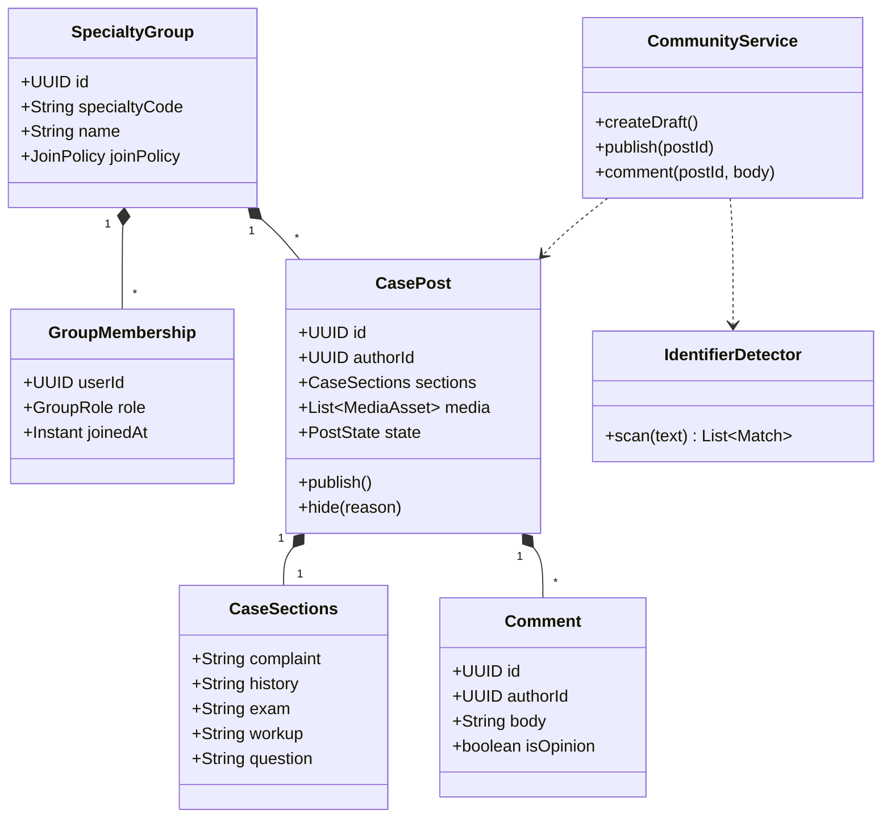
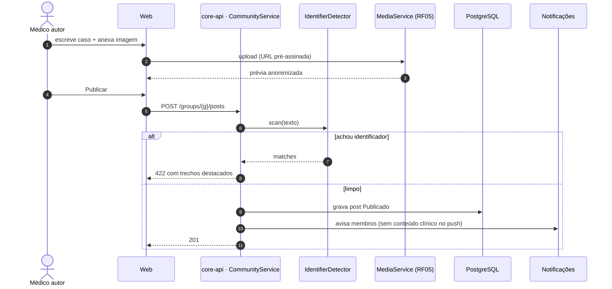
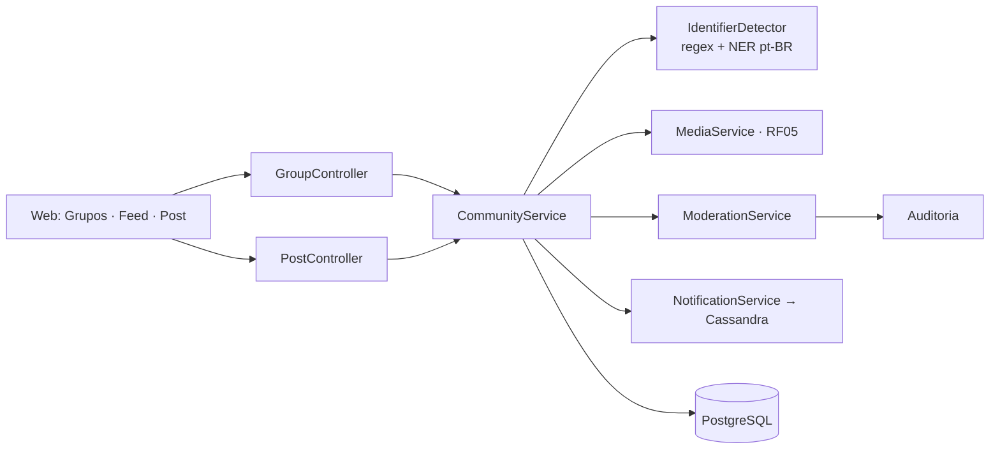
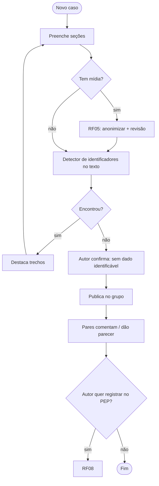

# RF04 · Grupos fechados por especialidade e feed de casos clínicos

## Critérios de aceite

1. Cada especialidade tem um grupo **fechado**. Entra automaticamente quem tem o RQE correspondente
   verificado; os demais pedem entrada e o moderador do grupo aprova.
2. O post de caso tem estrutura própria: queixa, história, exame, exames complementares, pergunta. Toda
   mídia passa obrigatoriamente pelo RF05 antes de publicar.
3. Antes de publicar, o texto passa por um detector de identificadores (nome, CPF, CNS, nº de prontuário,
   telefone, data completa, endereço). Se encontrar algo, **bloqueia** e destaca o trecho.
4. O conteúdo do grupo não é indexado por mecanismo de busca nem aparece fora do grupo.
5. Comentários aceitam marcação "parecer" (opinião técnica). O botão "Registrar no prontuário" (RF08)
   aparece só para o autor do caso.
6. Denúncia, ocultação e exclusão por moderação ficam registradas na auditoria.
7. Feed ordenado por recência, com filtro por especialidade e "sem resposta". Sem algoritmo de
   engajamento no MVP.

## Segmentação do feed por classificações

Toda publicação tem **exatamente um valor em cada eixo**. Os eixos são filtros independentes e combináveis
na interface (abas para o tipo, chips para os demais, interruptor "Só sem resposta"); a escolha fica salva
só no aparelho do usuário (conveniência, não dado pessoal).

| Eixo | Valores | Quem define |
|---|---|---|
| **Tipo** | `caso` · `parecer` · `protocolo` · `comunicado` · `educacao` | autor, ao publicar |
| **Especialidade** | código da especialidade (RQE) | grupo onde foi publicado; o usuário vê as suas marcadas |
| **Origem** | `rede` (rede verificada) · `instituicao` (minha instituição) · `grupo` (meus grupos) | derivado do vínculo do leitor |
| **Estado** | `sem_resposta` · `em_discussao` · `resolvido` | automático (0 pareceres → sem resposta) e autor (resolvido) |

Regras: `protocolo` e `comunicado` só podem ser publicados por conta institucional (RF11) e nascem
`resolvido`; `educacao` aceita quiz com gabarito; o rascunho de autor com selo `PENDING` fica retido e só
o próprio autor vê. Ordem fixa por recência, **sem** ranking por engajamento no MVP. Protótipo:
`design/prototype/index.html#/`.

## Base legal

CFM: sigilo profissional (CEM arts. 73 a 79) · LGPD Art. 12 (dado anonimizado deixa de ser dado pessoal,
desde que a anonimização não seja reversível com meios razoáveis) **⚖️ validar**.

## Máquina de estados (post de caso)

## Classes

## Sequência: publicar caso

## Componentes

## Atividades

## Rastreabilidade

| Camada | Artefato | Status |
|---|---|---|
| Migração | `V4__comunidade.sql` (specialty_group com os 7 grupos do MVP, group_membership, case_post com os eixos de classificação, post_comment) | ✅ |
| Domínio | `SpecialtyGroup`, `GroupMembership` (REQUESTED/ACTIVE/REMOVED), `CasePost` (tipo, origem, estado derivado `feedState()`, resolver/ocultar/excluir), `PostComment` (parecer) | ✅ |
| Serviço | `IdentifierDetector` (CPF, CNS, telefone, e-mail, data completa, nº de prontuário, "paciente Nome Sobrenome"; conservador, com trecho e dica) | ✅ (NER pt-BR ⏳) |
| Serviço | `CommunityService`: entrada automática por RQE confirmado ou pedido + aprovação por moderador, publicação bloqueada por identificador (422 com todos os trechos), parecer muda estado, resolver só pelo autor (404 para os demais), ocultar por moderação, feed por recência com filtros combináveis (tipo, especialidade, origem, estado, "só sem resposta") | ✅ |
| Serviço | origem "minha instituição": audiência INSTITUTION, `publishInstitutional` (PROTOCOL/NOTICE por gestor com papel que publica; RF11) | ✅ |
| Serviço | mídia anonimizada no post (RF05), notificações sem conteúdo (Cassandra) | ⏳ |
| API | `GET /groups` (campos em ordem estável: código, nome, política, vínculo), `POST /groups/{code}/join`, `POST /groups/{code}/members/{id}/approve`, `GET /feed?kind&specialty&origin&state&unanswered`, `POST /posts`, `GET /posts/{id}` (com `canRecordInEhr` só para o autor), `POST /posts/{id}/comments`, `POST /posts/{id}/resolve`, `DELETE /posts/{id}`, `POST /admin/posts/{id}/hide`, `POST /admin/moderation/groups/{code}/members/{id}/approve` (fila do moderador, RF02) | ✅ |
| Web | `apps/web/app/(app)/feed` (quatro eixos + "só sem resposta" na URL, `lib/feed-params.ts`, sem ranking), `/casos/novo` (seções do caso, 422 com todos os trechos identificadores), `/casos/[id]` (pareceres, resolver só o autor, "Registrar no prontuário" só o autor), `/grupos` (entrar por RQE ou aprovação); moderadores veem “Ocultar (moderação)” no caso e aprovam pedidos de grupo em `/moderacao` | ✅ |
| Auditoria | ocultar publicação grava `moderation.post_hide` com o motivo (RF13) | ✅ |
| Testes | `IdentifierDetectorTest` (corpus), `CommunityIT` (sem selo 403, RQE entra/sem RQE pede, bloqueio por identificador, publicar → parecer → resolver, segmentação por cada eixo, não-membro só vê a rede e recebe 404 no post do grupo, PROTOCOL/NOTICE recusados a pessoa física) | ✅ |
