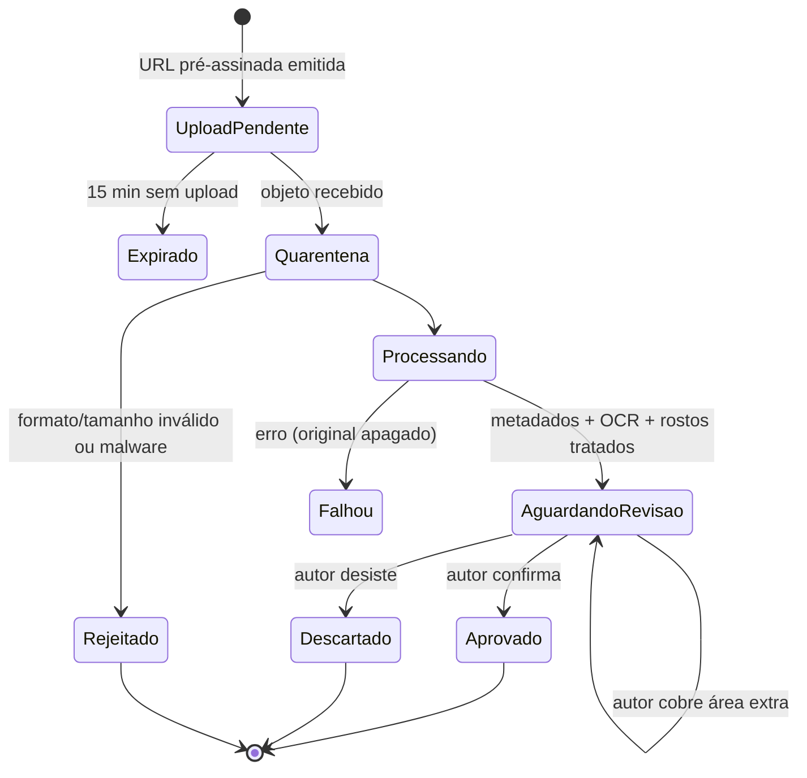
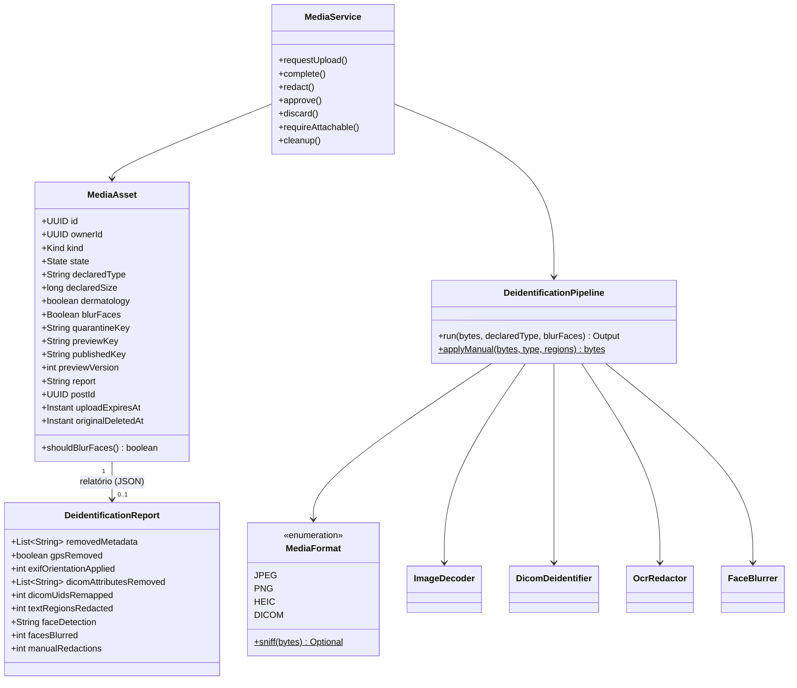
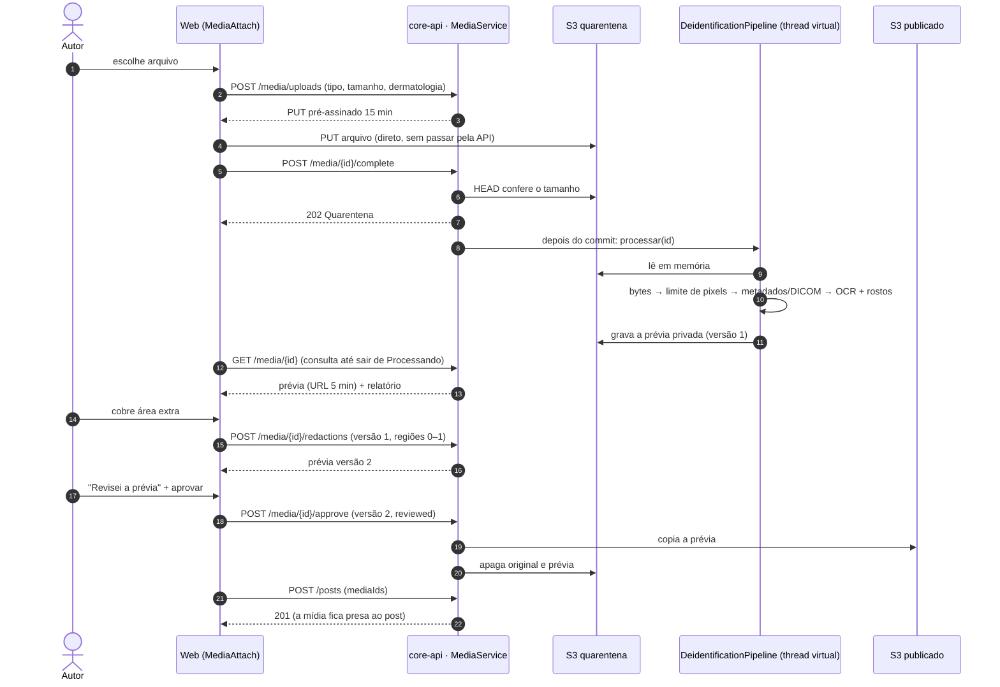
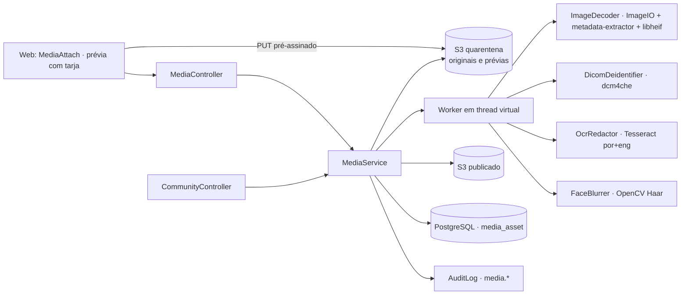
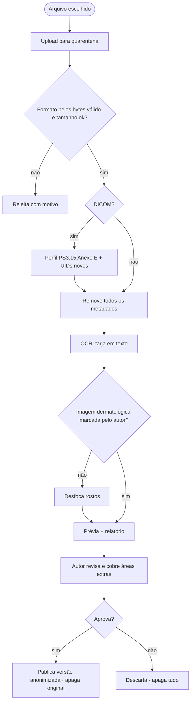

# RF05 · Anonimização automática de mídias de pacientes

## Critérios de aceite

1. Upload direto ao S3 por URL pré-assinada (15 min, tipo e tamanho na assinatura) num bucket de
   **quarentena**, sem leitura pública.
2. Imagens (JPEG/PNG/HEIC): formato detectado pelos bytes, limite de pixels **antes** de decodificar,
   orientação EXIF aplicada e **todos** os metadados removidos (EXIF, XMP, IPTC, GPS).
3. DICOM: desidentificação pelo *Basic Application Level Confidentiality Profile* (PS3.15 Anexo E), com
   novos UIDs. Exportado para PNG para exibição.
4. OCR procura texto gravado na imagem (nome, data, nº de prontuário) e cobre com tarja. A detecção de
   rosto cobre rostos com desfoque. **⚖️** A detecção de rosto não roda em imagens dermatológicas sem
   escolha explícita do autor.
5. O autor **revisa obrigatoriamente** a prévia, vê a lista do que foi removido e pode cobrir áreas a mais
   antes de aprovar.
6. Só a versão anonimizada sai da quarentena. O original é apagado em até 24 h e nunca vai para o grupo.
7. Vídeo fica **fora do MVP**.

### Como o MVP cumpre cada critério

| # | Implementação |
|---|---|
| 1 | `POST /media/uploads` devolve um PUT pré-assinado com `Content-Type` e `Content-Length` assinados (o S3 recusa outro tamanho); o navegador envia direto ao bucket de quarentena (CORS só para a origem do web, `doctor-explorer.media.cors-origins`). `POST /media/{id}/complete` confere o tamanho no S3 e agenda o processamento depois do commit. 15 min sem envio → `EXPIRADO`. |
| 2 | `MediaFormat.sniff` pelos bytes (o tipo declarado precisa bater, senão `REJEITADO`); dimensões lidas do cabeçalho (ImageIO / `heif-info`) e comparadas ao limite (40 MP) **antes** de decodificar; orientação EXIF aplicada aos pixels; a saída é reconstruída só dos pixels (JPEG q0,9 sem metadado ou PNG), então nada de EXIF, XMP, IPTC, GPS ou ICC sobrevive. O relatório lista os grupos removidos (só nomes e contagens). HEIC passa por `heif-convert` (libheif) num diretório privado em `/dev/shm`. |
| 3 | dcm4che `DeIdentifier` (perfil básico + troca de UIDs); o relatório lista os atributos alterados e quantos UIDs; o DICOM limpo é renderizado em PNG pelo leitor ImageIO do dcm4che. `BurnedInAnnotation=YES` vira aviso na revisão. |
| 4 | Tesseract (`por+eng`, `--psm 11`, confiança ≥ 30, ≥ 2 caracteres) acha palavras; cada linha vira tarja preta com margem. OpenCV (Haar frontal) acha rostos; pixelização grossa (bloco ≥ 1/6 do rosto). As duas detecções olham a imagem **intacta** (uma tarja do OCR sobre a testa não esconde o rosto do detector). Dermatologia: sem detecção de rosto, salvo se o autor marcar "mesmo assim, borrar". |
| 5 | Prévia privada (GET pré-assinado de 5 min) com `previewVersion`; tarjas manuais em coordenadas 0–1 (`POST /redactions`) geram nova versão; aprovar exige `reviewed: true` **e** a versão que o autor viu (senão 409 `previa-desatualizada`). |
| 6 | Na aprovação a prévia é copiada para o bucket publicado e o original e a prévia saem da quarentena. O job `MediaService.cleanup` (a cada 10 min) expira envios pendentes e apaga qualquer original com mais de 24 h, em qualquer estado. Publicar só aceita mídia do autor, aprovada e ainda não usada; a leitura no caso é por URL de 10 min, só depois de a comunidade liberar o post. |
| 7 | `video/*` → 422 "Vídeo fica fora do MVP". |

**Concorrência e retomada.** Tarjar, aprovar, descartar e anexar travam a linha da mídia (`SELECT … FOR UPDATE`):
duas abas não sobrescrevem as tarjas uma da outra (a segunda recebe 409 `previa-desatualizada`). O original só é
marcado como apagado quando o S3 confirma a exclusão; se falhar, o job de 24 h tenta de novo. Se a API reiniciar
no meio, o job (que também roda logo na subida) retoma QUARENTENA parada há 2 min e PROCESSANDO parada há 10 min
(`V10`: momento da última transição e número de tentativas); na terceira interrupção a mídia vai para FALHOU.

**Falha fechada.** Qualquer erro de ferramenta (Tesseract ou libheif ausentes, tempo-limite, leitura) leva a
`FALHOU`, apaga o original e não publica nada. Os binários vêm da imagem base `infra/images/core-api-base`.

## Máquina de estados

## Classes

## Sequência

## Componentes

> dcm4che, Tesseract, libheif e OpenCV estão registrados em ADR-012. Na produção a quarentena é um bucket
> separado, sem leitura pública, com regra de ciclo de vida de 1 dia como segunda rede de segurança.

## Atividades

## Rastreabilidade

| Camada | Artefato | Status |
|---|---|---|
| Migração | `V8__midia.sql` (`media_asset` com os estados, versão da prévia, relatório, vínculo ao post, prazo do envio e data em que o original foi apagado), `V10__midia_retomada.sql` (última transição e tentativas) | ✅ |
| Pipeline | `MediaFormat`, `ImageDecoder` (limite de pixels antes de decodificar, orientação EXIF explícita, HEIC por libheif), `DicomDeidentifier` (dcm4che, perfil básico, UIDs novos), `OcrRedactor` (Tesseract), `FaceBlurrer` (OpenCV, cascata Haar em `resources/media`), `DeidentificationPipeline` (falha fechada) | ✅ |
| Serviço | `MediaService`: pedido de envio, conclusão com conferência de tamanho, processamento depois do commit, prévia privada, tarja manual com versão, aprovação com confirmação, descarte, anexo ao post, limpeza de 15 min / 24 h; auditoria `media.upload_request/processed/redaction/approve/discard/original_deleted` | ✅ |
| API | `POST /media/uploads`, `POST /media/{id}/complete`, `GET /media/{id}`, `POST /media/{id}/redactions`, `POST /media/{id}/approve`, `DELETE /media/{id}` (selo VERIFIED); `POST /posts` com `mediaIds`; `GET /posts/{id}` com `media[]` (URLs de 10 min) e `mediaCount` no feed | ✅ |
| Web | `components/media/MediaAttach.tsx` em `/casos/novo` (envio direto, estado do processamento, prévia com tarjas desenhadas, relatório em frases, "Revisei a prévia", aprovar/descartar), imagens no caso, contagem no feed; `lib/media.ts` | ✅ |
| Infra | buckets `de-media-quarantine` e `de-media-published` (Garage no Compose e nos testes), CORS só para o web, `infra/images/core-api-base` com Tesseract e libheif; CI instala as mesmas ferramentas | ✅ |
| Infra | Object Lock/ciclo de vida de 1 dia no bucket de quarentena, varredura antimalware | ⏳ produção |
| Testes | `DeidentificationPipelineTest` (bytes ≠ declarado, limite de pixels, EXIF+GPS removidos e rotação, as 8 orientações, OCR com tarja, rosto real de domínio público borrado e mantido na dermatologia, DICOM sintético, HEIC real, tarja manual, ferramenta ausente falha fechada), `MediaIT` com Garage real (quarentena → revisão → tarja → aprovação → post → leitura; rejeição; DICOM; regras de envio e posse; limpeza de 24 h; duas tarjas simultâneas sem perda silenciosa; retomada após reinício e desistência na terceira tentativa), `tests/media.test.ts`, e2e no navegador | ✅ |
