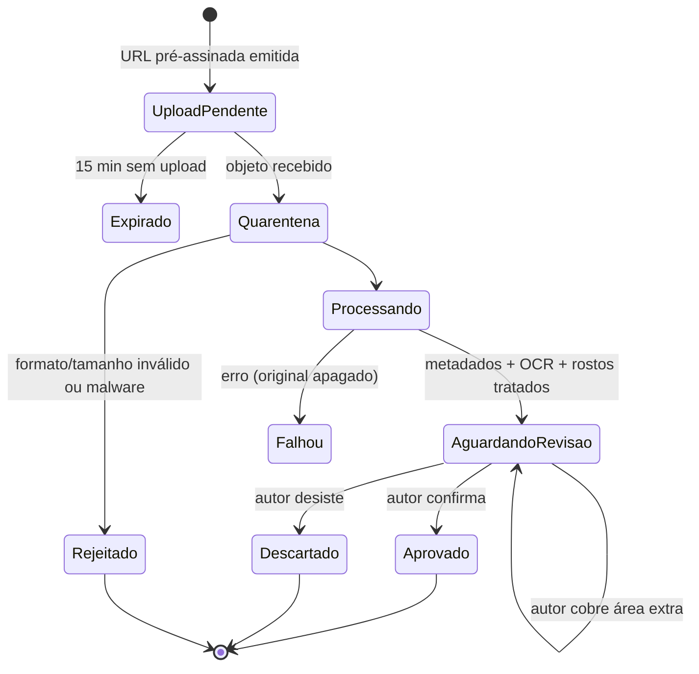
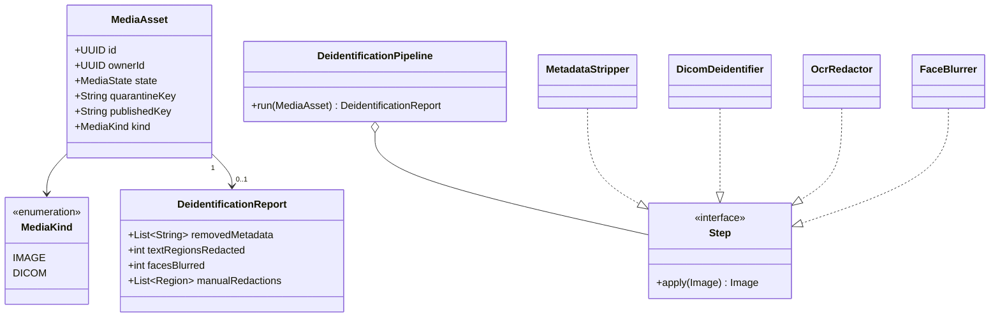
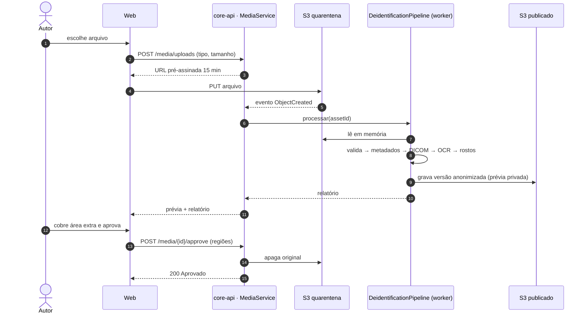
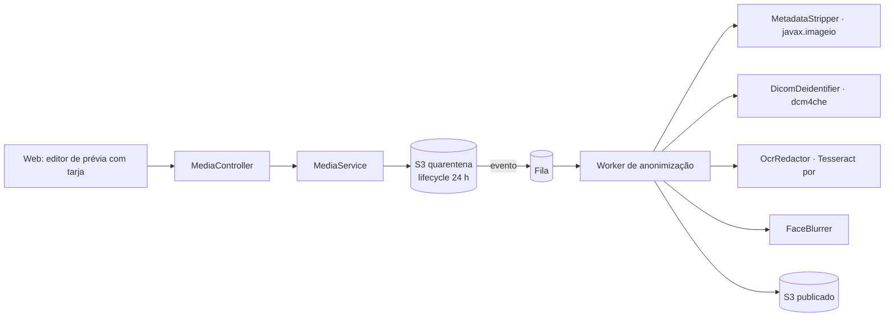

# RF05 · Anonimização automática de mídias de pacientes

## Critérios de aceite

1. Upload direto ao S3 por URL pré-assinada (15 min, tipo e tamanho na assinatura) num bucket de
   **quarentena**, sem leitura pública.
2. Imagens (JPEG/PNG/HEIC): formato detectado pelos bytes, limite de pixels **antes** de decodificar,
   orientação EXIF aplicada e **todos** os metadados removidos (EXIF, XMP, IPTC, GPS).
3. DICOM: desidentificação pelo *Basic Application Level Confidentiality Profile* (PS3.15 Anexo E), com
   novos UIDs. Exportado para PNG para exibição.
4. OCR procura texto gravado na imagem (nome, data, nº de prontuário) e cobre com tarja. A detecção de
   rosto cobre rostos com desfoque. **⚖️** A detecção de rosto não roda em imagens dermatológicas sem
   escolha explícita do autor.
5. O autor **revisa obrigatoriamente** a prévia, vê a lista do que foi removido e pode cobrir áreas a mais
   antes de aprovar.
6. Só a versão anonimizada sai da quarentena. O original é apagado em até 24 h e nunca vai para o grupo.
7. Vídeo fica **fora do MVP**.

## Máquina de estados

## Classes

## Sequência

## Componentes

> dcm4che e Tesseract são tecnologias novas em relação à stack de referência e estão registradas em
> ADR-012.

## Atividades

## Rastreabilidade

| Camada | Artefato | Status |
|---|---|---|
| Serviço | `MediaService`, `DeidentificationPipeline` | ⏳ |
| Worker | etapas de anonimização | ⏳ |
| Infra | buckets quarentena/publicado, lifecycle | ⏳ |
| Testes | corpus de imagens sintéticas com EXIF/GPS, DICOM de teste e texto gravado | ⏳ |
