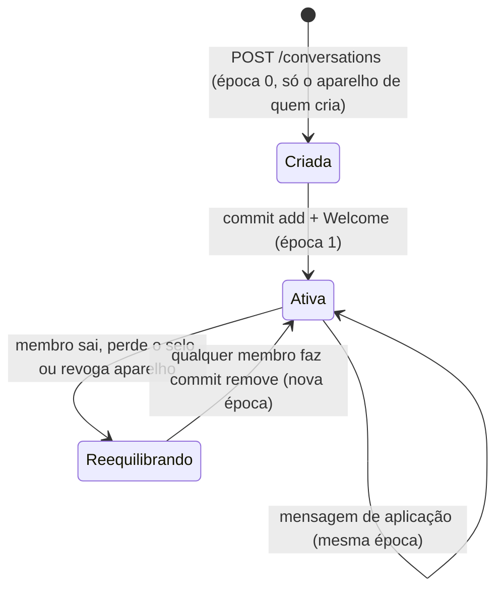
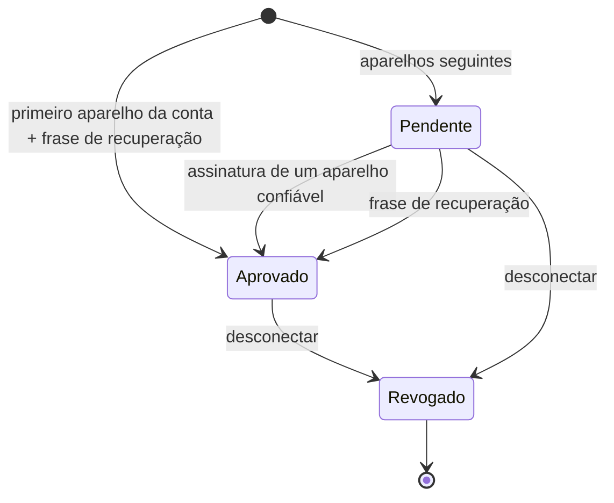
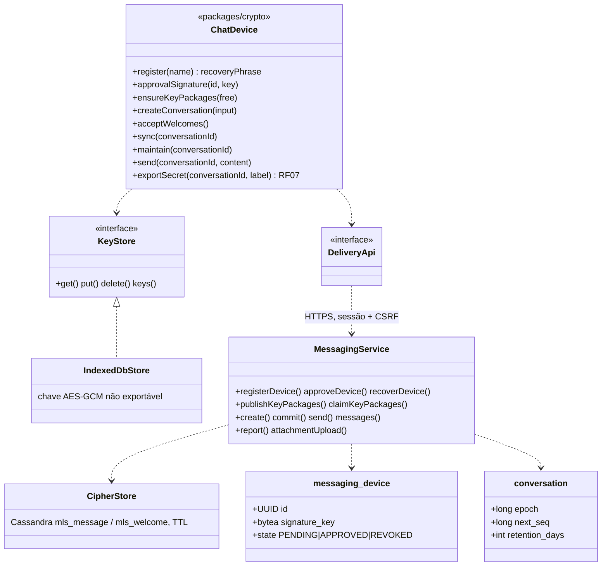
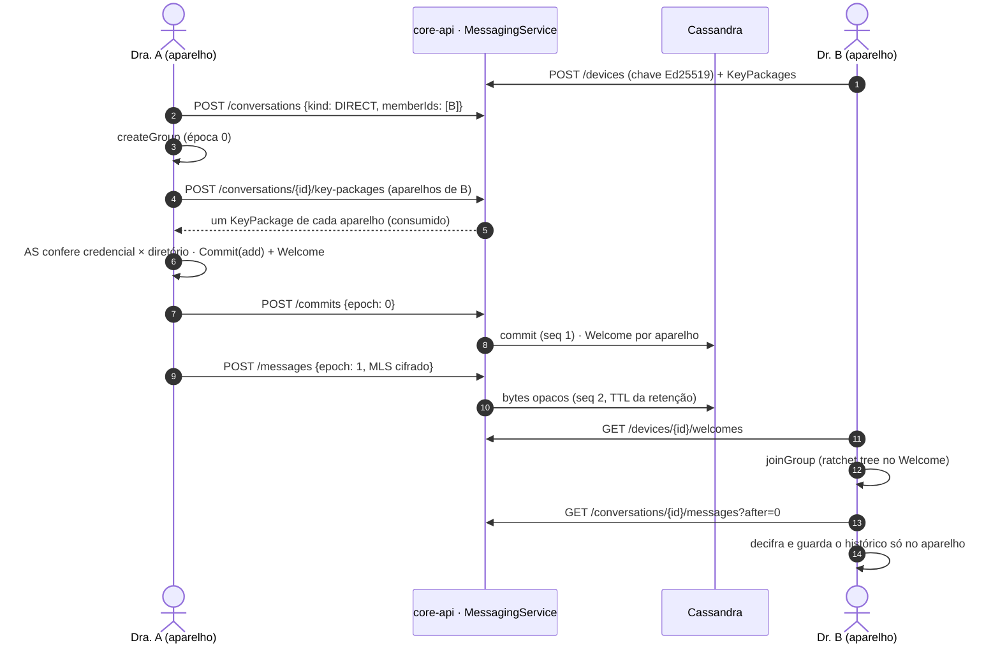
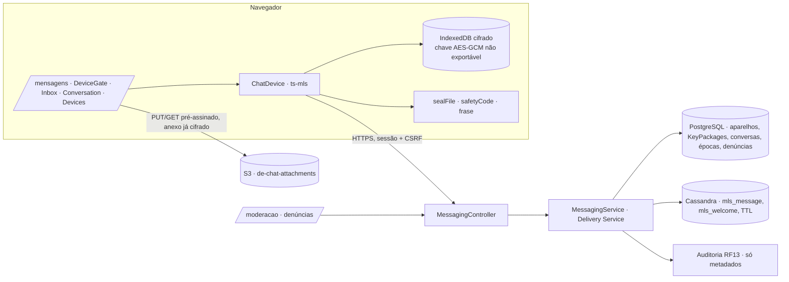
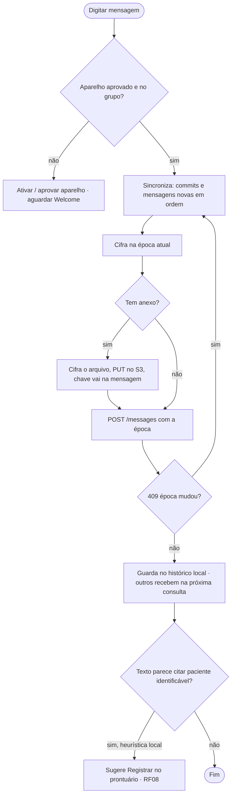

# RF06 · Chat criptografado ponta a ponta

## Critérios de aceite

1. Conversas 1:1 e em grupo (até 50 membros) usam **MLS, RFC 9420** (ADR-010). O servidor guarda só
   mensagens cifradas e o *Delivery Service*. Ele **não** tem como decifrar.
2. Só médicos `VERIFIED` (ou profissionais verificados, conforme a matriz) iniciam conversa.
3. Cada aparelho tem seu próprio par de chaves. Adicionar um aparelho exige aprovação num aparelho já
   confiável ou a frase de recuperação.
4. A interface mostra "Criptografada ponta a ponta" e o código de segurança para comparar com o contato.
5. Anexos: cifrados no cliente com chave por arquivo e enviados ao S3. A chave segue dentro da mensagem
   MLS.
6. Denúncia: o denunciante encaminha as mensagens decifradas ao moderador. Isso fica explícito na interface.
7. Mensagens temporárias são opcionais (24 h / 7 dias / 90 dias). Padrão: **90 dias** **⚖️ validar**.
8. Conversa sobre paciente identificado: o app sugere "Registrar no prontuário" (RF08) e lembra que o chat
   não é prontuário.
9. Push só com "Nova mensagem", nunca com conteúdo.

### Como o MVP cumpre cada critério

| # | Implementação |
|---|---|
| 1 | **MLS RFC 9420** no navegador com `ts-mls` (suíte 1: X25519, AES-128-GCM, SHA-256, Ed25519), em `packages/crypto`. A core-api é o **Delivery Service**: aceita commits só na época atual (409 `epoca-desatualizada`, o cliente sincroniza e refaz), dá a cada envio um `seq` (PostgreSQL, com a conversa travada) e guarda os bytes MLS opacos na Cassandra (`mls_message`, `mls_welcome`). KeyPackages são de uso único. Grupo de até 50 membros. O servidor não tem chave nenhuma: nem o conteúdo, nem o anexo, nem a frase de recuperação passam por ele em claro. |
| 2 | Registrar aparelho, publicar KeyPackage, criar conversa, fazer commit e enviar exigem selo `VERIFIED`; contato e novo membro também precisam estar verificados (422). Quem perde o selo sai da árvore no próximo commit (`devicesToRemove`). |
| 3 | Cada navegador gera o próprio par Ed25519 (a credencial MLS é o id do aparelho). O primeiro aparelho da conta entra aprovado e mostra uma **frase de recuperação** (160 bits) uma vez; o servidor guarda só o Argon2id de um verificador PBKDF2 dela. Os seguintes ficam `PENDING` até um aparelho confiável **assinar** a aprovação (o servidor confere a assinatura Ed25519 com a chave do aprovador) ou a frase ser apresentada. Pendente não publica KeyPackage nem entra em grupo. O **Authentication Service** do cliente confere cada folha contra o diretório (`/devices/{id}/public`): chave diferente ou aparelho pendente não entra. Chaves e estado ficam no IndexedDB, cada valor cifrado (AES-256-GCM) por uma chave **não exportável**. Aparelho novo não vê o histórico anterior. |
| 4 | Selo "Criptografada ponta a ponta" na conversa e **código de segurança** de 60 dígitos (SHA-512 das chaves de todos os aparelhos que estão na árvore MLS dos dois lados): igual nos dois aparelhos; muda se alguém (ou o servidor) adicionar aparelho. |
| 5 | Anexo cifrado no aparelho com AES-256-GCM e chave própria, enviado por PUT pré-assinado ao bucket `de-chat-attachments`; chave, IV e SHA-256 do cifrado vão **dentro** da mensagem MLS. Expira com a retenção da conversa (job apaga o objeto). |
| 6 | "Denunciar": quem denuncia marca as mensagens e o app encaminha o texto decifrado com o motivo, com aviso explícito. É o único texto de chat no servidor (`message_report`), visível na fila de moderação (MODERATOR/ADMIN + 2FA) até a decisão registrada. |
| 7 | Retenção por conversa: 24 h, 7 dias ou **90 dias** (padrão), aplicada como TTL na Cassandra em cada gravação; mudar vale para as próximas. ⚖️ prazo padrão segue para validação. |
| 8 | Heurística **local** (CPF, "paciente Nome Sobrenome", nº de prontuário, data de nascimento, cartão SUS) sugere "Registrar no prontuário" e lembra que o chat não é prontuário. Nada sai do aparelho. O nome do grupo, que não é cifrado, passa pelo detector de identificadores do RF04 (422). |
| 9 | Aviso de novidade sem conteúdo: contagem de conversas não lidas no menu (`/messaging/unread`). Web Push com só "Nova mensagem" ⏳. |

Limites do MVP: mensagens chegam por consulta a cada 2,5 s (WebSocket ⏳); um aparelho que fica fora mais
que a retenção precisa ser adicionado de novo; o app móvel nativo (Keychain/Keystore) ⏳.

## Máquina de estados (conversa / grupo MLS)

## Máquina de estados (aparelho)

## Classes

## Sequência: primeira mensagem 1:1

## Componentes

## Atividades: enviar mensagem

## Rastreabilidade

| Camada | Artefato | Status |
|---|---|---|
| Cripto | `packages/crypto` (`ChatDevice` sobre `ts-mls` 1.6.4, `safetyCode`, `sealFile`, frase de recuperação; `exportSecret` dá a chave das chamadas do RF07, e `frames.ts` é a cifra de quadro delas) | ✅ |
| Serviço | `MessagingService` + `MessagingController` (Delivery Service, diretório de aparelhos, AS no cliente) | ✅ |
| Dados | `V11__mensagens.sql` (aparelho, recuperação, KeyPackage, conversa, membro, árvore, denúncia, anexo); Cassandra `cql/V2__messaging.cql` (`mls_message`, `mls_welcome` com TTL) | ✅ |
| Web | `/mensagens`, `/mensagens/[id]` (com o botão "Chamada de vídeo" do RF07), `/mensagens/aparelhos`, denúncias na fila de moderação, contador no menu | ✅ |
| Testes | `chat.test.ts` (dois aparelhos reais com MLS: entrega, servidor sem texto claro, recarregar, aparelho novo aprovado e revogado, commits concorrentes, AS recusando chave trocada); `MessagingIT` (aprovação assinada e por frase, KeyPackage de uso único, época, bytes opacos com TTL, grupos, anexos no S3, denúncia); e2e com dois navegadores e um segundo aparelho | ✅ |
| Pendências | WebSocket, Web Push sem conteúdo, app móvel nativo | ⏳ |
