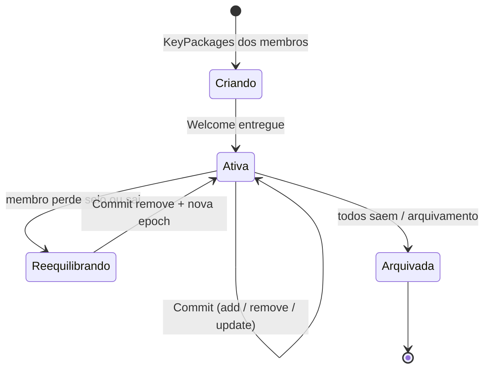
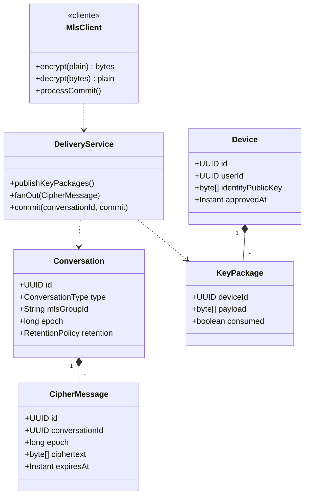
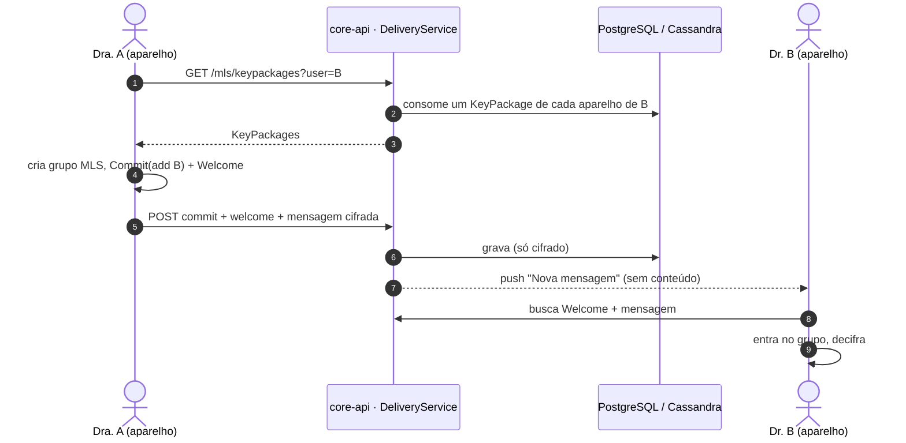
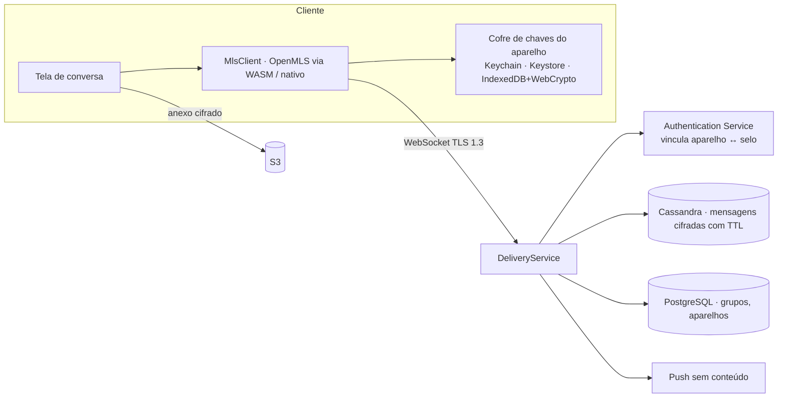
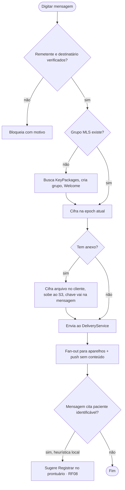

# RF06 · Chat criptografado ponta a ponta

## Critérios de aceite

1. Conversas 1:1 e em grupo (até 50 membros) usam **MLS, RFC 9420** (ADR-010). O servidor guarda só
   mensagens cifradas e o *Delivery Service*. Ele **não** tem como decifrar.
2. Só médicos `VERIFIED` (ou profissionais verificados, conforme a matriz) iniciam conversa.
3. Cada aparelho tem seu próprio par de chaves. Adicionar um aparelho exige aprovação num aparelho já
   confiável ou a frase de recuperação.
4. A interface mostra "Criptografada ponta a ponta" e o código de segurança para comparar com o contato.
5. Anexos: cifrados no cliente com chave por arquivo e enviados ao S3. A chave segue dentro da mensagem
   MLS.
6. Denúncia: o denunciante encaminha as mensagens decifradas ao moderador. Isso fica explícito na interface.
7. Mensagens temporárias são opcionais (24 h / 7 dias / 90 dias). Padrão: **90 dias** **⚖️ validar**.
8. Conversa sobre paciente identificado: o app sugere "Registrar no prontuário" (RF08) e lembra que o chat
   não é prontuário.
9. Push só com "Nova mensagem", nunca com conteúdo.

## Máquina de estados (conversa / grupo MLS)

## Classes

## Sequência: primeira mensagem 1:1

## Componentes

## Atividades: enviar mensagem

## Rastreabilidade

| Camada | Artefato | Status |
|---|---|---|
| Cripto | `packages/crypto` (OpenMLS) | ⏳ |
| Serviço | `DeliveryService` | ⏳ |
| Dados | Cassandra `cipher_message` (TTL) | ⏳ |
| Testes | interop MLS entre web e mobile; teste de que o servidor não guarda texto claro | ⏳ |
| Segurança | revisão criptográfica externa | ⏳ |
