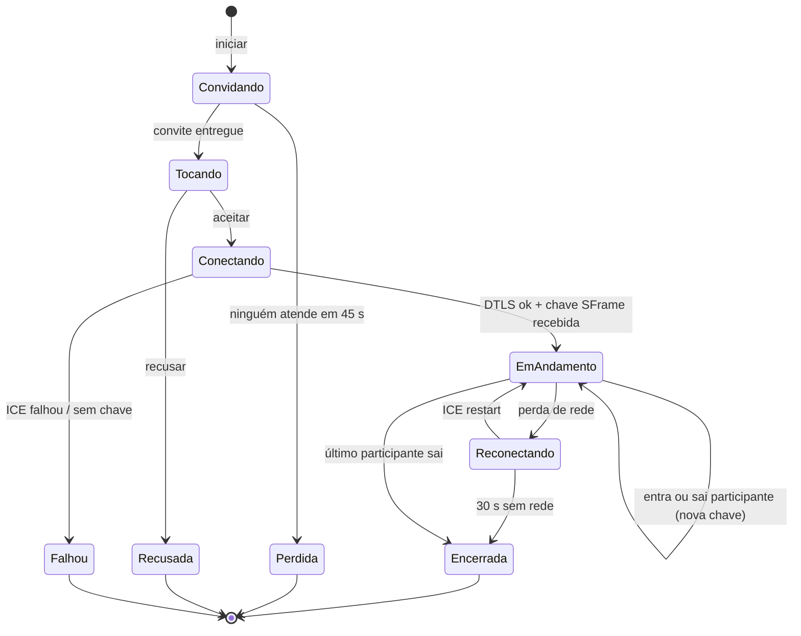
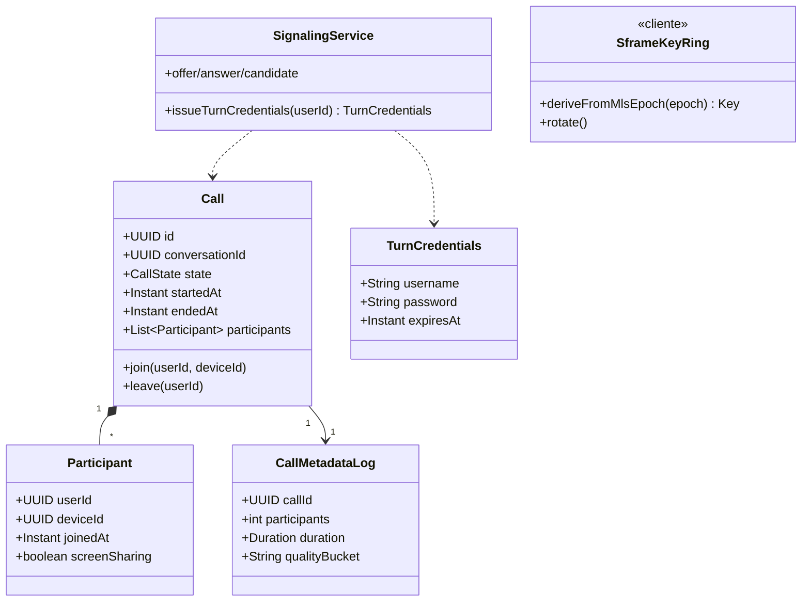
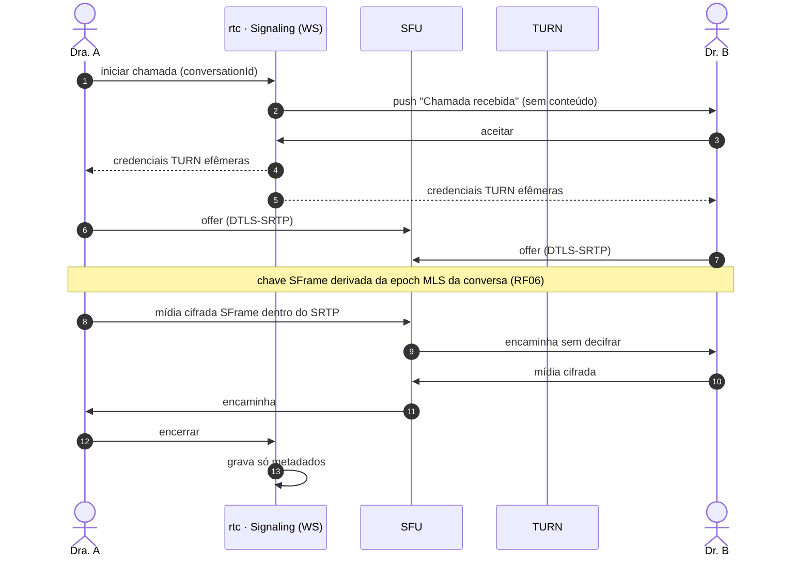
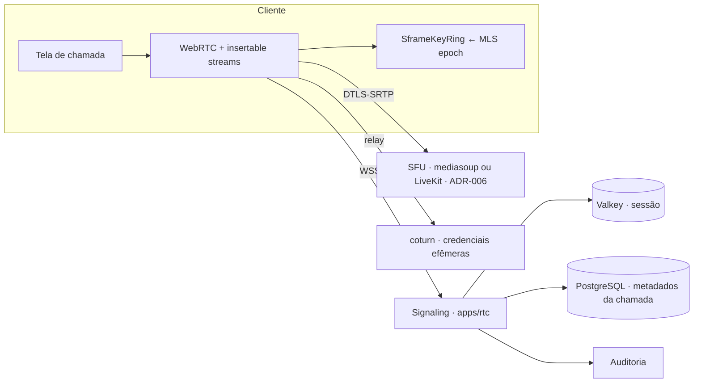
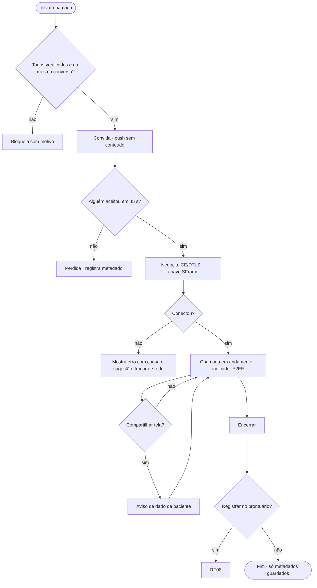

# RF07 · Chamadas de vídeo criptografadas ponta a ponta

## Critérios de aceite

1. Chamada 1:1 e em grupo (até 8 participantes no MVP) entre usuários `VERIFIED`.
2. Mídia por **WebRTC com DTLS-SRTP** (obrigatório) **mais** E2EE por *insertable streams* (SFrame, ADR-006).
   O SFU encaminha pacotes sem conseguir decifrar. A chave SFrame é distribuída pelo grupo MLS da
   conversa (RF06).
3. A tela mostra "Criptografada ponta a ponta", a qualidade da rede e quem está na chamada
   (heurística 1).
4. Compartilhamento de tela permitido, com aviso de que o conteúdo pode conter dado de paciente.
5. **Sem gravação no servidor.** Gravação local é bloqueada no app; não há como impedir captura externa,
   então o aviso aparece ao entrar.
6. Chamada **não** é consulta com paciente: a teleconsulta (Res. CFM 2.314/2022) fica fora do MVP. O
   convite só aceita usuários da plataforma.
7. Conversa clínica em chamada: botão "Registrar no prontuário" (RF08) ao encerrar.
8. Sinalização por WebSocket autenticado pela sessão; TURN com credenciais efêmeras (TTL 10 min).

## Máquina de estados (chamada)

## Classes

Só metadados (duração, participantes, qualidade) são guardados. Nunca conteúdo.

## Sequência

## Componentes

## Atividades

## Rastreabilidade

| Camada | Artefato | Status |
|---|---|---|
| Serviço | `apps/rtc` (signaling + SFU) | ⏳ |
| Cliente | `packages/rtc-client` (SFrame) | ⏳ |
| Infra | coturn, SFU em 3 AZs | ⏳ |
| Testes | 2 navegadores headless em chamada; verificação de que o SFU não decifra | ⏳ |
