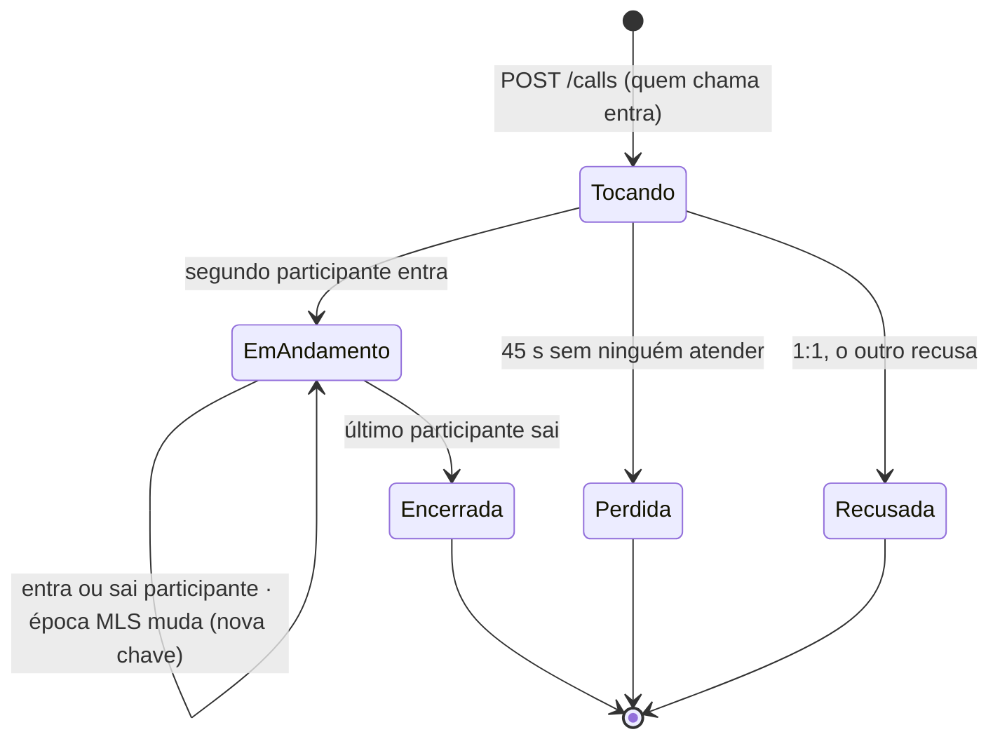
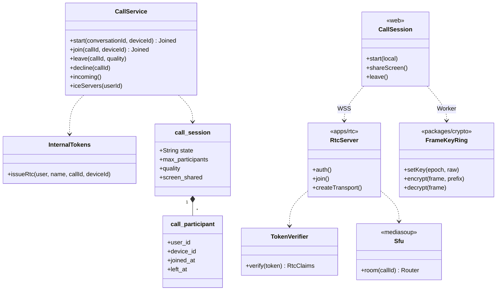
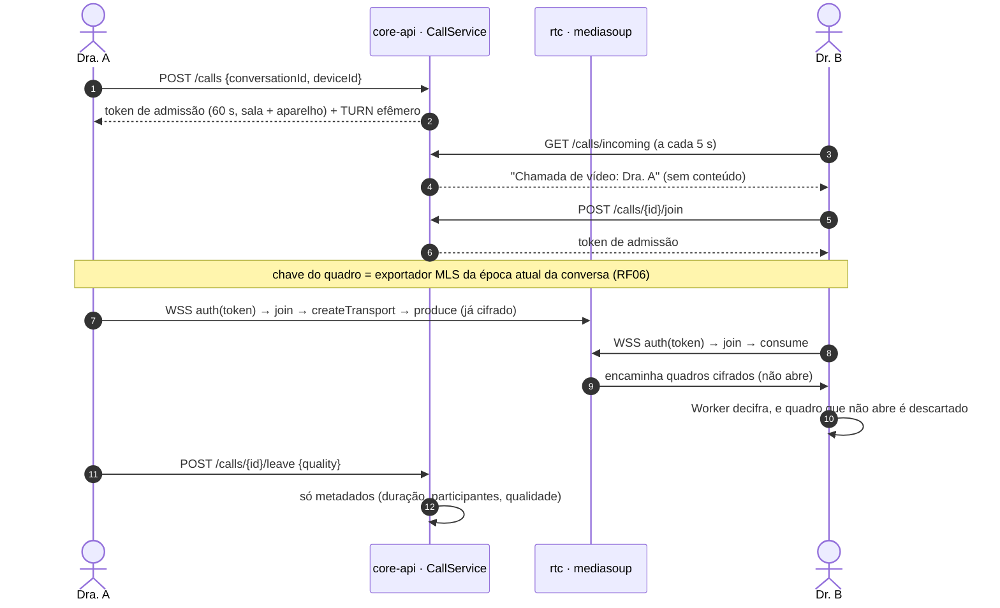
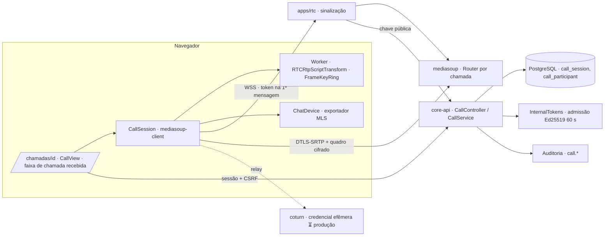
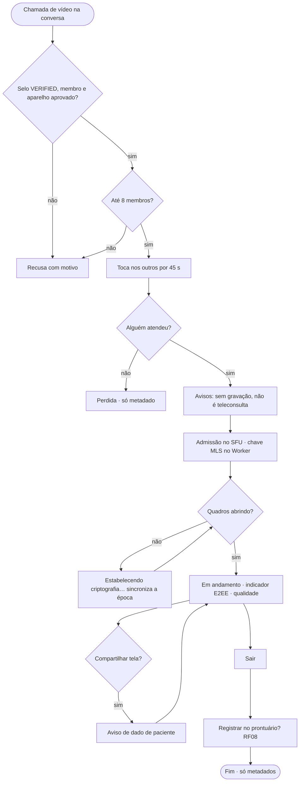

# RF07 · Chamadas de vídeo criptografadas ponta a ponta

## Critérios de aceite

1. Chamada 1:1 e em grupo (até 8 participantes no MVP) entre usuários `VERIFIED`.
2. Mídia por **WebRTC com DTLS-SRTP** (obrigatório) **mais** E2EE por *insertable streams* (SFrame, ADR-006).
   O SFU encaminha pacotes sem conseguir decifrar. A chave SFrame é distribuída pelo grupo MLS da
   conversa (RF06).
3. A tela mostra "Criptografada ponta a ponta", a qualidade da rede e quem está na chamada
   (heurística 1).
4. Compartilhamento de tela permitido, com aviso de que o conteúdo pode conter dado de paciente.
5. **Sem gravação no servidor.** Gravação local é bloqueada no app; não há como impedir captura externa,
   então o aviso aparece ao entrar.
6. Chamada **não** é consulta com paciente: a teleconsulta (Res. CFM 2.314/2022) fica fora do MVP. O
   convite só aceita usuários da plataforma.
7. Conversa clínica em chamada: botão "Registrar no prontuário" (RF08) ao encerrar.
8. Sinalização por WebSocket autenticado pela sessão; TURN com credenciais efêmeras (TTL 10 min).

### Como o MVP cumpre cada critério

| # | Implementação |
|---|---|
| 1 | Chamada a partir de uma conversa do chat (RF06), 1:1 ou grupo de até **8** membros (422 acima disso; o SFU também fecha a 9ª conexão com 4009). Começar, atender e entrar exigem selo `VERIFIED`, ser membro da conversa e um aparelho de chat **aprovado** do próprio usuário. |
| 2 | WebRTC (DTLS-SRTP) até o SFU **mediasoup** em `apps/rtc` + **E2EE por quadro** com `RTCRtpScriptTransform` num Worker, aplicado no `onRtpSender`/`onRtpReceiver` antes do primeiro quadro: AES-256-GCM com IV aleatório, trailer com a época, só o cabeçalho do codec em claro (VP8: 10/3 bytes; Opus: 1) e autenticado. A chave é o **exportador do grupo MLS** da conversa (RFC 9420 §8.5, rótulo `doctor-explorer/call/v1`, contexto = id da chamada): muda a cada época, o anel guarda as quatro últimas. O SFU só tem bytes cifrados: no e2e, trocar a chave de um lado faz os quadros falharem e o vídeo não decodificar. Só Opus e VP8 no roteador. |
| 3 | Selo "Criptografada ponta a ponta" que só acende quando quadros cifrados com a chave MLS estão abrindo; qualidade da rede (BOA / REGULAR / RUIM) pela perda de pacotes e RTT do `getStats`; lista de quem está na chamada. |
| 4 | "Compartilhar tela" pede confirmação com o aviso de dado de paciente e mostra um aviso fixo enquanto compartilha; o fluxo de tela é cifrado como o vídeo. |
| 5 | Sem gravação: nada da mídia passa pela core-api e o SFU não grava. Aviso antes de entrar: não há como impedir captura externa. Ficam só metadados (`call_session`, `call_participant`: quem, quando, duração, pico de participantes, pior qualidade relatada, se houve tela compartilhada). |
| 6 | Só membros da plataforma (conversa do chat); aviso de que não é teleconsulta. |
| 7 | Ao encerrar: "Registrar no prontuário" (RF08) e lembrete de que a chamada não é prontuário. |
| 8 | A core-api admite no SFU com o **token interno de 60 s** (ADR-008, Ed25519, não é JWT) com sala, aparelho e uso único; o SFU confere com a chave pública da core-api e a origem do navegador. O token vai como primeira mensagem do WebSocket, nunca na URL nem no armazenamento do navegador. TURN do coturn com credencial efêmera (REST API: usuário "validade:id", senha HMAC-SHA1, 10 min); o segredo vem só de variável de ambiente (`DE_TURN_SECRET`). |

Aviso de chamada recebida: faixa na área logada (quem chama e de qual conversa), por consulta a cada 5 s;
tocando por 45 s vira "perdida". Web Push sem conteúdo ⏳.

## Máquina de estados (chamada)

## Classes

## Sequência

## Componentes

## Atividades

## Rastreabilidade

| Camada | Artefato | Status |
|---|---|---|
| SFU | `apps/rtc` (Node 22 + mediasoup 3.31: WebSocket com admissão por token interno, origem permitida, até 8 por sala, router por chamada) | ✅ |
| Serviço | `CallService` + `CallController` (`/api/v1/calls`), `InternalTokens.issueRtc`, TURN efêmero | ✅ |
| Dados | `V12__chamadas.sql` (`call_session`, `call_participant`) | ✅ |
| Cliente | `packages/crypto/src/frames.ts` (`FrameKeyRing`), `lib/e2ee-worker.ts`, `lib/call-client.ts` (mediasoup-client), `/chamadas/[id]`, faixa de chamada recebida | ✅ |
| Infra | coturn em produção, SFU em 3 AZs, Web Push | ⏳ |
| Testes | `frames.test.ts` (ida e volta, chave errada, adulteração, troca de época), `server.test.ts` em apps/rtc (token, uso único, origem, limite de 8), `CallIT` (admissão, TURN, tocando → em andamento → encerrada, recusada, perdida, limite), e2e com dois navegadores headless (câmera falsa, vídeo decifrado dos dois lados, chave errada não abre) | ✅ |
