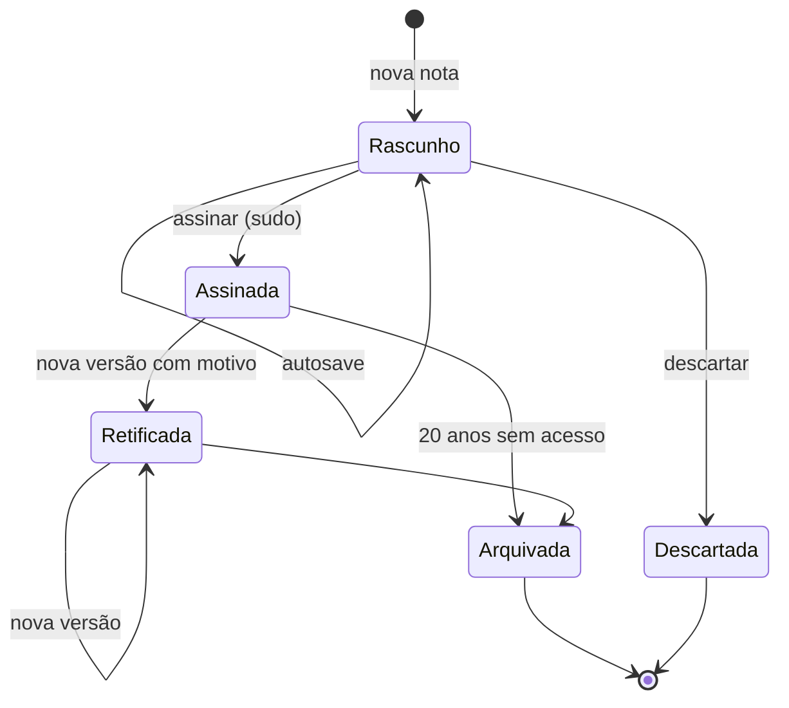
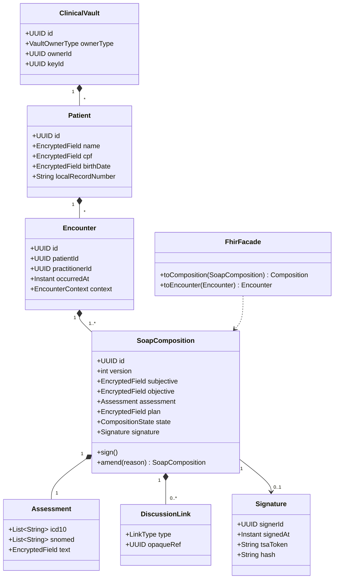
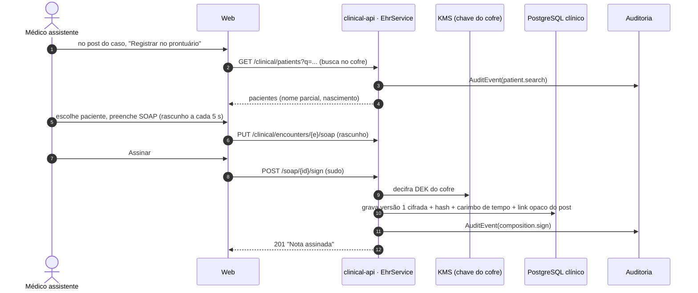
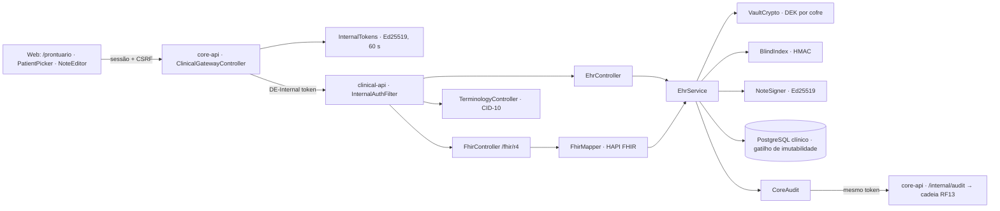

# RF08 · Prontuário eletrônico simplificado (SOAP) vinculado à discussão

O PEP vive na **`clinical-api`**, com banco e chaves separados (ADR-001). Modelo interno **openEHR**
(Composition por encontro) e fachada **FHIR R4** (ADR-003, ADR-004).

## Critérios de aceite

1. Só médico `VERIFIED` cria nota. O paciente é identificado no **cofre clínico** (do médico ou da
   instituição), nunca no fórum.
2. A nota tem os quatro campos SOAP: Subjetivo, Objetivo, Avaliação (com CID-10 e, opcionalmente,
   SNOMED CT) e Plano. Rascunho salvo a cada 5 s.
3. Pode vincular um post de caso (RF04), uma conversa (RF06) ou uma chamada (RF07) pelo **id opaco**. O
   fórum nunca recebe o id do paciente.
4. Assinatura: no MVP, assinatura eletrônica avançada (sessão + sudo + carimbo de tempo do servidor).
   ICP-Brasil é obrigatório para receita e exame (RF09); para a nota é **⚖️ validar** com o Diretor-Técnico
   (Res. CFM 1.821/2007 e SBIS NGS2 exigem ICP-Brasil para eliminar o papel).
5. Nota assinada é **imutável**. Correção gera nova versão com motivo; as duas ficam visíveis.
6. Guarda mínima de **20 anos** desde o último registro; a chave do cofre não é destruída pela exclusão
   da conta social.
7. Toda leitura e escrita gera `AuditEvent` (quem, quando, qual paciente, por quê).
8. `/fhir/r4/Composition`, `Encounter`, `Patient`, `Practitioner`, `Condition`, `Provenance` expostos e
   validados contra os perfis no CI.

### Como o MVP cumpre cada critério

| # | Implementação |
|---|---|
| 1 | A `clinical-api` só aceita o token interno da core-api (ADR-008) e recusa selo diferente de VERIFIED. Cofre pessoal do médico criado no primeiro uso (upsert, seguro em paralelo); nome, nascimento e CPF cifrados por cofre (AES-256-GCM, DEK por cofre embrulhada pela KEK; AAD "tabela.coluna:id"). Busca por nome com índice cego (HMAC por cofre dos prefixos de cada palavra, sem acento): o banco não vê nome nem termo buscado. O cofre da instituição está modelado (`owner_type = INSTITUTION`) e entra com o RF11. |
| 2 | S, O, A (texto + CID-10 da tabela do DATASUS embarcada + SNOMED CT opcional por formato) e P. O editor salva o rascunho a cada 5 s quando algo mudou (`PUT /compositions/{id}`). Assinar exige S, O, P e ao menos um CID-10. |
| 3 | `links[]` com `{type: POST \| CONVERSATION \| CALL, ref: id opaco}`. "Registrar no prontuário" no caso abre `/prontuario/nova?post={id}`; a core-api não grava nada do paciente e o fórum não recebe nada da nota. |
| 4 | Assinatura eletrônica avançada: sudo recente (claim `sudoUntil` do token) + carimbo de tempo do servidor + Ed25519 da `clinical-api` sobre o SHA-256 do JSON canônico (inclui o hash da versão anterior). ⚖️ ICP-Brasil para a nota segue em validação com o Diretor-Técnico. |
| 5 | Assinada é imutável na API (409 `nota-imutavel`) e no banco (gatilho `soap_composition_guard` recusa qualquer UPDATE de conteúdo ou DELETE). Correção = `POST /amend` com motivo (≥ 10 caracteres) → nova versão em rascunho; ao assinar, a anterior vira RETIFICADA e aponta para a nova; `GET /versions` mostra todas, cada uma com a integridade conferida na hora. |
| 6 | Sem rota de exclusão de paciente ou nota assinada; `last_record_at` marca o início do prazo de 20 anos. A exclusão da conta social (RF10) não toca o banco nem a chave da `clinical-api` (segredo e banco próprios). |
| 7 | Toda leitura e escrita chama `POST /api/v1/internal/audit` da core-api com o mesmo token: `clinical.patient_list/search/create/read`, `clinical.composition_create/draft/read/versions/sign/amend/discard`, `clinical.fhir_read`; `patientRef` é o id opaco do cofre; o termo buscado e o conteúdo nunca vão para o evento. Sem auditoria a operação falha (503) e a escrita é desfeita. |
| 8 | `/fhir/r4` (somente leitura) com Patient, Practitioner, Encounter, Composition (LOINC 11506-3, seções S/O/A/P com LOINC, `attester` e `relatesTo: replaces`), Condition (CID-10 BR), Provenance (assinatura) e `metadata`; `FhirValidationIT` valida tudo contra os perfis base R4 no CI. Perfis da RNDS ⏳. |

## Base legal

Res. CFM 1.638/2002 (prontuário), 1.821/2007 (digitalização e guarda), Lei 13.787/2018 (20 anos) ·
LGPD Art. 11, II, "f" (tutela da saúde) e Art. 16, I (conservação por obrigação legal).

## Máquina de estados

## Classes

## Sequência: registrar discussão no prontuário

## Componentes

## Atividades

## Rastreabilidade

| Camada | Artefato | Status |
|---|---|---|
| Serviço | `apps/clinical-api` (Spring Boot 4.1, banco e segredo próprios, Jib, porta 8081) | ✅ |
| Migração | `clinical V1__ehr.sql` (cofre, médico, paciente cifrado, índice cego, encontro, nota SOAP versionada, gatilho de imutabilidade) | ✅ |
| Domínio | `ClinicalVault`, `Practitioner`, `Patient`, `Encounter`, `SoapComposition` (RASCUNHO → ASSINADA → RETIFICADA, DESCARTADA) | ✅ |
| Segurança | token interno (`InternalTokens` na core-api, `InternalTokenVerifier`/`InternalAuthFilter` na clinical-api), `VaultCrypto`, `BlindIndex`, `NoteSigner` | ✅ |
| Integração | `ClinicalGatewayController` (`/api/v1/clinical/**`), `InternalController` (`/api/v1/internal/public-key`, `/api/v1/internal/audit`), `CoreAudit` | ✅ |
| Terminologia | CID-10 completo do DATASUS (14 496 códigos) em `terminology/cid10.tsv`, busca por código e palavras | ✅ |
| FHIR | `FhirMapper`, `FhirController`, validação HAPI no CI; perfis BR da RNDS | ✅ / ⏳ RNDS |
| Web | `/prontuario` (cofre), `/prontuario/pacientes/[id]`, `/prontuario/nova?post=` (a partir da discussão), `/prontuario/notas/[id]` (editor com rascunho a cada 5 s, CID-10, assinar com sudo, corrigir, versões) | ✅ |
| Infra | `infra/postgres/10-clinical.sql` (banco e usuário separados no Compose), job `clinical-api` no CI, CodeQL e Trivy na imagem; KMS e instância separada em produção | ✅ / ⏳ produção |
| Testes | `CryptoTest`, `Cid10Test`, `InternalTokenVerifierTest`, `EhrIT` (token, selo, cofre isolado, busca cega, rascunho → assinatura → imutável na API e no banco → retificação, auditoria sem dado do paciente, falha fechada sem auditoria, primeiro uso em paralelo), `FhirValidationIT`, `ClinicalGatewayIT` (core), e2e no navegador | ✅ |
