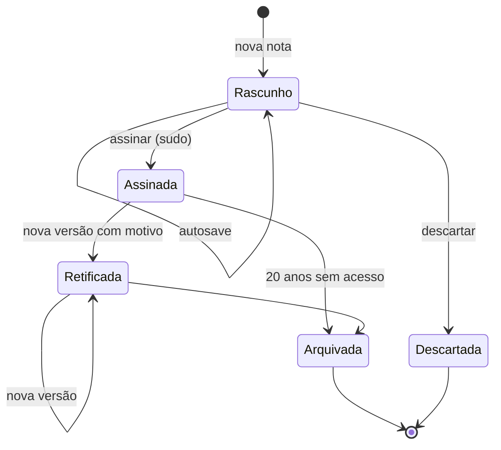
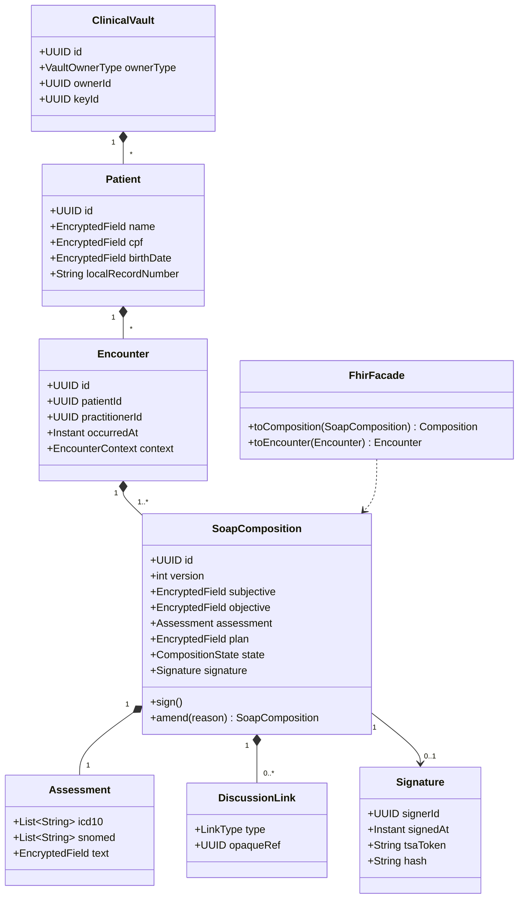
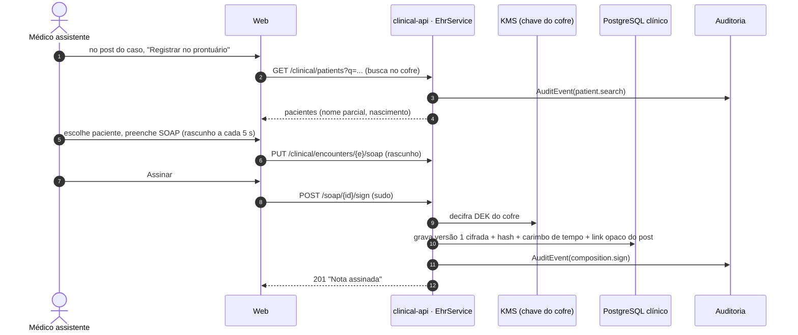
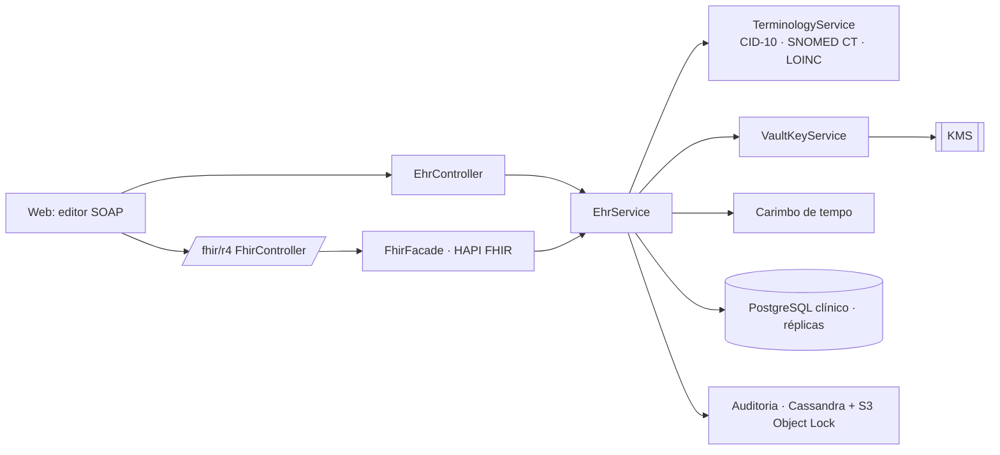
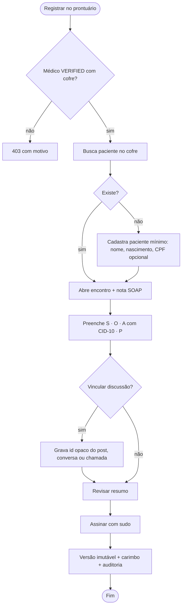

# RF08 · Prontuário eletrônico simplificado (SOAP) vinculado à discussão

O PEP vive na **`clinical-api`**, com banco e chaves separados (ADR-001). Modelo interno **openEHR**
(Composition por encontro) e fachada **FHIR R4** (ADR-003, ADR-004).

## Critérios de aceite

1. Só médico `VERIFIED` cria nota. O paciente é identificado no **cofre clínico** (do médico ou da
   instituição), nunca no fórum.
2. A nota tem os quatro campos SOAP: Subjetivo, Objetivo, Avaliação (com CID-10 e, opcionalmente,
   SNOMED CT) e Plano. Rascunho salvo a cada 5 s.
3. Pode vincular um post de caso (RF04), uma conversa (RF06) ou uma chamada (RF07) pelo **id opaco**. O
   fórum nunca recebe o id do paciente.
4. Assinatura: no MVP, assinatura eletrônica avançada (sessão + sudo + carimbo de tempo do servidor).
   ICP-Brasil é obrigatório para receita e exame (RF09); para a nota é **⚖️ validar** com o Diretor-Técnico
   (Res. CFM 1.821/2007 e SBIS NGS2 exigem ICP-Brasil para eliminar o papel).
5. Nota assinada é **imutável**. Correção gera nova versão com motivo; as duas ficam visíveis.
6. Guarda mínima de **20 anos** desde o último registro; a chave do cofre não é destruída pela exclusão
   da conta social.
7. Toda leitura e escrita gera `AuditEvent` (quem, quando, qual paciente, por quê).
8. `/fhir/r4/Composition`, `Encounter`, `Patient`, `Practitioner`, `Condition`, `Provenance` expostos e
   validados contra os perfis no CI.

## Base legal

Res. CFM 1.638/2002 (prontuário), 1.821/2007 (digitalização e guarda), Lei 13.787/2018 (20 anos) ·
LGPD Art. 11, II, "f" (tutela da saúde) e Art. 16, I (conservação por obrigação legal).

## Máquina de estados

## Classes

## Sequência: registrar discussão no prontuário

## Componentes

## Atividades

## Rastreabilidade

| Camada | Artefato | Status |
|---|---|---|
| Migração | `clinical V1__ehr.sql` | ⏳ |
| Domínio | `ClinicalVault`, `Patient`, `Encounter`, `SoapComposition` | ⏳ |
| FHIR | `FhirFacade`, perfis BR | ⏳ |
| Testes | `SoapSignIT`, `FhirValidationIT` (validador HAPI) | ⏳ |
