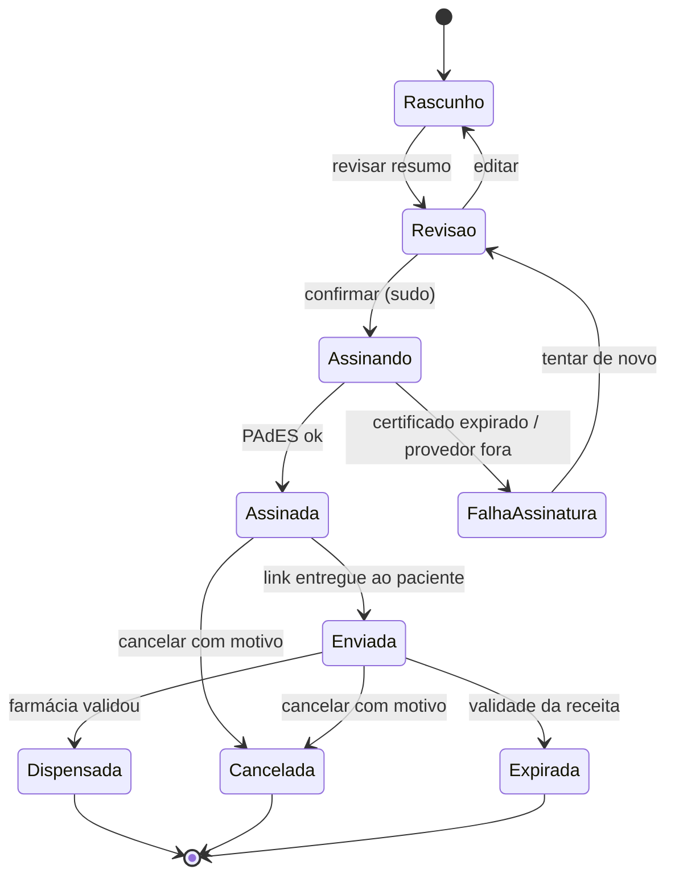
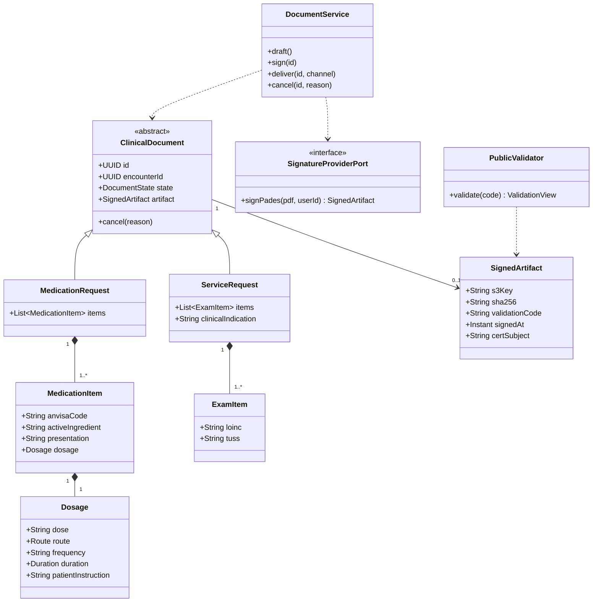
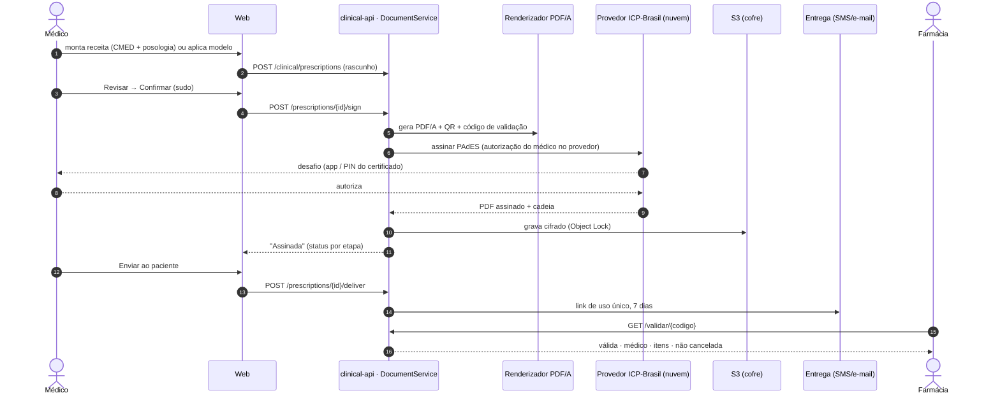
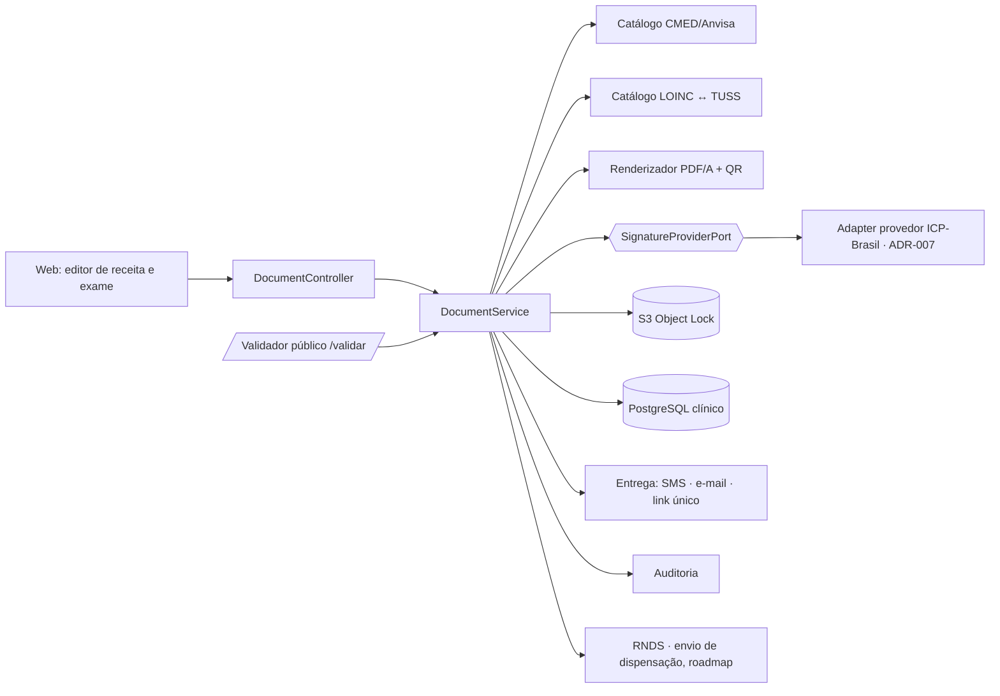
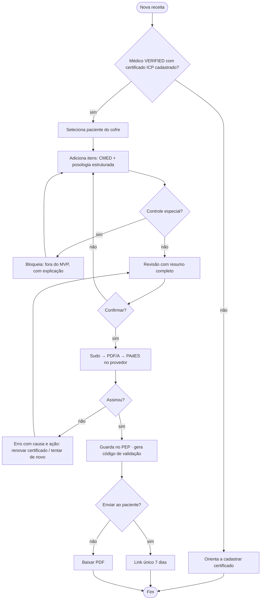

# RF09 · Prescrição eletrônica e solicitação de exames com assinatura ICP-Brasil

## Critérios de aceite

1. Receita simples e pedido de exame no MVP. **Receita de controle especial** (Portaria 344/1998) e
   atestado ficam fora **⚖️**.
2. Medicamento escolhido da base **CMED/Anvisa** (princípio ativo, apresentação); posologia estruturada
   (dose, via, frequência, duração) e convertida para FHIR `Dosage`. Exame escolhido por **LOINC** com
   mapeamento TUSS.
3. Confirmação com resumo antes de assinar (heurística 5). Assinatura **PAdES** com certificado
   **ICP-Brasil** do médico via provedor de assinatura em nuvem (ADR-007), em sudo.
4. O PDF/A segue o padrão do CFM: identificação do médico (CRM/UF), do paciente, data, QR code e URL
   para validação pela farmácia (validador público, sem login, que mostra só o necessário).
5. Entrega ao paciente por link de uso único (SMS/e-mail) com validade de 7 dias, ou PDF baixado pelo
   médico. O documento fica no PEP (RF08) por 20 anos.
6. Documento assinado não se apaga: **cancela** com motivo; o validador mostra "cancelada".
7. Feedback por etapa: rascunho → assinando no provedor → assinada → enviada (heurística 1).
8. Modelos de receita por médico (heurística 7). Alertas de dose e alergia **fora do MVP** por risco de
   enquadramento SaMD **⚖️**.

## Base legal

Res. CFM 2.299/2021 (prescrição eletrônica) · Lei 14.063/2020 (assinatura eletrônica) · MP 2.200-2/2001
(ICP-Brasil) · Portaria 344/1998 · Res. CFM 1.821/2007 · LGPD Art. 11, II, "f".

## Máquina de estados

## Classes

## Sequência: emitir receita

## Componentes

## Atividades

## Rastreabilidade

| Camada | Artefato | Status |
|---|---|---|
| Domínio | `MedicationRequest`, `ServiceRequest`, `SignedArtifact` | ⏳ |
| Integração | adapter ICP-Brasil (ADR-007), catálogos CMED/LOINC | ⏳ |
| API pública | `/validar/{codigo}` | ⏳ |
| Testes | `PrescriptionSignIT` com provedor simulado; validação PAdES com biblioteca independente | ⏳ |
