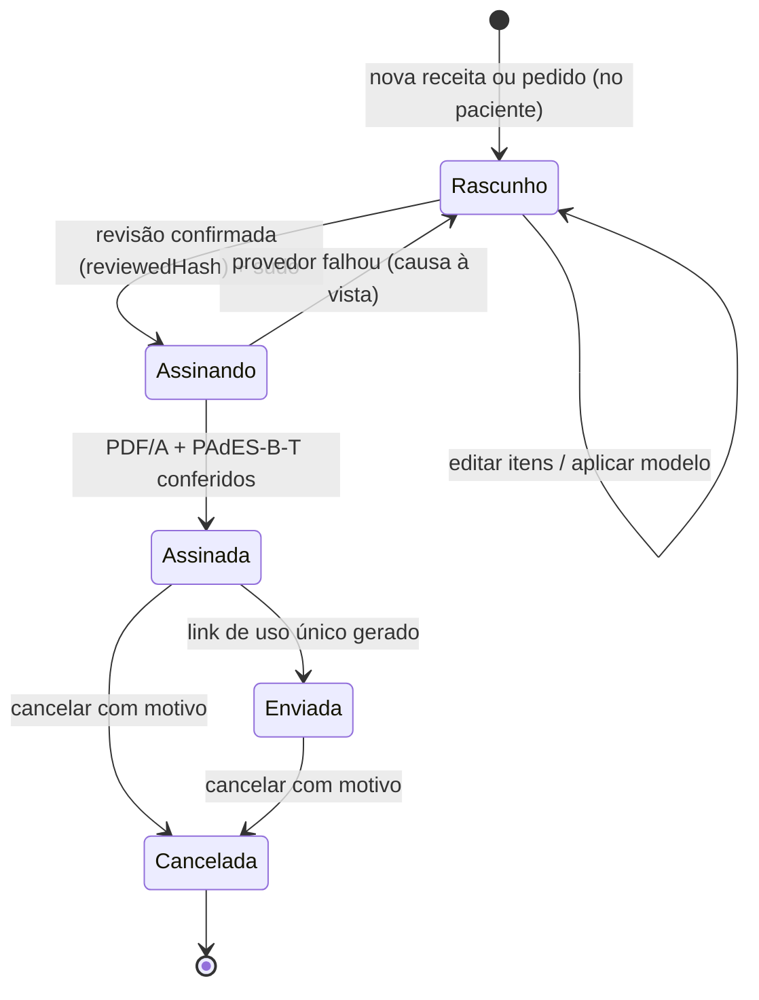
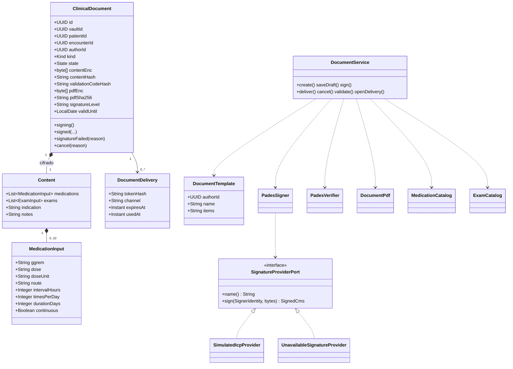
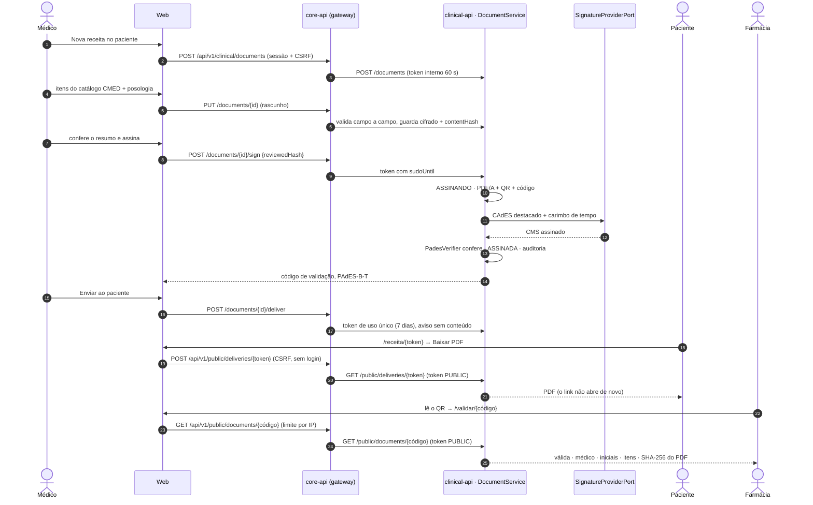
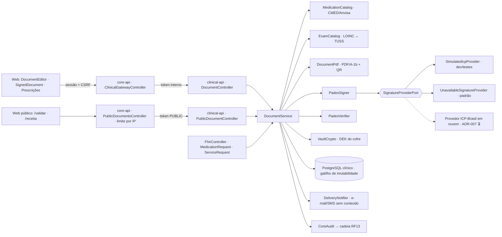
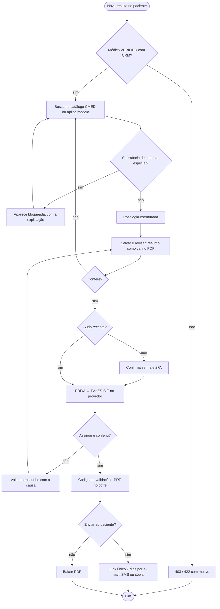

# RF09 · Prescrição eletrônica e solicitação de exames com assinatura ICP-Brasil

## Critérios de aceite

1. Receita simples e pedido de exame no MVP. **Receita de controle especial** (Portaria 344/1998) e
   atestado ficam fora **⚖️**.
2. Medicamento escolhido da base **CMED/Anvisa** (princípio ativo, apresentação); posologia estruturada
   (dose, via, frequência, duração) e convertida para FHIR `Dosage`. Exame escolhido por **LOINC** com
   mapeamento TUSS.
3. Confirmação com resumo antes de assinar (heurística 5). Assinatura **PAdES** com certificado
   **ICP-Brasil** do médico via provedor de assinatura em nuvem (ADR-007), em sudo.
4. O PDF/A segue o padrão do CFM: identificação do médico (CRM/UF), do paciente, data, QR code e URL
   para validação pela farmácia (validador público, sem login, que mostra só o necessário).
5. Entrega ao paciente por link de uso único (SMS/e-mail) com validade de 7 dias, ou PDF baixado pelo
   médico. O documento fica no PEP (RF08) por 20 anos.
6. Documento assinado não se apaga: **cancela** com motivo; o validador mostra "cancelada".
7. Feedback por etapa: rascunho → assinando no provedor → assinada → enviada (heurística 1).
8. Modelos de receita por médico (heurística 7). Alertas de dose e alergia **fora do MVP** por risco de
   enquadramento SaMD **⚖️**.

### Como o MVP cumpre cada critério

| # | Implementação |
|---|---|
| 1 | `RECEITA` e `EXAME`. Controle especial é decidido **por substância**, não pela linha da CMED (a tarja varia entre apresentações: há alprazolam "vermelha" e "não informada"): a substância com alguma apresentação de tarja preta ou venda sob retenção (fora os antibacterianos J1), e as classes EphMRA N2A, N5A, N5C e N6A, aparecem na busca marcadas e não entram (422 com a explicação da Portaria 344). Kits com antibiótico fora da classe J1 (ex.: H. pylori, A2B2) ficam fora por cautela. Antibacteriano J1 entra como receita simples de **2 vias com validade de 10 dias** (RDC 471/2021). |
| 2 | Catálogo **CMED/Anvisa** (PMC de 09/10/2026, sem uso hospitalar) embarcado por GGREM; posologia estruturada (dose, unidade, via, intervalo **ou** vezes ao dia, duração ou uso contínuo, quantidade, orientações) validada campo a campo (422 em `medications[i].campo`), escrita por extenso no PDF ("1 cápsula por via oral, de 8 em 8 horas, por 7 dias") e mapeada para FHIR `MedicationRequest.dosageInstruction` (`timing.repeat`, `route`, `doseAndRate`). Exames por **LOINC com TUSS** (tabela 22) → FHIR `ServiceRequest`. `FhirValidationIT` valida os dois contra os perfis base R4. |
| 3 | Fluxo Itens → **Revisão** (o resumo é o que vai no PDF, e o servidor guarda o SHA-256 do conteúdo revisto) → Assinatura. `POST /sign` exige `reviewedHash` igual ao do rascunho (409 `revisao-desatualizada` se algo mudou) e **sudo** recente. **PAdES-B-T**: CAdES destacado (`ETSI.CAdES.detached`, `signing-certificate-v2`) com carimbo de tempo RFC 3161; o `PadesVerifier` confere cobertura do `/ByteRange`, a assinatura CMS, a cadeia até a âncora e o carimbo antes de aceitar o resultado do provedor. Provedor por porta (`SignatureProviderPort`, ADR-007): `simulated` em dev e testes (AC raiz e TSA "ICP-Brasil SIMULADA" derivadas do segredo, CRM no `otherName` 2.16.76.1.4.2.1.1, marcada "sem validade jurídica" no PDF e no validador) e `unavailable` como padrão fora de dev, que falha com causa e deixa o rascunho intacto. O adapter do provedor em nuvem real é ⏳. |
| 4 | **PDF/A-1b** (PDFBox, fontes DejaVu embutidas, `OutputIntent` sRGB, XMP `pdfaid`), conferido pelo validador de PDF/A no teste antes e depois de assinar: médico (nome, CRM/UF), paciente (nome, nascimento), data e hora, itens, **QR** e URL `/validar/{código}`. Código de 16 caracteres Crockford (`XXXX-XXXX-XXXX-XXXX`, aceita minúsculas, espaços e O/I/L trocados); o banco guarda o SHA-256 do código e uma cópia cifrada. **Validador público** sem login (`/validar`, `/validar/{código}` → `GET /api/v1/public/documents/{código}`): situação, médico, **iniciais** do paciente, itens, assinatura conferida na hora e o SHA-256 do PDF; 30 consultas por IP a cada 10 min. |
| 5 | **Link de uso único** de 7 dias (`/receita/{token}`; o banco guarda só o hash do token): o PDF sai por `POST` com CSRF ao clicar, para que antivírus e pré-visualizadores de e-mail não gastem o uso. E-mail e SMS levam só "Dr(a). X enviou um documento", sem nome do paciente, medicamento ou diagnóstico; no MVP o envio é registrado no log com destino mascarado (`LoggingDeliveryNotifier`) e o provedor real de e-mail/SMS é ⏳. O médico também baixa o PDF. O documento fica no cofre da `clinical-api` (PDF cifrado com a DEK do cofre, no PostgreSQL clínico) e não tem rota de exclusão; S3 com Object Lock é ⏳. |
| 6 | Assinado é imutável na API (409 `documento-imutavel`) e no banco (gatilho `clinical_document_guard` recusa UPDATE de conteúdo e DELETE). `POST /cancel` com motivo (≥ 10 caracteres): o validador mostra "cancelado" (sem o motivo), os links abertos deixam de funcionar (410) e não se gera link novo (409). |
| 7 | Estados `RASCUNHO → ASSINANDO → ASSINADA → ENVIADA`, `CANCELADA`, com indicador de etapas (Itens, Revisão, Assinatura, Entrega). Falha do provedor volta a `RASCUNHO` com `failureReason` à vista e sem perder nada; `ASSINANDO` preso há mais de 2 min pode ser assinado de novo. |
| 8 | Modelos por médico (`/document-templates`): guardam só os itens, nunca o paciente nem as observações; nome único por médico. Sem alertas de dose ou alergia. |

Também: a lista "Prescrições" mostra os 50 documentos mais recentes do médico, de todos os pacientes;
toda leitura e escrita vai para a auditoria (`clinical.document_*`, inclusive `document_validate` e
`document_delivery_open` com ator anônimo, que o token público só consegue registrar), sem conteúdo nem
código de validação.

## Base legal

Res. CFM 2.299/2021 (prescrição eletrônica) · Lei 14.063/2020 (assinatura eletrônica) · MP 2.200-2/2001
(ICP-Brasil) · Portaria 344/1998 · Res. CFM 1.821/2007 · LGPD Art. 11, II, "f".

## Máquina de estados

A validade (10 dias para antimicrobiano) não muda o estado: o validador mostra "fora da validade" a
partir do dia seguinte ao prazo. A dispensação pela farmácia (e o envio à RNDS) é roadmap.

## Classes

## Sequência: emitir, entregar e validar uma receita

## Componentes

## Atividades

## Rastreabilidade

| Camada | Artefato | Status |
|---|---|---|
| Migração | `clinical V2__documentos.sql` (`clinical_document` com gatilho de imutabilidade, `document_delivery`, `document_template`) | ✅ |
| Domínio | `ClinicalDocument`, `DocumentDelivery`, `DocumentTemplate`, `DocumentViews`, `Posology` | ✅ |
| Catálogos | `MedicationCatalog` (CMED/Anvisa, controle especial por substância), `ExamCatalog` (LOINC ↔ TUSS 22), `CatalogController` | ✅ |
| Assinatura | `SignatureProviderPort`, `SimulatedIcpProvider`, `UnavailableSignatureProvider`, `PadesSigner`, `PadesVerifier`, `DocumentPdf` (PDF/A-1b + QR) | ✅ / ⏳ provedor real |
| API | `DocumentController` (`/documents`, `/sign`, `/pdf`, `/deliver`, `/cancel`, `/document-templates`), `PublicDocumentController` (`/public/**`, só token PUBLIC); core-api `PublicDocumentsController` (`/api/v1/public/documents/{código}`, `POST /api/v1/public/deliveries/{token}`) e gateway com `documents`, `document-templates`, `catalog` | ✅ |
| FHIR | `MedicationRequest` e `ServiceRequest` em `/fhir/r4` (por id e `?patient=`) | ✅ |
| Entrega | `DeliveryNotifier` com `LoggingDeliveryNotifier` no MVP; provedor de e-mail/SMS | ✅ / ⏳ |
| Web | `/prontuario/documentos/[id]` (editor por etapas, revisão, sudo, entrega, cancelamento), "Prescrições", receitas na ficha do paciente, `/validar`, `/validar/[código]`, `/receita/[token]`; confirmações por etapa ("Receita assinada.", link copiado, envio) como aviso na tela | ✅ |
| Testes | `PadesPipelineTest` (PDF/A-1b no preflight antes e depois de assinar, PAdES-B-T, adulteração e AC estranha recusadas), `MedicationCatalogTest`, `DocumentIT`, `SignatureProviderDownIT`, `FhirValidationIT`, `ClinicalGatewayIT` (core), e2e no navegador (bloqueio de controle especial, assinatura, validador sem login, uso único, cancelamento) | ✅ |
