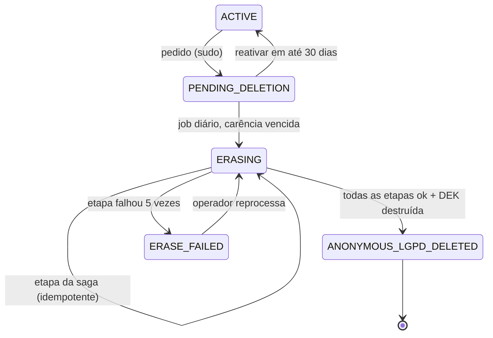
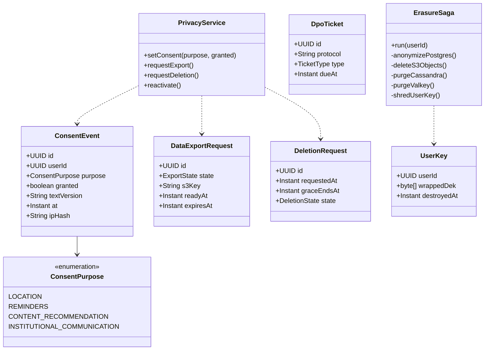
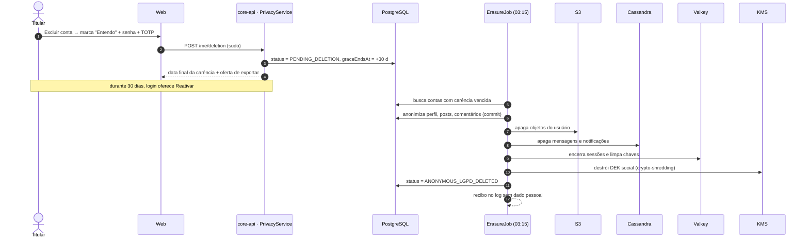
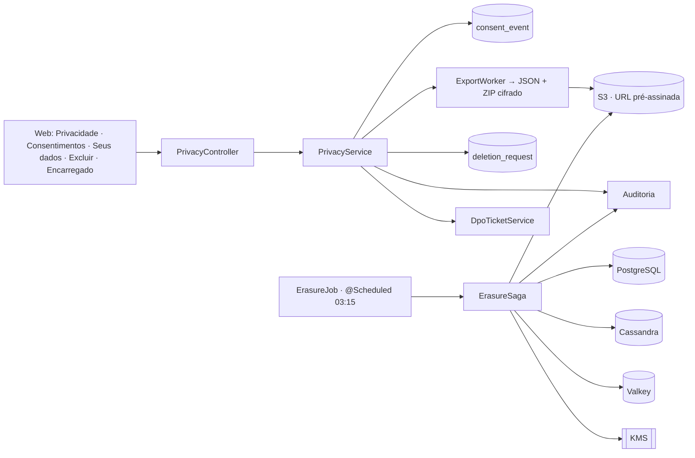
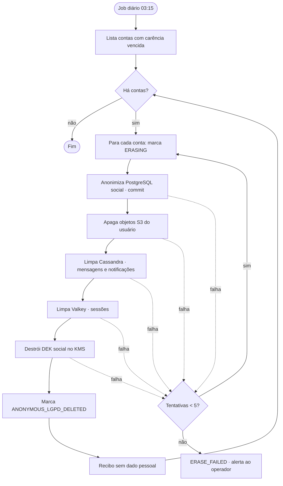

# RF10 · Consentimentos, painel do titular e exclusão de conta (LGPD)

## Critérios de aceite

1. **Consentimentos:** um toggle por finalidade (localização, lembretes, recomendação de conteúdo,
   comunicação institucional), **todos desligados por padrão**. Revogar usa o mesmo controle. Histórico
   completo em `consent_event` (quem, quando, versão do texto, IP).
2. **Seus dados:** ver o que guardamos por categoria, **corrigir** cadastro, **exportar** (JSON versionado
   + ZIP cifrado por URL pré-assinada, pronto em até 24 h), e pedir informação sobre compartilhamento
   (lista de operadores).
3. **Excluir conta:** `alertdialog` com consequências, data final da carência (30 dias), "Baixar uma
   cópia", caixa "Entendo" + senha + TOTP; botão só habilita depois da caixa. Explica que **registros
   clínicos ficam guardados por 20 anos** por obrigação legal.
4. **Reativar:** oferta no login durante a carência.
5. **Eliminação:** saga idempotente em job diário (03:15): anonimiza o PostgreSQL social, remove objetos
   do S3 **depois do commit**, limpa Cassandra e Valkey e destrói a **DEK social** (crypto-shredding).
   Recibo sem dado pessoal no log.
6. **Canal do Encarregado:** formulário autenticado ou e-mail, protocolo, prazo de resposta de 15 dias
   **⚖️ validar**.
7. Dado de saúde nunca vai em log, URL, analytics ou push.

## Base legal

LGPD Art. 7º, I; Art. 8º §5º; Art. 9º; Art. 11, I; Art. 16, I; Art. 18 (I a IX); Art. 37; Art. 41; Art. 46.

## Máquina de estados (conta, visão LGPD)

## Classes

## Sequência: exclusão com carência

## Componentes

## Atividades: saga de eliminação

Registros clínicos (RF08, RF09) **não** entram na saga: ficam no cofre clínico, com a chave do cofre, por
20 anos.

## Rastreabilidade

| Camada | Artefato | Status |
|---|---|---|
| Migração | `V1` (consent_event, terms_acceptance, user_key) | ⏳ |
| Serviço | `PrivacyService`, `ErasureSaga`, `ExportWorker` | ⏳ |
| Job | `ErasureJob` | ⏳ |
| Web | telas de Privacidade | ⏳ |
| Testes | `DeletionSagaIT` (idempotência, falha no meio), `ConsentIT` | ⏳ |
