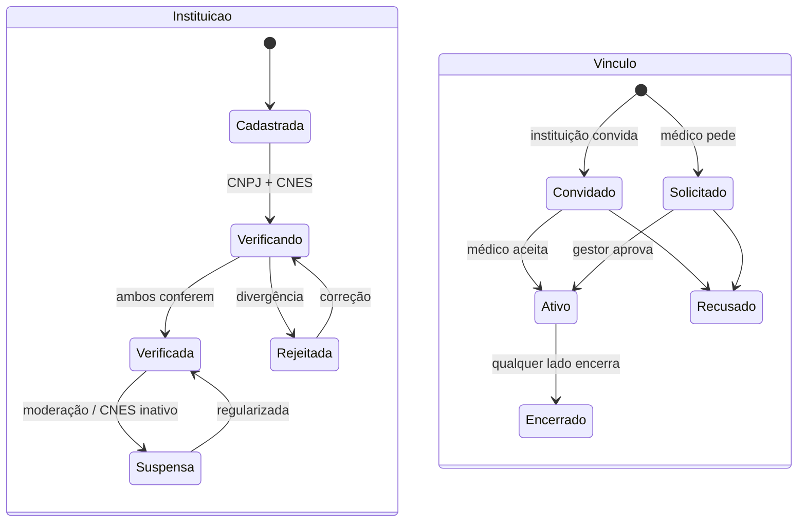
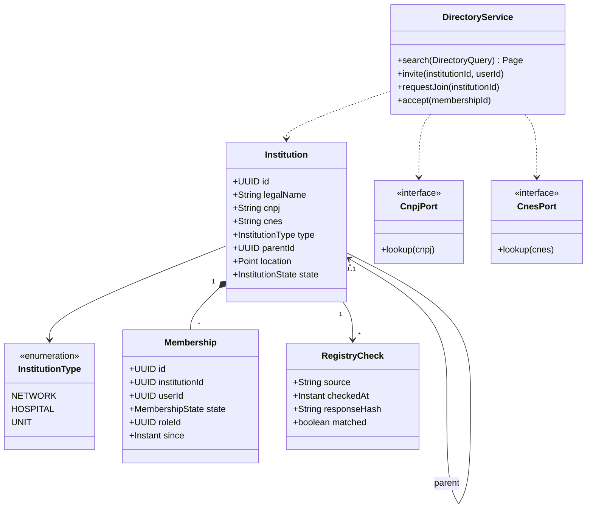
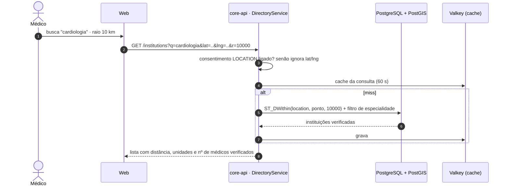
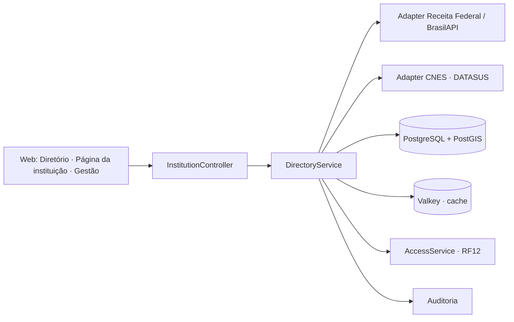
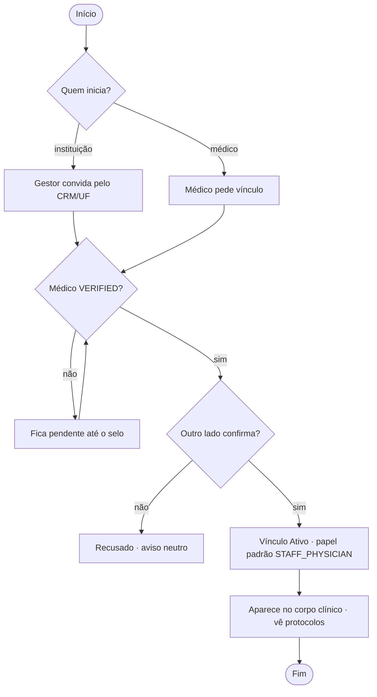

# RF11 · Diretório de redes hospitalares e corpo clínico verificado

## Critérios de aceite

1. Instituição cadastrada por gestor com e-mail institucional, **CNPJ** (Receita Federal) e **CNES**
   (DATASUS) conferidos. Sem conferência, não aparece no diretório.
2. Hierarquia: **rede → hospital → unidade** (UTI, centro cirúrgico, pronto-socorro). A unidade herda a
   instituição pai.
3. Vínculo médico–instituição aceito pelos **dois lados**: a instituição convida ou o médico pede, e o
   outro confirma. Só médicos `VERIFIED` aparecem no corpo clínico.
4. Busca por nome, cidade, especialidade e raio (PostGIS) com filtros; a localização do usuário só é
   usada se o consentimento `LOCATION` estiver ligado (RF10).
5. Página da instituição: dados públicos do CNES, unidades, corpo clínico (nome, CRM, especialidade),
   contatos institucionais. Nada de dado de paciente.
6. Instituição pode exibir **protocolos e comunicados** para o corpo clínico (visíveis só aos vinculados).

## Base legal

Portaria MS 1.646/2015 (CNES) · LGPD Art. 7º, V (execução de contrato) para dados do gestor ·
Res. CFM 2.147/2016 (diretor técnico e clínico) **⚖️ validar**.

## Máquina de estados (instituição e vínculo)

## Classes

## Sequência: busca por raio

## Componentes

## Atividades: vínculo médico–instituição

## Rastreabilidade

| Camada | Artefato | Status |
|---|---|---|
| Migração | `V5__instituicoes.sql` (institution com hierarquia por `parent_id`, institution_check, institution_membership, audiência INSTITUTION em case_post) | ✅ |
| Domínio | `Institution` (NETWORK/HOSPITAL/UNIT, VERIFICANDO→VERIFICADA/REJEITADA), `InstitutionMembership` (papéis com hierarquia, INVITED/REQUESTED/ACTIVE), `InstitutionCheck` | ✅ |
| Serviço | `DirectoryService`: cadastro com validação completa, conferência CNPJ (situação ATIVA) + CNES (mesmo CNPJ), quem cadastra vira gestor, vínculo aceito pelos dois lados, papéis na árvore, corpo clínico só com selo VERIFIED | ✅ |
| Serviço | `InstitutionTreePolicy`: papel efetivo = maior papel ativo na instituição ou em ancestral (herda para baixo, nunca para cima); concede no máximo o próprio papel | ✅ |
| Integração | `RegistryPorts` com `FakeRegistries` (dev/it) e `HttpRegistries` (BrasilAPI para CNPJ, dados abertos DATASUS para CNES) | ✅ (contrato HTTP ⚖️) |
| Busca | `Institutions.search`: texto, UF e raio por Haversine em SQL; raio só com consentimento LOCATION (RF10) | ✅ (PostGIS/GiST: ADR-013) |
| API | `GET /institutions` (público), `GET /institutions/{id}` (unidades, corpo clínico, `myRole`), `POST /institutions`, `GET /{id}/staff`, `POST /{id}/join`, `GET /{id}/members` (gestão: nome, papel, estado, desde), `POST /{id}/members/{userId}` (convida/aprova), `PUT .../role`, `DELETE .../members/{userId}`, `POST /institutions/{id}/posts` (protocolo/comunicado → feed dos vinculados, origem "instituição") | ✅ |
| Web | `apps/web/app/(app)/instituicoes`: busca por texto/UF/raio (geolocalização só com consentimento LOCATION; aviso quando o raio é ignorado), `/instituicoes/nova` (cadastro com CNPJ/CNES conferidos; `?parentId=` cria unidade na árvore), página da instituição com unidades, corpo clínico, pedir vínculo/aceitar convite e, para gestores, `/instituicoes/[id]/gestao` (aceitar pedidos, papel até o próprio, encerrar, publicar protocolo/comunicado) e convite a colegas pela página do perfil (`InviteToInstitution`) | ✅ |
| Testes | `DirectoryIT`: gestão lista nome/estado/desde; cadastro coerente vs CNES de outro CNPJ, 422 agrupado, busca pública e raio com/sem consentimento, vínculo pelos dois lados, herança na árvore e papel nunca acima do concedente, protocolo no feed só dos vinculados | ✅ |
