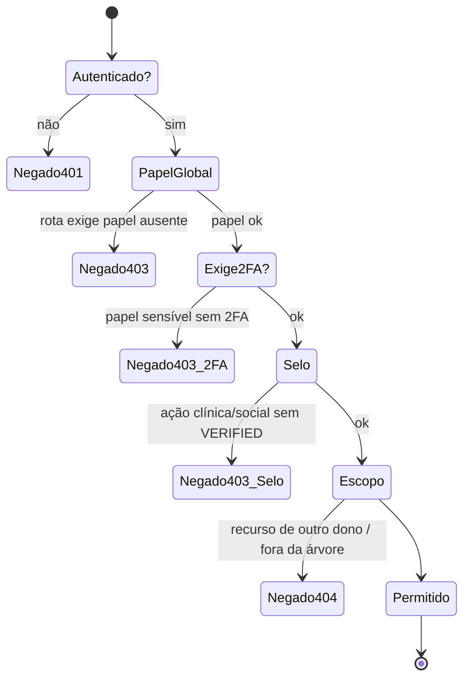
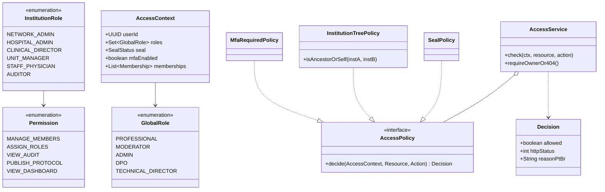
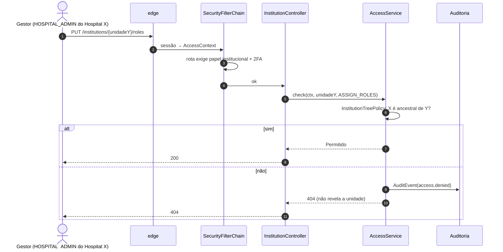
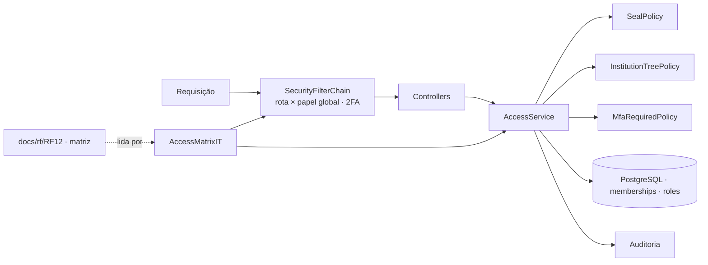
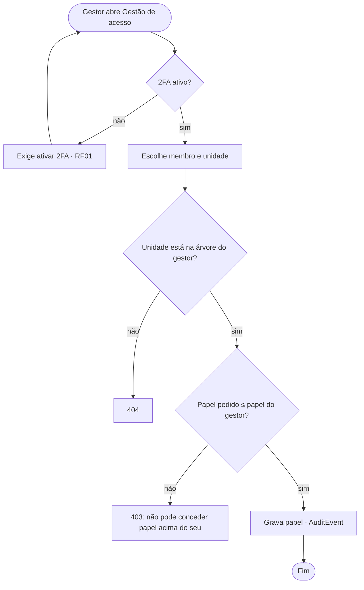

# RF12 · Controle de acesso por papel e selo (RBAC hierárquico)

## Critérios de aceite

1. Regras centralizadas no `SecurityFilterChain` (rota × papel global) e checagens de domínio no serviço
   (dono do recurso → `404`; papel ou selo insuficiente → `403` com motivo em pt-BR).
2. **Papéis globais:** `PROFESSIONAL`, `MODERATOR`, `ADMIN`, `DPO`, `TECHNICAL_DIRECTOR`.
3. **Papéis institucionais** (por `Membership`): `NETWORK_ADMIN`, `HOSPITAL_ADMIN`, `CLINICAL_DIRECTOR`,
   `UNIT_MANAGER`, `STAFF_PHYSICIAN`, `AUDITOR`. Permissão **herda para baixo** na hierarquia
   rede → hospital → unidade, nunca para cima.
4. **Selo** entra como atributo (ABAC): `VERIFIED` é pré-requisito para publicar, conversar, chamar,
   prescrever e aparecer no diretório.
5. Moderador, Admin, DPO e papéis institucionais de gestão exigem **2FA**.
6. A **matriz de acesso** abaixo é a mesma que a implementação aplica e é coberta por `AccessMatrixIT`,
   que lê a tabela deste arquivo.
7. Toda decisão negada relevante gera `AuditEvent(access.denied)` sem dado sensível.

## Matriz de acesso

| Rota / ação | Visitante | Pendente | Ativo sem selo | Médico VERIFIED | Gestor (inst.) | Moderador | DPO |
|---|---|---|---|---|---|---|---|
| `GET /institutions` (diretório) | ✅ | ✅ | ✅ | ✅ | ✅ | ✅ | ✅ |
| `GET /profiles/{id}` | só PUBLIC_MINIMAL | só PUBLIC_MINIMAL | rede verificada ❌ | ✅ | ✅ | ✅ | ✅ |
| `POST /credentials` | ❌ | ❌ | ✅ | ✅ | ✅ | — | — |
| `GET /groups/**` | ❌ | ❌ | ❌ | ✅ (membro) | ❌ | ✅ | ❌ |
| `POST /posts`, comentar | ❌ | ❌ | ❌ | ✅ | ❌ | ❌ | ❌ |
| Chat / vídeo | ❌ | ❌ | ❌ | ✅ | ✅ (com selo) | ❌ | ❌ |
| `POST /clinical/**` (SOAP, Rx) | ❌ | ❌ | ❌ | ✅ | ❌ | ❌ | ❌ |
| `GET /institutions/{id}/members` (gestão) | ❌ | ❌ | ❌ | ❌ | ✅ (sua árvore) | ❌ | ❌ |
| `PUT /institutions/{id}/roles` | ❌ | ❌ | ❌ | ❌ | ✅ HOSPITAL_ADMIN+ | ❌ | ❌ |
| `GET /admin/audit` | ❌ | ❌ | ❌ | ❌ | ✅ AUDITOR (sua árvore) | ✅ | ✅ |
| `POST /admin/moderation/**` | ❌ | ❌ | ❌ | ❌ | ❌ | ✅ | ❌ |
| `GET /privacy/dpo/tickets` | ❌ | ❌ | ❌ | ❌ | ❌ | ❌ | ✅ |
| `/me/**` | ❌ | ✅ (parcial) | ✅ | ✅ | ✅ | ✅ | ✅ |

Legenda: ✅ permitido · ❌ negado (`401` sem sessão, `403` sem papel/selo, `404` recurso de outro dono) ·
— não se aplica (conta interna não faz esse fluxo). `AccessMatrixIT` lê esta tabela e exercita as linhas
cujas rotas já existem; "gestor" entra com o RF11.

## Máquina de estados (decisão de acesso)

## Classes

## Sequência

## Componentes

## Atividades: atribuir papel institucional

## Rastreabilidade

| Camada | Artefato | Status |
|---|---|---|
| Migração | `V2` (`user_role`: MODERATOR, ADMIN, DPO, TECHNICAL_DIRECTOR) | ✅ |
| Config | `SecurityConfig`: rota × papel global (`/admin/audit` → MODERATOR/ADMIN/DPO **+ 2FA**, demais `/admin/**` → MODERATOR/ADMIN **+ 2FA**, `/privacy/dpo/**` → DPO **+ 2FA** via `MfaRequiredAuthorizationManager`; rotas públicas de auth/diretório; resto autenticado), 401 sem sessão, 403 sem papel | ✅ |
| Domínio | `AccessService` (`requireActive`, `requireVerifiedSeal` para escrita social/clínica, `requireVerifiedSealOrModerator` para leitura de grupos/feed, `requireOwnerOr404`) | ✅ |
| Domínio | `InstitutionTreePolicy` (papéis institucionais, herança rede → hospital → unidade) | ⏳ RF11 |
| Testes | `SecurityHeadersTest` (401 sem sessão) | ✅ |
| Testes | `AccessMatrixIT` (lê a tabela deste doc; rotas implementadas `/me/**`, `POST /credentials`, `GET /groups/**`, `POST /posts`, `GET /admin/audit`, `GET /privacy/dpo/tickets` × visitante/pendente/ativo/verificado/moderador/DPO) | ✅ |
| Testes | `InstitutionTreePolicyTest` | ⏳ RF11 |
