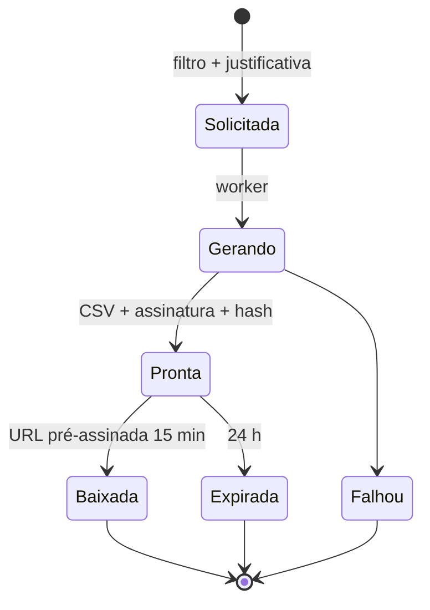
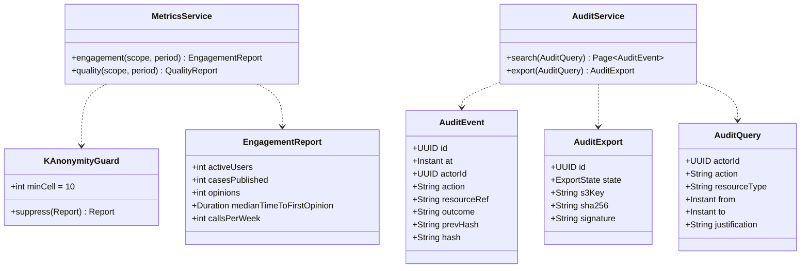
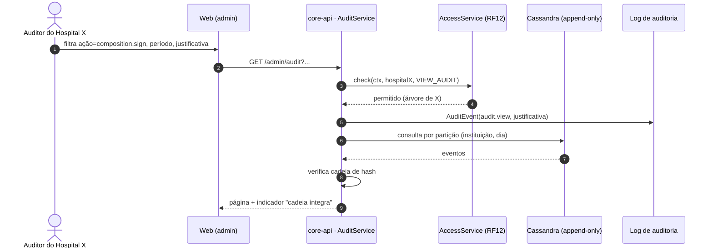
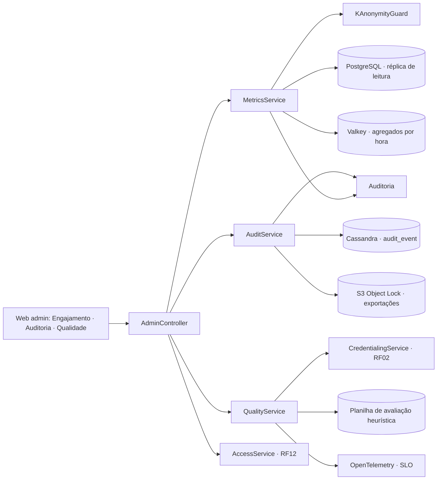

# RF13 · Dashboard administrativo (engajamento, auditoria, qualidade)

## Critérios de aceite

1. Visível para `HOSPITAL_ADMIN`, `NETWORK_ADMIN`, `AUDITOR` (na sua árvore), `MODERATOR`, `ADMIN` e
   `DPO` (recorte de privacidade). Exige 2FA.
2. **Engajamento:** usuários ativos, casos publicados, pareceres, tempo até o 1º parecer, chamadas por
   semana. Tudo **agregado**, com célula mínima de **10 pessoas** (k-anonimato), sem dado de saúde e sem
   drill-down para indivíduo.
3. **Auditoria:** log filtrável por ator, ação, recurso, período; exportável em CSV assinado. Eventos
   clínicos mostram o id do paciente só para `AUDITOR`/`DPO` com justificativa registrada.
4. **Qualidade:** selos pendentes e tempo médio de verificação, incidentes de privacidade abertos,
   problemas de usabilidade por severidade (planilha da avaliação heurística), disponibilidade e p95.
5. Gráficos seguem o Design System (cores de série acessíveis, nunca só cor para distinguir, tabela de
   dados alternativa para leitor de tela).
6. Cada acesso ao dashboard de auditoria gera `AuditEvent` (auditoria da auditoria).

## Base legal

LGPD Art. 37 (registro das operações), Art. 46, Art. 50 (boas práticas e governança) · Res. CFM 1.821/2007
(auditoria do PEP) · ONA/acreditação **⚖️ opcional**.

## Máquina de estados (exportação de auditoria)

## Classes

## Sequência: consultar auditoria

## Componentes

## Atividades: gerar relatório de engajamento

## Rastreabilidade

| Camada | Artefato | Status |
|---|---|---|
| Serviço | `MetricsService`, `AuditService`, `QualityService` | ⏳ |
| Dados | Cassandra `audit_event` com hash encadeado | ⏳ |
| Web | páginas admin com gráficos acessíveis | ⏳ |
| Testes | `KAnonymityGuardTest`, `AuditChainIT`, `AdminAccessIT` | ⏳ |
