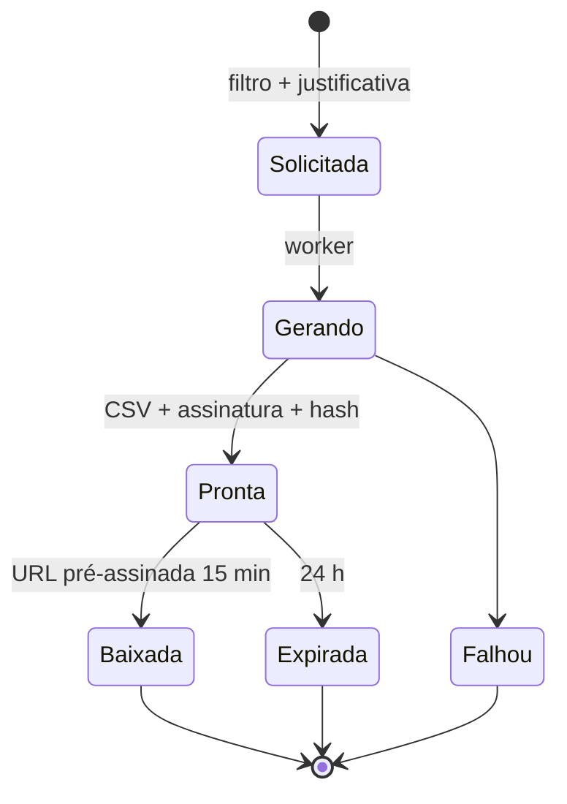
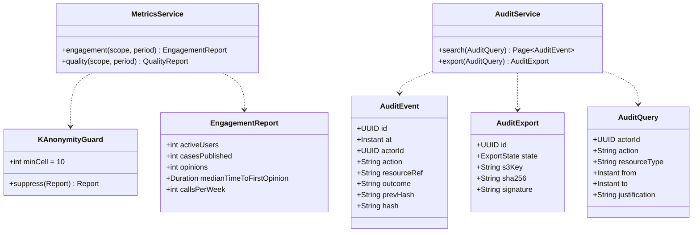
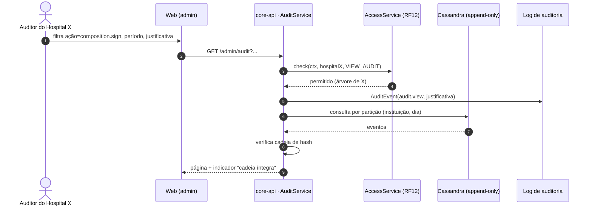
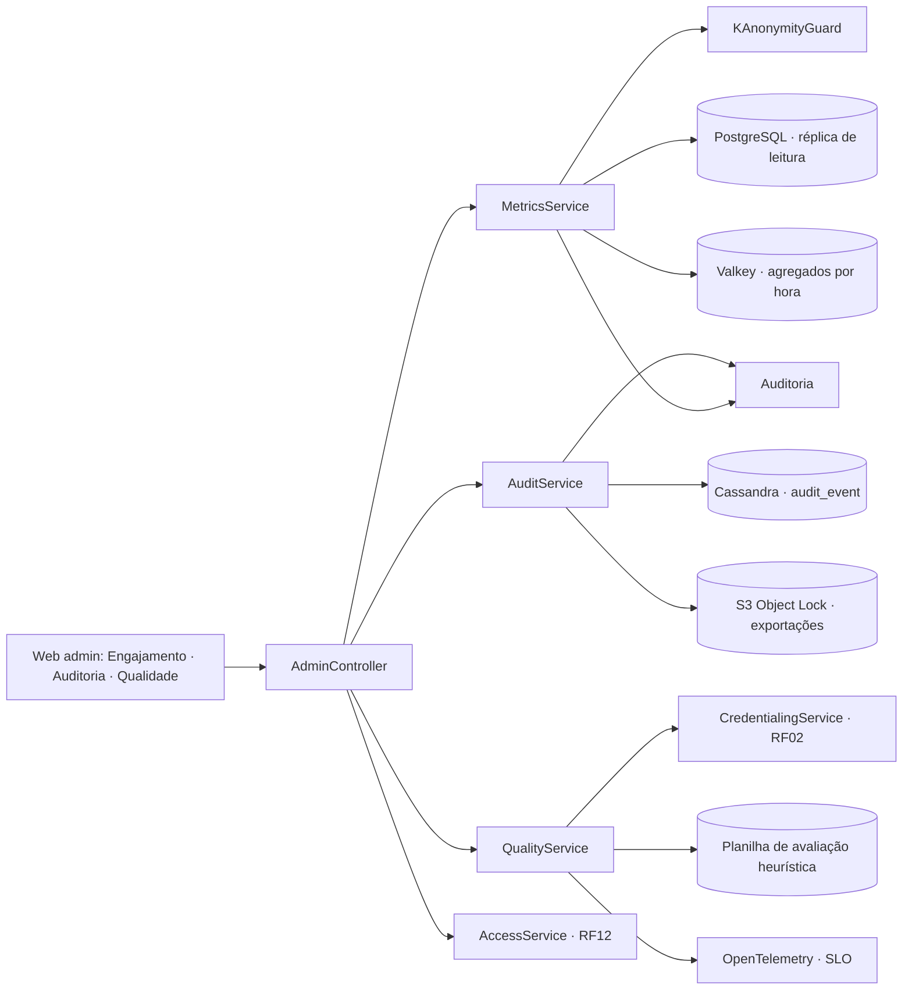
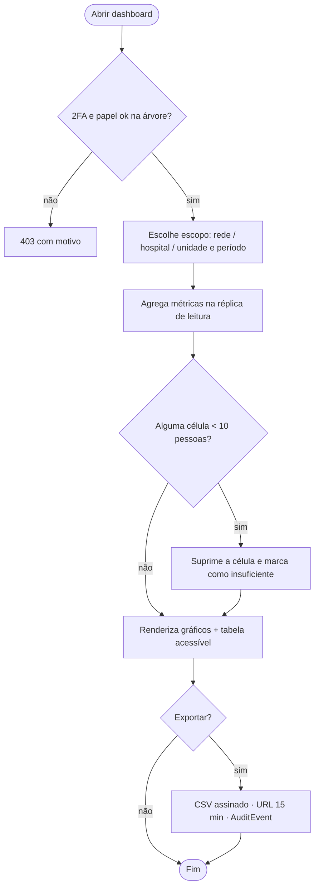

# RF13 · Dashboard administrativo (engajamento, auditoria, qualidade)

## Critérios de aceite

1. Visível para `HOSPITAL_ADMIN`, `NETWORK_ADMIN`, `AUDITOR` (na sua árvore), `MODERATOR`, `ADMIN` e
   `DPO` (recorte de privacidade). Exige 2FA.
2. **Engajamento:** usuários ativos, casos publicados, pareceres, tempo até o 1º parecer, chamadas por
   semana. Tudo **agregado**, com célula mínima de **10 pessoas** (k-anonimato), sem dado de saúde e sem
   drill-down para indivíduo.
3. **Auditoria:** log filtrável por ator, ação, recurso, período; exportável em CSV assinado. Eventos
   clínicos mostram o id do paciente só para `AUDITOR`/`DPO` com justificativa registrada.
4. **Qualidade:** selos pendentes e tempo médio de verificação, incidentes de privacidade abertos,
   problemas de usabilidade por severidade (planilha da avaliação heurística), disponibilidade e p95.
5. Gráficos seguem o Design System (cores de série acessíveis, nunca só cor para distinguir, tabela de
   dados alternativa para leitor de tela).
6. Cada acesso ao dashboard de auditoria gera `AuditEvent` (auditoria da auditoria).

## Base legal

LGPD Art. 37 (registro das operações), Art. 46, Art. 50 (boas práticas e governança) · Res. CFM 1.821/2007
(auditoria do PEP) · ONA/acreditação **⚖️ opcional**.

## Máquina de estados (exportação de auditoria)

## Classes

## Sequência: consultar auditoria

## Componentes

## Atividades: gerar relatório de engajamento

## Rastreabilidade

| Camada | Artefato | Status |
|---|---|---|
| Base | pacote `admin` já tem `AdminController` (`GET /admin/audit`, estrutura vazia para a matriz RF12) e a fila de moderação `ModerationService`/`ModerationController` (`/admin/moderation/**`, especificada no RF02/US06). As decisões de moderação hoje ficam em `credential_check` (fonte `moderador`); entram no `audit_event` encadeado quando a auditoria chegar | ✅ (base) |
| Dados | Cassandra `de_audit.audit_event` particionada por (escopo, dia), cadeia por escopo (`platform` e `inst:{id}`), `audit_chain_head` avançada por LWT (`IF seq = ?`), CQL em `resources/cql` aplicado na subida (`CassandraSchema`) | ✅ |
| Serviço | `AuditLog.record` (ponto único; falha ao gravar derruba a ação), `AuditChain` (SHA-256 encadeado, verificação de alteração, buraco e elo), `CassandraAuditStore` | ✅ |
| Serviço | `AuditService`: busca por período (≤ 31 dias), ator, ação, recurso; verificação da cadeia a cada leitura; recortes (ADMIN tudo sem paciente, DPO tudo e revela com justificativa, MODERATOR moderação/comunidade, AUDITOR da árvore revela com justificativa, gestor da árvore sem paciente); `audit.view` a cada consulta | ✅ |
| Exportação | `AuditExport` (`V7__auditoria.sql`, SOLICITADA → GERANDO → PRONTA → BAIXADA/EXPIRADA 24 h), CSV com defesa contra fórmula, assinatura Ed25519 (`AuditSigner`, chave derivada do segredo), objeto no S3 (`ObjectStore`), URL pré-assinada 15 min, `GET /audit/public-key` sem login para conferir com OpenSSL | ✅ |
| Serviço | `MetricsService` (usuários ativos, casos, pareceres, mediana até o 1º parecer, chamadas/semana via `call.start`, série de 8 semanas) + `KAnonymityGuard` (célula < 10 pessoas suprimida, sem revelar a contagem) | ✅ |
| Serviço | `QualityService`: selos pendentes/revisão manual e tempo médio de verificação, incidentes e pedidos ao Encarregado, planilha `docs/usabilidade/AVALIACAO_*.md` (empacotada no classpath), SLI desta instância (`SliMetrics`: p95 e disponibilidade) | ✅ |
| API | `/api/v1/admin/dashboard/{engagement,quality}`, `/api/v1/admin/audit[/exports]` (MODERATOR/ADMIN/DPO + 2FA no `SecurityConfig`); `/api/v1/institutions/{id}/dashboard/{engagement,quality,audit,audit/exports}` (papel com leitura de auditoria na árvore + 2FA); `/api/v1/audit/exports[/{id}/download]` (só quem pediu) | ✅ |
| Eventos | `auth.login/logout/password_change/mfa_*`, `privacy.consent_change/export_request/deletion_request/dpo_*`, `institution.register/member_*/role_assign`, `moderation.seal_*/group_approve/post_hide`, `audit.view/export/export_download` | ✅ |
| Web | `/admin` e `/instituicoes/[id]/painel` (`components/dashboard`): indicadores, colunas semanais com legenda, dica no hover e foco, tabela alternativa e células suprimidas; auditoria com filtros, selo de cadeia íntegra, paginação, exportação com justificativa e links de 15 min; qualidade com severidade por barras + tabela | ✅ |
| Infra | réplica de leitura do PostgreSQL e agregados por hora no Valkey; S3 Object Lock no bucket de exportações; SLO pelo OpenTelemetry em vez do retrato da instância | ⏳ produção (ADR-011) |
| Testes | `AuditChainTest` (adulteração, buraco, elo forjado, ordem dos detalhes, CSV), `KAnonymityGuardTest`, `AuditDashboardIT` com Cassandra e Garage reais (recortes por papel, adulteração detectada na leitura, exportação baixada e assinatura conferida com a chave pública, engajamento com 10 autores, painel da instituição com 2FA e paciente só para o auditor), e2e no navegador | ✅ |
| Usabilidade | `docs/usabilidade/AVALIACAO_MVP-1.md`: pré-avaliação da equipe; a avaliação formal com 3 a 5 avaliadores segue pendente | 🟡 |
